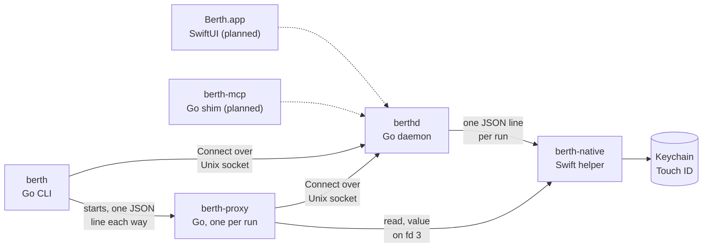
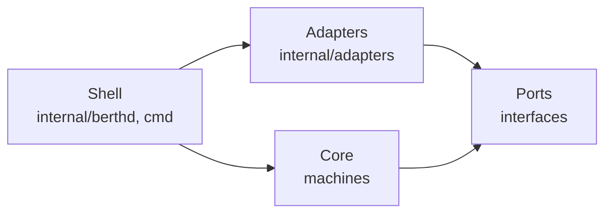
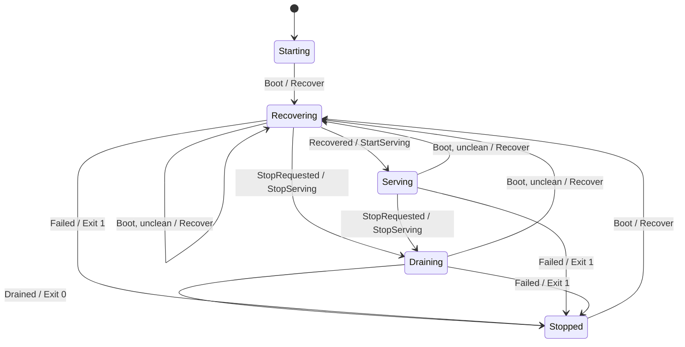
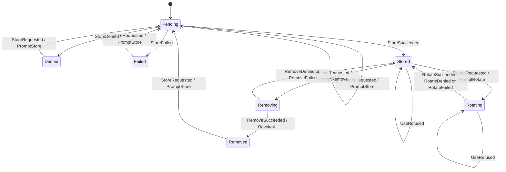
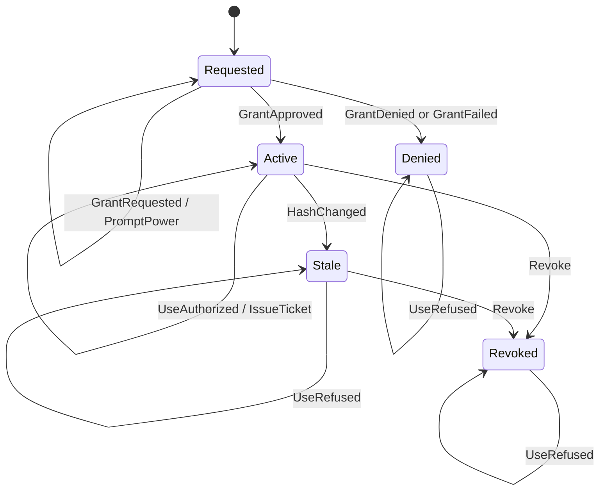
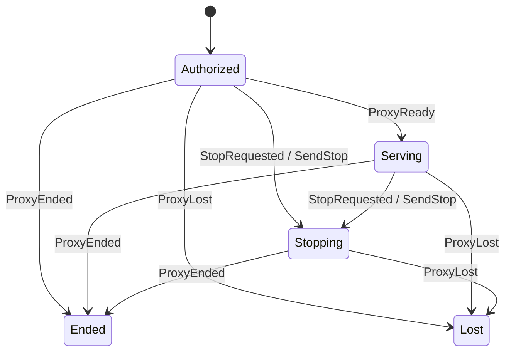
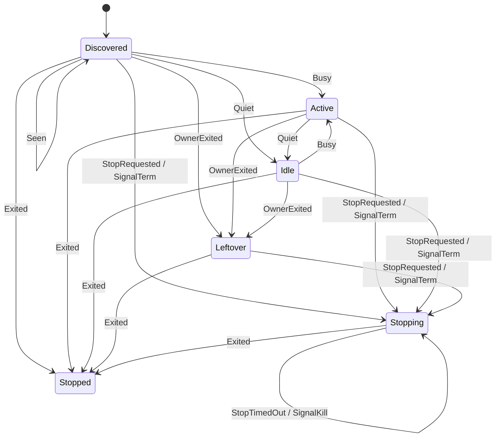
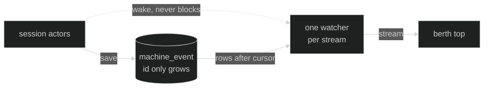
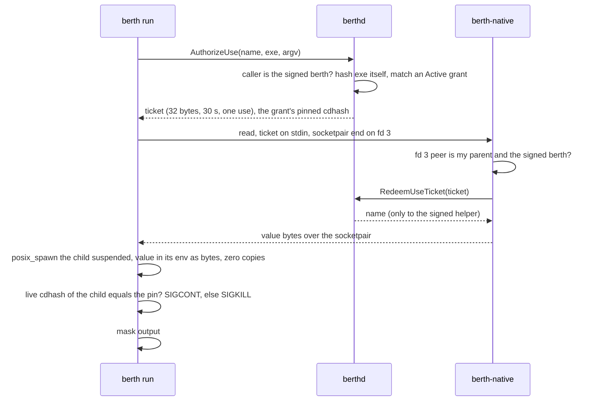
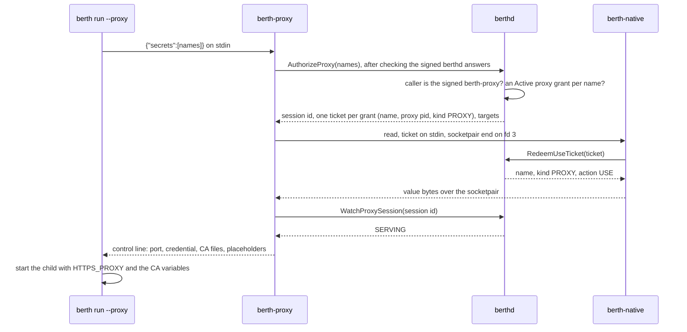

# Berth architecture

This is the canonical description of how Berth is built, for people reading the code and for coding agents changing it.
A change to behaviour or structure updates this file in the same commit.
Each section says what is **built** (in the code on `main` today) and what is **planned** (designed, not yet written).

## What Berth is

Berth is a local app for macOS that lists every browser your agents, tests and scrapers have open, lets you watch and take over any of them, and brokers Keychain secrets to browsers and terminals without agents ever reading them.
It borrows Docker's model: a browser and whoever drives it is a session, a saved Chrome profile is like an image, and Keychain grants are like secrets.
It runs only on your own Mac, talks only over a Unix socket, and has no telemetry.

Berth is in pre release development.
Terminal secrets (E2a) are done: the maintainer's manual check with real signing and Touch ID passed on 2026-11-17. The header proxy with the secret lifecycle (E2b) is built and wired and awaits the maintainer's manual check; isolated agents (E3) are in progress, starting with the agent socket; seeing every browser (M2) is in progress, with discovery, `berth ps`, `inspect`, `stop` and `leftovers` built and awaiting the maintainer's check; the live terminal view (M3), `WatchSessions` and `berth top`, is built and awaits the maintainer's look.
See [Milestones](#milestones) for the exact status.

## Processes



| Process | Language | Status | Job |
|---|---|---|---|
| `berthd` | Go | Built | The daemon: owns all state, runs the state machines, serves the API, decides every security question; `make build` signs it, since `berth`, `berth-proxy` and `berth-native` talk only to the signed daemon |
| `berth` | Go | Built | The command line client: `status`, `debug state`, `secret request`, `secret add`, `secret ls`, `secret grant`, `secret proxy`, `secret revoke`, `secret rm`, `secret rotate`, `run`, `ps`, `inspect`, `stop`, `leftovers`, `top`; `make build` signs it, since `berthd` gives use tickets only to the signed CLI |
| `berth-proxy` | Go | Built | A loopback HTTPS proxy, one per `berth run --proxy`, that writes one granted header into requests to the granted hosts and tunnels everything else; standard library only; `make build` signs it, since `berthd` authorizes only the signed proxy ([the E2b plan](docs/plans/e2b-header-proxy.md)) |
| `berth-native` | Swift | Built | The only Berth process that reads secret values from the Keychain: add, read, replace and delete, Touch ID, the secure input dialog; `berth-proxy` holds a value only after reading it through this helper |
| `Berth.app` | Swift | Planned (M5) | Window and menu bar, live view and takeover, notifications, registers `berthd` as a login item |
| `berth-mcp` | Go | Planned (M4) | A thin MCP shim for agents without a shell; holds no state and exposes only agent methods |
| TUI | Go | Built (M3) | `berth top`, a full screen live view of every browser session inside `berth`, on Bubble Tea v2; see [the live terminal view](#live-terminal-view-built-m3) |

Swift does the native work because Keychain, Touch ID and ScreenCaptureKit are Apple frameworks; keeping them in Swift keeps the Go code free of cgo ([ADR 0001](docs/adr/0001-go-for-the-daemon-cli-and-tui.md)).

### The API: Connect over a Unix socket (built)

- One Protobuf schema, package `berth.v1` in [`proto/berth/v1/`](proto/berth/v1), generates every client; generated code is committed under `gen/` ([ADR 0002](docs/adr/0002-connect-api-with-one-protobuf-schema.md)).
- `berthd` serves Connect, gRPC and Connect JSON on one socket, over HTTP/2 without TLS and over HTTP/1.1.
- The socket is `$BERTH_HOME/berthd.sock`; `BERTH_HOME` defaults to `~/Library/Application Support/Berth`.
- With `berthd -agent-uid <uid> -agent-gid <gid>`, a second socket serves the agent user (E3), by default at `/Users/Shared/Berth/<owner uid>/agent.sock`, with only the agent methods; see [the socket](#the-socket-built).
- Every Go client calls `Handshake` first, and a protocol version mismatch is a typed error (`ERROR_REASON_PROTOCOL_MISMATCH`).
- `buf breaking` fails the build if a change would break an existing client; `v1` only gains fields.

| Service | Methods | Status |
|---|---|---|
| `DaemonService` | `Handshake`, `Status`, `Shutdown` | Built |
| `DebugService` | `GetState` (state and recent transitions of any entity) | Built |
| `SecretsService` | `RequestSecret`, `ListSecrets`, `GrantSecret`, `AuthorizeUse`, `RedeemUseTicket`, `GrantProxy`, `RevokeGrant`, `RemoveSecret`, `RotateSecret`, `AuthorizeProxy`, `WatchProxySession` (server stream), `EndProxySession` | Built |
| `SessionsService` | `ListSessions`, `InspectSession`, `StopSession`, `WatchSessions` (server stream, resumable; none on the agent surface) | Built (M2, M3) |
| Sessions, Profiles, Runbooks, Policies | `LaunchSession`, `WatchScreen`, `SendInput`, `FillLogin` and more | Planned (M3 to M6) |

### The native helper protocol (built)

`berthd` and `berth run` start `berth-native <command>` once per request, with a scrubbed environment (only `HOME`, `PATH`, `BERTH_HOME`).
The helper reads one JSON object on one line from stdin and writes one JSON line to stdout, except for `read`, whose value goes to file descriptor 3.

| Command | Does | Replies |
|---|---|---|
| `store` | Shows the secure input dialog with facts `berthd` verified, then Touch ID, then writes Keychain item `berth.<name>` | `stored`, `denied` or `failed`; never the value |
| `confirm` | Shows a Touch ID prompt for a power action: `"action":"grant"` names a consumer executable and who signed it, from the signature kind `berthd` verified (a team, `Apple (platform)` for a platform binary, `ad hoc`, `unsigned` or `no team`) (with `"interpreter":true` the text starts with "<path> is an interpreter and can print this secret", and `"pass_env"` names are listed); `"action":"proxy"` names a `target` (host, port, header, prefix, suffix, path glob, methods, placeholder variable) | `approved`, `denied` or `failed` |
| `read` | Refuses unless fd 3 is a connected Unix stream socket whose peer, by its audit token, is the helper's parent and satisfies the CLI or the proxy requirement; connects to the daemon socket, checks by the peer's audit token that the signed `berthd` answers, then redeems the ticket; the answer must say action `USE` and the consumer kind of the parent (`EXECUTABLE` for `berth`, `PROXY` for `berth-proxy`), and only then reads `berth.<name>` | The raw value bytes on fd 3, one end of a socketpair the parent created and passed in; or nothing and exit code 3. stdout carries nothing |
| `rotate` | Reads `{"name","ticket","requester"}`, redeems the action ticket first (it must say `ROTATE` for the same name), then shows the store dialog in replace mode and Touch ID, then `SecItemUpdate` | `stored`, `denied` or `failed` |
| `remove` | The same shape; redeems an action ticket that must say `REMOVE`, asks Touch ID, then `SecItemDelete`; an item already gone counts as removed | `removed`, `denied` or `failed` |

The exact message shapes are in [the E2 plan](docs/plans/e2-terminal-secrets.md#native-helper-protocol-items-2-4-and-6-must-match-it-exactly) and, for `rotate`, `remove` and the proxy confirm, [the E2b plan](docs/plans/e2b-header-proxy.md#notes-for-the-integration-item-item-6).
`berthd` starts the helper for `rotate` and `remove` itself, so their action tickets are bound to `berthd`'s pid, the parent the redeem must come from.
Go tests use a fake helper written in Go ([`internal/adapters/native/fakehelper`](internal/adapters/native/fakehelper)), never the Swift binary.
`scripts/build-native.sh` builds the helper in release mode, and `scripts/sign.sh` signs it (and `make build` signs `bin/berth`, `bin/berthd` and `bin/berth-proxy`) with a stable Apple Development identity, identifier and the hardened runtime, because `berthd` trusts the CLI, the helper and the proxy by team, identifier and cdhash, `berth` and `berth-proxy` trust `berthd` the same way, and Keychain items trust the helper by its designated requirement.

### The proxy control protocol (built)

`berth run --proxy <name> [--proxy <name2>] -- <command>` starts the `berth-proxy` beside its own resolved executable (the `BERTH_PROXY` override exists only under `berth_e2e`) in its own process group, with only `HOME`, `PATH`, `BERTH_HOME` and `TMPDIR`.

| Direction | Line | Meaning |
|---|---|---|
| `berth` to proxy, stdin | `{"secrets":["name",...]}` | The names to serve, 1 to 16; stdin then stays open for the run |
| Proxy to `berth`, stdout | `{"port":N,"credential":"<32 hex>","ca_file":"<abs>","bundle_file":"<abs>","placeholders":{"VAR":"berth-proxy-placeholder"}}` | Written only after `berthd` sent `SERVING`; carries no value |
| `berth` closes stdin | | The child exited: the proxy closes its listener, zeroes its values, deletes its folder, calls `EndProxySession` with counts and exits |

`berth` reads nothing else from the proxy and kills it 5 seconds after closing its stdin.
The proxy exits 0 when it ended normally, 1 on an error (berthd, `berth-native` or the network), 2 when it refused its environment, the request or a grant before serving, and 3 when `berthd` stopped the session, the watch stream broke or the CA expired.

### The berth command line (built)

| Exit code | Meaning |
|---|---|
| 0 | Success |
| 1 | `berthd` unreachable, or it refused the request; the message says why |
| 2 | Usage error |
| 3 | The person denied the dialog or Touch ID |
| 4 | The store, grant, rotate or remove failed |
| 5 | `run`: no grant lets this executable use the secret; nothing started |
| 6 | `run`: the executable changed since it was granted, or the image the kernel loaded is not the granted code (killed while suspended) |
| 7 | The secret is busy: a store, rotate or remove dialog or a grant's Touch ID is open (`ERROR_REASON_BUSY`) |
| 8 | `run --proxy`: `berth-proxy` did not start or answered badly; nothing started |

Once its command starts, `berth run` exits with the command's own code.
`berth secret ls` prints one line per consumer under each secret, starting with the grant id that `berth secret revoke <grant id>` takes; an executable consumer shows its path, hash, team, argument glob and state, and a proxy consumer its host and port, header, methods, path glob and state.

## Layers and import rules (built)

Berth is a functional core with an imperative shell, arranged as ports and adapters ([ADR 0005](docs/adr/0005-ports-and-adapters.md)).
The core decides; adapters and the shell do.



| Layer | Path | May import | Holds |
|---|---|---|---|
| Ports | `internal/core/ports/` | stdlib only | `Store`, `Clock`, `RequestLog`, `ExecIdentity`, `PeerFacts`, `CodeInspector`, `Approver`, `TicketSource`, `SecretRecords`, `ProxySessionRecords`, `ProcessSource`, `EntityLister` and their domain types |
| Machine kit | `internal/core/machine/` | ports | `Transition`, `Actor`, `machinetest.Walk` |
| Machines | `internal/core/{daemon,secret,grant,proxysession,session}/` | machine, ports | One transition table each |
| Policies | `internal/core/{envpolicy,hostpolicy}/` | stdlib only | Pure rules the daemon and its clients must apply alike: which variables a consumer gets, which proxy hosts are local |
| Discovery | `internal/core/{browsersig,ownerchain,discovery}/` | ports, session | Pure rules that recognise a browser, pick its owner, group processes into sessions and derive their events |
| Adapters | `internal/adapters/{sqlite,socket,api,clock,native,execid,peer,ticket,procscan}/` | core, gen | Implementations of the ports and the API handlers |
| Shell | `internal/berthd/` | everything | Wires adapters, runs actors, performs effects |
| Clients | `internal/client/`, `internal/cli/`, `internal/proxy/`, `internal/proxyctl/`, `internal/peertrust/`, `internal/spawn/`, `cmd/` | gen, api, adapters | The Go client, the CLI logic, the `berth-proxy` logic, the two JSON lines `berth` and `berth-proxy` exchange (so `berth-proxy` links no TUI code, pinned by a `go list -deps` test), the shared rule for trusting signed Berth peers and the signed `berthd` (release or `berth_e2e`), the suspended start and live cdhash read for `berth run`, thin entry points |
| Fakes | `internal/testutil/` | ports | In memory store, fake clock, scriptable secrets fakes, a scriptable process table |

The rules are enforced by `golangci-lint`, not by convention:

- `depguard` fails the build if `internal/core` imports an adapter, `database/sql`, `os/exec` or `net/http`.
- `forbidigo` bans `time.Now` and `fmt.Print` in `internal/core`, so time comes only from the `Clock` port.
- `exhaustive` fails the build when a `switch` over states, events or effects misses a case.

Ports named in ADR 0005 that do not exist yet: `BrowserDriver` (M4), `SecretStore` (M6), `Notifier` (M5).

## State machines (built)

Every stateful thing has one `state` field, a closed set of events, and one hand written transition function ([ADR 0003](docs/adr/0003-explicit-hand-written-state-machines.md)).
No booleans whose combinations mean something, and no state machine library.

```go
type Transition[S ~string, E Event, F any] func(state S, event E) (S, []F, error)
```

- **Pure:** a transition does no I/O, logging, randomness or clock reads; it returns the next state and the effects to run, or an error wrapping `machine.ErrIllegal`.
- **Actors:** one goroutine owns each entity (`daemon`, `secret/<name>`, `grant/<id>`, `proxy/<session id>`) and applies its events one at a time from a bounded inbox, so state is never shared or locked.
- **Persist before effects:** the actor writes the new state and the event row in one SQLite transaction, and only then runs the effects; if the write fails, the actor stops rather than act on a state it could not record ([ADR 0004](docs/adr/0004-state-and-event-rows-in-one-transaction.md)).
- **Failures are events:** an effect that fails returns a follow up event (for example `Failed` with a note), so failure is a state, not a silent retry.
- **Illegal events are rejected, not fatal:** the actor reports them and keeps running; nothing is persisted.
- **Walked:** each machine's test runs `machinetest.Walk` over every state and event pair and pins the number of legal pairs, so any table change is deliberate.
- **Names are data:** state and event names are stored in `machine_state` and `machine_event`, so they are never renamed; a retired name becomes illegal everywhere and stays in the code.
- **Debuggable:** `berth debug state <entity>` prints the current state and recent transitions of any machine.

Labels below are event names, with effects after a slash.

### Daemon machine (built, 12 legal pairs)

Source: [`internal/core/daemon/daemon.go`](internal/core/daemon/daemon.go).



`Boot` is legal from every state because a process start is a fact; booting from anything but `Starting` or `Stopped` means the last run crashed, and the `Recover` effect records that as an unclean shutdown.
SIGTERM, SIGINT and the `Shutdown` call all send `StopRequested`.

### Secret machine (built, 17 legal pairs)

Source: [`internal/core/secret/secret.go`](internal/core/secret/secret.go).
One entity per secret name; the value never appears in the machine.



- `PromptStore` asks `berth-native store` to show the dialog; its outcome comes back as `StoreSucceeded`, `StoreDenied` or `StoreFailed`.
- `PromptRotate` and `PromptRemove` make an action ticket bound to `berthd`'s pid and run `berth-native rotate` or `remove`, which redeems it before any prompt; the ticket is dropped when the helper exits.
- `RevokeAll` revokes every grant of the secret, ends any grant still waiting for Touch ID with `GrantFailed` and the note `secret removed` (waiting for its prompt to finish, and revoking it if the approval got there first), drops its live use tickets and stops the proxy sessions holding its grants; `RemoveSecret` answers with the revoked grant ids.
- A `Stored` secret refuses another store with `ERROR_REASON_SECRET_EXISTS`; `Pending`, `Rotating` and `Removing` answer `ERROR_REASON_BUSY` to a store, grant, rotate or remove, and so does a secret with a grant waiting for Touch ID to a rotate or remove. The shell checks this before it sends the event, so the table never sees a request it refuses.
- Uses accept `Stored` and `Rotating`: a run during a rotate gets the old value. `Removing` and `Removed` refuse uses, and `Removed` frees the name for a new store.
- `UseRefused` records a refused use of a stored secret that has no grant to record it on.
- Boot recovery fails `Rotating` and `Removing` with the note `interrupted` (`RotateFailed`, `RemoveFailed`) and revokes any grant of a `Removed` secret left Active by a crash.

### Grant machine (built, 11 legal pairs)

Source: [`internal/core/grant/grant.go`](internal/core/grant/grant.go).
One entity per grant row; a grant pins one verified executable to one secret.



- `PromptPower` asks `berth-native confirm` for Touch ID; `IssueTicket` makes a single use ticket and counts the use on the grant row.
- A `Denied`, `Stale` or `Revoked` grant is never approved again; granting again creates a new grant, which is a new entity.
- The grant and remove checks are not one transaction, so `PromptPower` checks again that the secret serves uses (`Stored` or `Rotating`) before it shows Touch ID and after the person approves; otherwise it answers `GrantFailed` with the note `secret removed`. With the remove's `RevokeAll` ending Requested grants, a grant and an `rm` racing never leave an Active grant on a removed secret, so a value stored later under the same name gets no grant without a fresh Touch ID.
- A grant pins either an executable (kind `exe`) or a proxy target (kind `proxy`); the kind is data on the grant row, not a state, and a proxy grant never sees `HashChanged`. `Consumer.kind` in `ListSecrets` comes from the row.
- `RevokeGrant` (`berth secret revoke`) and a remove's `RevokeAll` send `Revoke`, with no Touch ID since it only lowers privilege; revoking also drops the grant's live use tickets, so one issued just before cannot be redeemed, and stops the proxy sessions holding the grant.
- `AuthorizeUse` considers only grants of kind `exe`, by an explicit kind check, so a proxy grant never authorizes an executable whatever its row holds.

### Proxy session machine (built, 9 legal pairs)

Source: [`internal/core/proxysession/proxysession.go`](internal/core/proxysession/proxysession.go).
One entity per `berth-proxy` run, `proxy/<session id>`; the row in `proxy_sessions` holds the proxy's pid and counts only.



- `AuthorizeProxy` creates the session in `Authorized`; `ProxyReady` comes when the proxy opens `WatchProxySession`, and `berthd` then sends `SERVING`.
- `StopRequested` comes from a revoke, a remove or `berthd` stopping; `SendStop` sends `STOP` with the reason on the watch stream, or waits for the stream if the proxy has not opened it yet.
- `ProxyEnded` comes from `EndProxySession` and records the counts once; `ProxyLost` records zero counts and comes when the proxy's pid exits (kqueue `NOTE_EXIT`), when the session is still `Authorized` 30 seconds after it was created (a session stopped before it was ready ends through `EndProxySession` or `NOTE_EXIT`), when the watch stream drops without an `EndProxySession` within 2 seconds, or at boot for any session a previous run left open.
- Revoke and remove can race on one session, so a second `StopRequested` in `Stopping` is illegal and the shell ignores it.
- The shell keeps no ready flag beside the machine: readiness is the session's state. It keeps one connection fact, whether a watch stream was ever opened, so a second stream is refused.
- Fails closed: a `STOP` or a broken stream makes the proxy zero its values and exit, and a session `berthd` marks `Lost` while its proxy still listens has its stream ended, so the proxy exits too.

### Session machine (built, 18 legal pairs)

Source: [`internal/core/session/session.go`](internal/core/session/session.go).
One entity per browser process tree, `session/<pid>-<start time in microseconds>`, so a reused pid is a new session; every event is an observation from the scan or a stop request.



- `Seen` comes on a session's first observation when it has no row yet, before anything else that scan saw, so every session has a row from first sight and `WatchSessions` sees it appear; it changes nothing.
- `Busy` comes when the session's CPU time grew by 20 ms or more since the last scan, `Quiet` after 60 seconds without that; the shell sends only events the table accepts in the current state, so a steady browser writes no rows.
- `OwnerExited` comes when the owner process, or the browser's parent at first sight, is gone, or when a browser with driver evidence (a Playwright or Puppeteer install or profile, headless, or a CDP pipe; a CDP port alone is not) already hangs from launchd. `Leftover` is sticky until the browser exits or is stopped.
- `SignalTerm` sends SIGTERM to the browser and starts a 5 second timer whose `StopTimedOut` makes `SignalKill` kill every process of the session; a signal to a process already gone is no failure, since the scan or `NOTE_EXIT` sends `Exited`.
- Boot recovery scans once, then sends `Exited` with the note `gone at boot` to every live session row the scan did not find.

### Planned machines

| Machine | Milestone | Owns |
|---|---|---|
| Session (grows) | M4 | `Launching`, `Ready` and `Failed` for a browser Berth starts itself |
| Profile lock | M4 | Which session holds a Chrome profile, and who waits for it |
| Screen stream | M5 | One live view stream to a client, dropping stale frames |
| Control | M5 | Whether the agent or a person drives the page |
| Fill | M6 | One attempt to type a secret into a page; the value exists only between reading and typing |
| Browser grant | M6 | A Keychain item granted to one browser profile for one site |

Sessions follow the observe then reconcile pattern: the scan (and in M4 browser drivers) only reports what it saw as events, and every scan sends corrective events, so a missed event heals itself.

## Browser discovery (built, M2)

`berthd` scans the process table every 2 seconds, and at once when a watched browser exits (kqueue `NOTE_EXIT` on each session's browser), and turns what it sees into session events.

- **What the kernel shows.** `kern.proc.all` gives every process's pid, parent, uid and start time in one call, and `proc_pidpath` its executable, for any user. `kern.procargs2` gives arguments only for the owner's own processes; another user's are refused, so such a browser is listed as unmanaged, other user, from its path alone, and is never stopped. A full table read takes about 4 ms for about 1,000 processes.
- **Recognising a browser** (`browsersig`): Chrome (with Beta, Dev and Canary), Chrome for Testing, Chromium, Edge, Brave and the headless shells, by the executable's path inside its bundle; helpers by their bundle name or `--type=`. The driver comes from the install location (`ms-playwright`, `.cache/puppeteer`), the profile folder's name, or `--enable-automation`; headless, the CDP pipe or port and the profile folder from the flags. Electron apps match nothing.
- **A session** is a browser process whose parent is not a process of the same browser, with every descendant.
- **The owner** (`ownerchain`) is the nearest agent anywhere above the browser (`claude`, `codex`, `cursor-agent`, `gemini` and others, also when run by `node`, `bun` or `deno`), else the nearest terminal, else the nearest app bundle, else the person for a browser app launchd started with no driver evidence (a CDP port alone is none), else none for a browser with driver evidence already under launchd, else the parent process.
- **Arguments never leave `berthd`.** They can carry credentials, so only the parsed facts reach the API; raw arguments are never stored or logged, and the `procargs2` buffer, which also holds the environment, is cleared after parsing. They are read once per process instance: the scanner keeps a browser process's parsed signature, and the arguments of a `node`, `bun` or `deno` ancestor (the only ancestors whose arguments name an agent), keyed by pid, start time and executable, and forgets them once the process is gone.
- **Bounded memory.** A stopped session's actor stops at once; berthd keeps at most the 200 newest stopped sessions, none older than an hour, and cuts every string it keeps about a session (paths, profile folder, owner name) to 1,024 bytes. Session rows in the database still grow until a later pruning pass.
- **Text a process chose** is printed by `berth ps` and `inspect` quoted with escapes whenever it holds a control or format character, so it cannot drive the terminal. A `procargs2` buffer that does not fit the kernel's layout is not guessed at: the session shows its arguments as unreadable.
- **Stop** needs no Touch ID: it only ends a process the person could end. A browser owned by the person or an app needs `force`, and another user's is refused (`ERROR_REASON_SESSION_NOT_STOPPABLE`). `Signal` re-reads the process's start time just before `kill(2)`, so a reused pid is not signalled.
- The honest limits (a poll can miss a browser that lives under 2 seconds, recognition by path and flags, owners guessed from the process tree, activity from CPU time) are in [the M2 plan](docs/plans/m2-see-every-browser.md#honest-limits).

## Live terminal view (built, M3)

`berth top` shows every browser session and updates as they appear, change state and stop, fed by `WatchSessions` ([the M3 plan](docs/plans/m3-live-terminal-view.md)).



- **The event table is the queue.** A saved session transition only wakes the watchers (a non blocking send on a channel of size one each), and each watcher reads the rows after its own cursor at its client's pace; a slow client holds one goroutine and one page of rows, never an actor.
- **Resume.** A message is a snapshot of every live session or one change (the `machine_event` id, the event name and the session), and carries the event id it is consistent with; a client that reconnects with the last id it applied gets every change after it, across a `berthd` restart too. More than 1,000 session events behind, or a cursor newer than the database, gets a snapshot instead.
- **Ending.** `StopServing` closes every stream before the servers shut down, so a stream ends cleanly and shutdown does not wait for it; at most 16 streams are open at once.
- **The TUI** (`internal/cli/top.go`) is a Bubble Tea v2 model whose update and view need no terminal: a list with id, state, browser, driver, headless, owner and age, a detail pane, inspect, filter, stopped sessions on `a`, and stop after a confirmation that follows `berth stop`'s rules (another user's never, the person's or an app's as a named forced stop). Every process chosen string goes through the same `shown` escaping as `berth ps`, and the view holds no escape sequence of its own. When a stream ends, `berth top` resumes after the last event id it applied.
- `WatchSessions` is not on the agent surface, for the M2 reasons. The limits (only transitions stream, `Seen` adds a row per browser, no colour) are in [the M3 plan](docs/plans/m3-live-terminal-view.md#honest-limits).

## Storage (built)

One SQLite file, `$BERTH_HOME/berth.db`, through the pure Go driver `modernc.org/sqlite` (no cgo).

- WAL journal, `synchronous=FULL` so a transition reported as saved survives power loss, foreign keys on, one connection.
- Migrations are numbered SQL files embedded in the binary ([`internal/adapters/sqlite/migrations/`](internal/adapters/sqlite/migrations)); each runs in its own transaction and bumps `PRAGMA user_version`, and a test fails on a gap in the numbering.
- Every table is `STRICT`.
- `SaveTransition` writes `machine_state` and `machine_event` in one transaction with an optimistic version check, so a crash can never leave one without the other and a stale writer gets `ErrVersionConflict`.

| Table | Migration | Holds |
|---|---|---|
| `machine_state` | 0001 | Current state and version of every entity |
| `machine_event` | 0001 | Every transition: entity, version, event, from and to state, a secret free detail, time; unique per entity and version; its `id` only grows and is `WatchSessions`'s resume cursor |
| `request_log` | 0001, 0008 | The first response to each mutating `request_id` per principal (socket, peer uid and the caller's audit token), so retries replay instead of acting twice and no caller replays another's reply |
| `secrets` | 0002 | Secret names and creation time; never values |
| `grants` | 0002, rebuilt by 0004, 0006, 0007 | Pinned consumers: kind (`exe` or `proxy`); for `exe` the resolved path, SHA-256, cdhash (the interpreter's for a script; empty for grants older than 0006), team and signing ID, signature kind (`team`, `apple` for a platform binary, `adhoc`, `unsigned` or `other`; empty for a grant older than 0007 that names no team), argument glob and passed variables; for `proxy` the host, port, header, value prefix and suffix, path glob, methods and placeholder variable; use count and last use. CHECKs refuse a row mixing the two, and the rebuild kept every id |
| `proxy_sessions` | 0005 | One row per `berth-proxy` run: id, proxy pid, created and ended time, injected and refused counts; never paths, request details or values |
| `proxy_session_grants` | 0005 | Which proxy grants each session holds tickets for, so a revoke finds the sessions to stop |

Browser sessions have no table: their facts are rebuilt by every scan, and only their machine rows (`session/<id>` in `machine_state` and `machine_event`) persist, which boot recovery finds by kind.

Single use tickets live only in `berthd` memory and are never persisted.

## Security model

Berth assumes any agent can be hijacked by text on a web page or in a repository, so every limit is enforced by deterministic code outside the model: the daemon, the native helper and Touch ID.
Instructions and prompts are never a security control.
[docs/agent-safety.md](docs/agent-safety.md) maps the controls to the OWASP agentic top 10 and holds the checklist each milestone walks before it closes.

### The socket (built)

- The socket is mode 0600 inside a 0700 folder, and only one `berthd` may serve it.
- Every connection's peer user ID is checked with `LOCAL_PEERCRED` before a single byte is read; another user's connection is closed.
- **The agent socket (built, E3 item 3):** when `berthd` is given an agent uid and gid, it also listens at `/Users/Shared/Berth/<owner uid>/agent.sock` (or `-agent-socket`), outside the owner's `0700` `~/Library` so the agent user can reach it. The folder is `0710` and the socket `0660`, both with the agent group (setup makes it the `berth` group, which the owner belongs to), so the agent can connect but not list the folder. `berth agent setup` creates both folders (`/Users/Shared/Berth` root owned `0755`, the socket folder owner owned with the agent group and `0710`); `berthd` never creates them, and without them the agent socket does not start and `berthd` says to run setup. `berthd` walks the path from `/` one component at a time with `O_NOFOLLOW`, follows only root owned symlinks, and refuses any level owned by another user or writable by others (except a root owned sticky folder like `/Users/Shared`); it walks again after the bind and serves only if it reaches the same folder. Connections whose uid, pid or audit token the kernel will not give are closed on both sockets. Every connection's `LOCAL_PEERCRED` uid must equal the agent uid, and only methods marked `(berth.v1.agent) = true` are served; every other method answers `PermissionDenied` with `ERROR_REASON_NOT_AGENT_METHOD`. With no agent uid the agent socket is off. The owner socket is unchanged and still refuses the agent uid.
- Every request is validated against `protovalidate` rules in the schema before a handler acts on it.
- Every mutating call carries a `request_id`; a retry gets the first response, and reusing an ID for another method is a typed error. Request IDs are scoped to the caller: the socket (owner or agent), the peer uid and the process's audit token, so a retry from the same process replays its reply while any other caller using the same ID gets its own call acted on, never someone else's stored reply.
- Logs go through a redacting `slog` handler that blanks any attribute whose key names a secret; core dumps are turned off at start.

### The agent surface

- **Built:** a method is meant for agents only when the schema marks it `option (berth.v1.agent) = true`, and `TestAgentSurface` pins the list: `Handshake`, `RequestSecret`, `ListSecrets`, `AuthorizeUse`, `AuthorizeProxy`, `WatchProxySession` and `EndProxySession`. The last three accept only the signed `berth-proxy`, and only the audit token that authorized a session may watch or end it. The sessions methods, `WatchSessions` included, are not marked: listing shows every browser on the Mac, the person's own included, and stopping one is a cross session action; agents get methods scoped to their own session with session tokens in M4.
- **Planned (M4):** agents get a session token that works only for their own session, only from their own process tree, and only for agent methods ([ADR 0006](docs/adr/0006-agents-are-scoped-by-session-token.md)); `berth-mcp` and the agent commands expose exactly the marked methods.
- **Enforced for a separate agent user (E3):** the agent socket serves exactly the marked methods, read from the schema option, and `TestAgentSurface` pins both the list and the refusal of every other method there.
- **Today's limit:** for an agent running as the same user, until session tokens exist, the daemon cannot tell it from the person; anything that can reach the socket can call any method, and the protections that hold are Touch ID on power actions, values never crossing the API, and use tickets going only to the signed `berth` CLI.

### Secrets: store and use, never read

Agents may store a secret (the person types it into a native dialog) and use one (Berth injects it where it was granted), but never read one ([ADR 0012](docs/adr/0012-agents-can-store-and-use-secrets-never-read-them.md)).

- No message in the schema carries a value; values exist only inside `berth-native`, in the child process `berth run --env` starts (and in `berth` as bytes until the child holds them), and in the `berth-proxy` of a `berth run --proxy`, never in its child.
- In Go a value is a `[]byte`, zeroed after use, never a `string`, never in a log, error, event note or reply.
- Keychain items Berth creates use the service prefix `berth.` so they never collide with existing items.
- Dialog and Touch ID text is built only from facts `berthd` verified from the kernel (peer process, executable, process tree, working directory) and from the file on disk (path, SHA-256, code signature); the requester's reason is shown quoted and labelled as the requester's claim, and never stored in an event.
- Granting a consumer, removing a secret and rotating one are power actions that need Touch ID; revoking a grant is not, since it only lowers privilege.

How a use travels (E2a):



- **Who may hold a ticket.** A ticket lets its holder start `berth-native` and read the value, so `berthd` issues one only when the `AuthorizeUse` caller is the signed `berth` CLI, which puts the value straight into its child. Any other process, including one an agent wrote, gets `ERROR_REASON_PEER_NOT_TRUSTED`.
- **How a binary is recognised.** At start `berthd` checks the `berth` and `berth-native` files beside it against the requirement `anchor apple generic and certificate leaf[subject.OU] = "XPJ7XA42J4" and identifier "<id>"` (`com.wesleybldc.berth.cli`, `com.wesleybldc.berth.native`) and pins each one's cdhash. A socket peer counts as that binary only when the kernel, asked by the peer's audit token (`LOCAL_PEERTOKEN`, then `csops_audittoken`), reports the same cdhash for the image it is running, a valid signature and the hardened runtime. Paths and names are never trusted, a reused pid or an exec'd process fails its audit token, and a debugger cannot attach to a hardened process. A cdhash that differs makes `berthd` read the file once more, so a fresh `make build` works without a restart.
- `RedeemUseTicket` uses the same live check for `berth-native`, before the request log is read, and accepts a ticket only from a helper whose parent is the process the ticket was issued to. `berth-native read` checks the other direction too, through the receiver check below.
- **Who answers the socket.** Anyone can listen on a socket at `BERTH_HOME`, so both clients authenticate the daemon before they act on its answers. `berth run` checks the peer's audit token with the same live check against the signed `berthd` beside it (requirement identifier `com.wesleybldc.berth.daemon`) before `AuthorizeUse`; `berth-native read` checks it with `SecCodeCopyGuestWithAttributes` and the same requirement before it sends the ticket. A server an agent started fails closed in both.
- **Who receives the value.** Berth does not try to make sure it starts the right helper; the helper makes sure the right process receives the value. A release `berth` starts the `berth-native` beside its own resolved executable (the `BERTH_NATIVE` override exists only under the `berth_e2e` build tag) and hands it one end of a Unix socketpair as fd 3. Before it redeems the ticket, `berth-native read` asks the kernel who holds the other end: fd 3 must be a connected `AF_UNIX` stream socket, the pid in its `LOCAL_PEERTOKEN` audit token must equal `getppid()`, and `SecCodeCopyGuestWithAttributes` with that audit token plus `SecCodeCheckValidity` must satisfy the CLI requirement. Anything else (a pipe, FIFO, file or terminal on fd 3, or berth's socket handed through a wrapper process that is now the parent) exits 3 with nothing written. A wrapper that only `exec`s the helper keeps berth as the parent, so the value still reaches only berth. `berthd` also accepts a redeem only from a signed helper whose parent holds the ticket.
- Pins are read from a private copy (0600 in a fresh 0700 folder) so the requirement check and the hash see the same bytes, and a file is pinned again at most once every 10 seconds. The copy does not stop a same-user process from swapping the file before it is copied: a swapped pin can at worst make Berth trust a fake CLI or helper, and the receiver check stops that fake from getting a value.
- An unsigned development `berth run` is refused with a message to run `make build`. The end to end tests compile a test only pin rule (`-tags berth_e2e`, no environment variable) that accepts ad hoc signed binaries beside `berthd`, still requiring the hardened runtime.
- `berthd` identifies the executable itself and never trusts a client hash; a changed hash moves the grant to `Stale`.
- **A file swapped between the check and the start is caught.** A grant pins the executable's cdhash as well as its SHA-256, read with `codesign` when the person grants it (migration 0006), and `AuthorizeUse` returns that pin. `berth run --env` starts the child with `posix_spawn` and `POSIX_SPAWN_START_SUSPENDED`, so the kernel loads the image and stops before its first instruction, then asks the kernel for the child's live cdhash and signature status (`csops` by pid; an unreaped child keeps its pid, so the pid names no other process). On a match with a valid signature it sends `SIGCONT`; otherwise it sends `SIGKILL` and `berth run` exits 6. This stops a file swap on its own; it does not stop an agent that also signals the processes, because any `SIGCONT` lifts `POSIX_SPAWN_START_SUSPENDED` (see the honest limits). The child stays in berth's process group so it keeps reading the terminal. Apple silicon kills a process whose pages fail their code directory hashes, so the cdhash identifies the code that runs. Every arm64 Mach-O carries at least an ad hoc linker signature, whose cdhash serves; an executable with no cdhash at all cannot be granted (`EXECUTABLE_NOT_FOUND`), and a grant made before cdhash pins goes `Stale` at its first use and must be granted again.
- The suspended child gets exactly stdin, stdout and stderr (`POSIX_SPAWN_CLOEXEC_DEFAULT`), an empty signal mask and berth's process group, and its environment is built from `[]byte` all the way, so `berth` never turns a value into a Go string. `posix_spawn` is reached through libSystem trampolines, as `golang.org/x/sys/unix` reaches libc, with no cgo.
- **Scripts stay open to the race.** A `#!` script is not Mach-O: the kernel runs its interpreter, so the pin and the live check are the interpreter's cdhash (for `#!/usr/bin/env python3`, `env`'s), and the script's own bytes can still change between `AuthorizeUse` and the start. Scripts are interpreters and need `--allow-interpreter` already.
- A grant to an interpreter (a shell, `python`, `perl`, `ruby`, `node`, `osascript`, `env`, or any `#!` file) is refused unless `--allow-interpreter` is passed, and then the Touch ID text says the interpreter can print the secret.
- **The consumer's environment.** The child gets only `HOME`, `PATH`, `TERM`, `LANG`, `LC_ALL`, `LC_CTYPE`, `USER`, `LOGNAME`, `SHELL`, `TMPDIR`, the bound secret keys, and the names its grant lists (`berth secret grant --pass-env NAME`, shown in the Touch ID text, returned by `AuthorizeUse`; with several secrets, only names every grant lists). `DYLD_*`, `LD_*`, `*_OPTIONS`, `*_OPTS` and `*OPT` are always dropped, even when listed, because they make a tool load or run other code. Interpreters and tools that run configured commands (`git`, `ssh`, `make`, `find`, `xargs`, `awk`, editors, `java`, `swift`, `expect`) need `--allow-interpreter`.
- A ticket is bound to the secret name, the executable hash and the caller's process ID, lives only in memory, and is valid once for 30 seconds.
- `berth run` masks the value in the child's stdout and stderr as a backstop.
- A store prompt open when `berthd` stops is cancelled (its helper killed) and records `StoreFailed` before the daemon drains; a store a crash left `Pending` is marked `StoreFailed` with the note `interrupted` at the next boot.

### The header proxy (built, E2b)

API keys reach HTTP APIs without entering the calling process, the agent, `berth` or `berthd`: `berth-proxy` writes the granted header itself, and the child only ever holds a proxy credential and a placeholder.



- **How berthd trusts the proxy.** `berthd` pins the `berth-proxy` beside it like the CLI and the helper, through `codetrust` with the requirement identifier `com.wesleybldc.berth.proxy` (the `berth_e2e` pin rule accepts the ad hoc signed test proxy). `TrustProxy` checks the caller's live cdhash, valid signature and hardened runtime by its audit token before the request log is read, for `AuthorizeProxy`, `WatchProxySession` and `EndProxySession`. A session is bound to the audit token that authorized it; an unknown session and one authorized by another process both answer `PEER_NOT_TRUSTED`, so ids cannot be probed. `berthd` registers a kqueue `NOTE_EXIT` watch on the proxy's pid, then checks the audit token again, so a reused pid cannot stand in for the proxy.
- **Tickets.** `AuthorizeProxy` answers `AUTHORIZED` only when every name has an Active proxy grant, and records the session row before it issues any ticket, so a revoke that lands in between finds the session. Each ticket is bound to the secret name and the proxy's pid, records consumer kind `PROXY` and action `USE`, and lives 30 seconds. `berth-native read` refuses a ticket whose kind is not its parent's: a proxy ticket redeemed under the CLI, or a CLI ticket under the proxy, is refused after the redeem, and the redeem itself must come from a helper whose parent is the pid the ticket was issued to.
- **What the proxy accepts.** It refuses to start if its environment holds anything beyond `HOME`, `PATH`, `BERTH_HOME` and `TMPDIR` (so `GODEBUG`, `SSL_CERT_FILE`, `HTTPS_PROXY` or `GOTRACEBACK` cannot change how it verifies TLS, where it dials or what a crash prints), turns core dumps off, and checks every target `berthd` sends against the same rules the schema applies.
- **Who may connect.** The proxy listens on `127.0.0.1` on a fresh port and accepts only `CONNECT` with a 128 bit per run credential in `Proxy-Authorization: Basic`, compared in constant time; anything else gets 407.
- **Injection rules.** Absolute form plain HTTP gets 405, so nothing is ever injected over cleartext. A `CONNECT` to exactly a granted host and port (lowercase, default 443) is terminated with a leaf from the run CA; anything else is a plain tunnel with no header, and the child verifies that host itself. On the granted host the `Host` header must match (else 421), an optional method list and path glob apply (else 403, counted as refused; with a glob set, a path a server might resolve elsewhere is refused too: dot segments, doubled slashes, backslashes, `;` path parameters such as `..;` or `foo;bar`, and encoded slashes, dots, backslashes or semicolons), every client copy of the header is removed and `<Header>: <prefix><value><suffix>` is written from bytes, hop by hop headers are dropped, and redirects are passed back, never followed. Upstream, the proxy dials the target itself with `ServerName` set to the granted host, TLS 1.2 or later, the system verifier and no proxy from the environment; a failed verification answers 502 with zero request bytes sent.
- **Grants berthd refuses.** Header names that frame or route a request (`Host`, `Content-Length`, `Transfer-Encoding`, `Connection`, `Upgrade`, `TE`, `Trailer`, `Proxy-*`) fail schema validation. `berthd` answers `BAD_PROXY_TARGET` for IP literals, an all numeric last label such as `127.1`, and `localhost` or `*.localhost`, except in `berth_e2e` builds; `berth-proxy` refuses the same hosts through the same function (`internal/core/hostpolicy`). The proxy refuses a value with CR, LF or NUL and two grants on one host and port in one run.
- **The CA.** Each run makes a fresh ECDSA P-256 CA with `CA:TRUE, pathlen 0` and critical name constraints that permit only the granted hosts and exclude their subdomains and every IP range, valid for the run and at most 24 hours. Its key and the leaf keys exist only in proxy memory. `ca.pem` and `bundle.pem` (`/etc/ssl/cert.pem` plus the CA) go into a fresh 0700 folder under `TMPDIR` that the proxy deletes when it exits; nothing is added to the login keychain or any trust store.
- **The child's environment.** `berth` passes the caller's environment except the variables Berth owns: `HTTPS_PROXY` and `https_proxy` (`http://berth:<credential>@127.0.0.1:<port>`), `SSL_CERT_FILE`, `REQUESTS_CA_BUNDLE` and `CURL_CA_BUNDLE` (the bundle), `NODE_EXTRA_CA_CERTS` (the CA), `NODE_USE_ENV_PROXY=1` and each grant's placeholder variable are set; `NO_PROXY`, `no_proxy`, `HTTP_PROXY`, `http_proxy`, `ALL_PROXY` and `all_proxy` are removed. The child holds no secret, so it needs no allowlist, and `berth` never reads a value in proxy mode.
- **Values in the proxy.** Each value is read through `berth-native` into locked memory outside the Go heap, never becomes a Go string, and is zeroed on every exit path before `EndProxySession`.
- **Redaction.** As a backstop the proxy replaces the exact value with asterisks in response headers and identity encoded response bodies.
- **Ending.** When the child exits `berth` closes the proxy's stdin and the proxy ends its session with counts. A revoke, a remove or a daemon stop sends `STOP`; `berthd` stopping first sends `STOP` to every serving session and gives the proxies 3 seconds to end their sessions while it still serves.
- **Lifecycle.** `berth secret revoke <grant id>` revokes one grant and stops its sessions; `berth secret rm <name>` deletes the Keychain item after Touch ID and then revokes every grant, drops live tickets and stops sessions; `berth secret rotate <name>` replaces the value through the store dialog and Touch ID, grants stay Active, and running sessions keep the old value until they end.

Tools that work through the proxy, from the end to end tests: `/usr/bin/curl` and Node (24, through `NODE_USE_ENV_PROXY` and `NODE_EXTRA_CA_CERTS`), and a Go program that loads `SSL_CERT_FILE` into its own pool.
Tools that use only the macOS trust store cannot: standard Go binaries on macOS (which ignore `SSL_CERT_FILE`) and Swift `URLSession`.

### Planned browser credentials (M6)

A grant ties one Keychain item to one browser profile and one site, approved once with Touch ID and then free unless the person sets ask every fill or strict mode ([ADR 0007](docs/adr/0007-grants-per-browser-profile-free-after-one-approval.md)).
A fill is one atomic step with the agent's CDP traffic paused: check the page's real origin, type, submit, wipe the fields on a failed login, scan held messages for the value, then resume; the agent gets only a status ([ADR 0008](docs/adr/0008-atomic-fill-with-the-agent-paused.md)).
The CDP proxy refuses methods outside the agent's own session and logs the rest ([ADR 0009](docs/adr/0009-cdp-proxy-refuses-cross-session-methods-from-day-one.md)).
Other password stores plug in as `berth-secret-<name>` helper programs pinned by code signing identity ([ADR 0011](docs/adr/0011-secret-stores-beyond-the-keychain-are-helper-programs.md)).

### Threat model

E2a defends against agents that are honest, confused, or prompt injected into asking for or printing secrets, and against casual misuse of the signed binaries (copying them, wrapping the helper, pointing them at a fake daemon).
A determined agent running as the same user that can run arbitrary code can still leak an environment injected secret through tool configuration (dotfiles, `PATH`, `HOME`).
The header proxy (E2b) keeps API keys out of every process an agent controls, and every check it rests on is a kernel fact (audit tokens, live cdhash, kqueue), never a path or the caller's environment.
Running agents as a separate macOS user (E3, [ADR 0018](docs/adr/0018-agents-run-as-a-separate-macos-user.md), proposed) is the stronger isolation beyond that.

### Honest limits

- Any process that holds a secret can leak it: environment injection is only as safe as the command it is pinned to, which is why grants pin the exact executable and an optional argument glob, and why the header proxy is the mode for API keys.
- A granted `#!` script can change between `AuthorizeUse` hashing it and `berth run` starting it, since the suspended check sees only its interpreter.
- **The suspended cdhash check stops a file swap by itself, not an agent that also signals berth and the child.** Any `SIGCONT` lifts `POSIX_SPAWN_START_SUSPENDED`, so a same user process can `SIGSTOP` berth and `SIGCONT` the suspended child before the `csops` check, or `SIGKILL` berth while the child waits, and a swapped binary then runs with the values in its environment. There is no fix while values travel in the environment; it falls under the hostile same user agent this mode already does not stop, and the header proxy is the mode for that.
- **A remove can wait on an open grant prompt.** When a grant's Touch ID prompt is open as the remove's `RevokeAll` runs, `RemoveSecret` waits for that prompt to finish, up to the 5 minute prompt timeout, before it ends the grant and answers.
- Environment injection protects against accidental exposure and limits what an agent can steer through variables, but a process running as the same user can still configure a tool through its dotfiles (for example `~/.gitconfig` or `~/.npmrc`), so a hostile agent can make a configurable tool reveal a secret from its environment. The consumer also gets the caller's `PATH` and `HOME`, so a tool that starts other programs through `PATH` can start one the agent placed earlier in `PATH`, and one that reads files under `HOME` reads what the agent left there. The header proxy is the mode for strong isolation of API keys.
- **The proxy credential sits in the child's environment**, readable by any process of the same user while the run lives. It grants only use of the granted hosts, within the grant's method and path limits, until the run ends or the grant is revoked; never the value.
- **What a hostile same user agent can still do with the proxy:** use the key against the granted host while a run lives; turn use into a readable credential if the API mints keys or echoes request headers (the method and path limits narrow this); exfiltrate data through the granted API itself; start `berth-proxy` directly, which gives it nothing beyond `berth run --proxy`; and deny service. It cannot read the value, send it to another host, send it over cleartext, keep using it after a revoke or remove, or find it in `berth`, `berthd`, the child, files or logs.
- **A response header that echoes the value** is redacted on the way to the child, but it already exists as a Go string inside `net/http`'s response parser in the proxy, which the proxy cannot zero; it lives until the garbage collector reuses that memory and the proxy exits.
- **Tools that trust only the macOS trust store** (standard Go binaries, Swift `URLSession`) cannot use the proxy, because the run CA is passed through environment variables rather than added to the keychain; adding a persistent CA would be a global trust change. Even the user trust domain needs a person: on macOS 26, `security add-trusted-cert` into the user domain asks for authorization (checked on 2026-11-17), so Berth could not add a CA silently.
- A rotate does not reach a run already going: its proxy keeps the old value until the run ends.
- **A remove interrupted by a crash** returns to `Stored` at the next boot even when `berth-native` had already deleted the Keychain item, because `berthd` cannot read the Keychain to tell. `berth secret ls` may show such a secret as `Stored` (and uses fail in the helper) until the next `berth secret rm`, which is idempotent, since an item already gone counts as removed.
- **Redaction has a timing side channel.** The masker holds back a tail of the response that could still grow into the value, so a value split across reads is still masked. A granted API that echoes attacker chosen text therefore delays the bytes after a correct prefix of the value until the next read, and an agent that can time the response can learn the value a prefix at a time. A masker with no hold back would close this but would pass a value split across two upstream reads, which an agent can arrange by padding the echoed text; Berth keeps the hold back, and the method and path limits are the mitigation.
- Two small denials of service: junk an agent writes into `bin/` beside the binaries makes a pin fail, and the 10 second re-pin limit keeps uses refused for that window; and the first use right after a rebuild can be refused for up to 10 seconds, until the next re-pin.
- Output masking matches only the literal value: an encoded, split by the child, or transformed copy (base64, hex, one character per line) passes through unmasked.
- The store dialog's `NSSecureTextField` hands the value over as a Swift `String`, which cannot be wiped; `berth-native` copies it into a buffer it zeroes and clears the field, but the string's own memory lives until the process exits a moment later.
- A granted interpreter can print the secret whatever the glob says; `--allow-interpreter` only makes that a deliberate choice.
- The receiver check compares the socket peer's audit token pid with `getppid()`; a parent that exited would reparent the helper (to pid 1) and fail that comparison, and the audit token itself stops matching once its process exits or execs.
- Until session tokens (M4), a malicious process running as the person can call every method; it still cannot read a value through the API or grant itself access without Touch ID.
- **`berthd` cannot read another user's process arguments:** `kern.procargs2` fails for processes of another uid (checked on 2026-11-17), so `berthd` cannot see the debugging port of a Chrome the agent user starts itself; agent browsers must be launched through Berth (E3 item 8), and M2 lists such a Chrome as unmanaged, other user, by its path alone, and never stops it.
- **The agent socket's path is checked twice, not bound through the checked descriptor:** Go cannot bind a Unix socket relative to a directory descriptor, so `berthd` walks the path before and after the bind. Every level is owned by root or the owner and writable by no one else, so only root could change it in between. The check ignores ACLs (a follow up in the E3 plan).
- **Until E3 items 4 to 6 land, the agent socket only narrows the surface:** a separate agent user can call the agent methods with no session token, and `AuthorizeUse` and `AuthorizeProxy` answer it as they answer the owner, though their tickets lead to no value, since only a `berth-native` or `berth-proxy` on the owner socket can redeem them.
- The peer adapter reads process facts through a raw `proc_info` syscall with a hardcoded struct offset, which a macOS update could break; its test guards it.
- Builds are signed with a free Apple Development identity; the data protection keychain, notarization and Developer ID signing wait for the paid program at M8.

## Milestones

The order is risk first, skeleton before features, terminal before app, and secrets after the parts they depend on.
Each milestone starts from a plan in [`docs/plans/`](docs/plans) with acceptance tests, and ends when `make check` passes and the [agent safety checklist](docs/agent-safety.md#milestone-checklist) is walked.

| Milestone | Builds | Status |
|---|---|---|
| M0 Spike | Five risky proofs: Swift streaming over the socket, Playwright MCP through a token proxy, 60 fps screencast in SwiftUI, Touch ID and Keychain from a signed helper, window capture by process ID | Done; code kept under the tag `m0-spike` ([ADR 0015](docs/adr/0015-m0-spike-results.md), [plan](docs/plans/m0-spike.md)) |
| M1 Skeleton | Repository rules, `berth.v1` schema, machine kit, SQLite store, daemon machine, socket checks, `berth status` and `berth debug state` | Done ([plan](docs/plans/m1-skeleton.md)) |
| E2a Terminal secrets | `berth secret request`, `add`, `ls`, `grant`, `berth run`, `berth-native`, secret and grant machines, audit rows, a Claude Code hook | Done: wired with the end to end canary test; the maintainer's manual check with real signing and Touch ID passed on 2026-11-17 ([plan](docs/plans/e2-terminal-secrets.md#manual-check-2026-11-17)) |
| E2b Header proxy and secret lifecycle | `berth-proxy` and `berth run --proxy`, `berth secret proxy`, `revoke`, `rm`, `rotate`, the proxy session machine, and `berth run --env` starting its child suspended to check its live cdhash | Built: wired with the canary and lifecycle end to end tests, agent safety checklist walked ([exit gate](docs/plans/e2b-header-proxy.md#e2b-exit-gate)); item 7 catches a Mach-O consumer swapped between the check and the start (not an agent that also signals berth and the child); awaiting the maintainer's manual check with real signing, Touch ID and a real API. `copy` moved to E3 or M5, MCP tools to M4 ([plan](docs/plans/e2b-header-proxy.md)) |
| E3 Isolated agents | Coding agents run as a separate macOS user (the scout's pick over Seatbelt and a VM), env consumers as a runner user `berthd` starts, so a hostile agent cannot reach your files, Keychain or `berth.db`; the agent surface becomes enforced | In progress: the agent socket is built (item 3); the separate macOS user is proposed in [ADR 0018](docs/adr/0018-agents-run-as-a-separate-macos-user.md) with provisional picks awaiting the maintainer, and the spike, setup and launching as another user need his admin rights ([plan](docs/plans/e3-isolated-agents.md)) |
| M2 See every browser | `ProcessSource`, signature registry, owner chain, session machine (observed states), `berth ps`, `inspect`, `stop`, `leftovers` | In progress: every item built with the real headless Chromium end to end tests and the agent safety checklist walked; awaiting the maintainer's `berth ps` check on his Mac ([plan](docs/plans/m2-see-every-browser.md)) |
| M3 Live terminal view | `WatchSessions` stream with resume, the TUI | Built, awaiting the maintainer's look: `WatchSessions` with resume, backpressure and a clean end on stop, and `berth top`, with golden view tests and a real headless Chromium end to end test ([plan](docs/plans/m3-live-terminal-view.md)) |
| M4 Managed Chromium | `BrowserDriver` over a private CDP pipe, the token gated CDP proxy, profile locks, session tokens, `berth-mcp` | Planned |
| M5 Mac app | `Berth.app`, login item registration, live view and takeover, window pictures, notifications | Planned |
| M6 Credentials and runbooks | Browser grants, the atomic fill, hard limits per profile, runbooks served to agents | Planned |
| E1 Other password stores | Helper contract with 1Password and Bitwarden helpers | Optional |
| M7 Firefox and your daily Chrome | WebDriver BiDi adapter; connecting to your own Chrome as a Touch ID power action | Planned |
| M8 Release | License, signed and notarized build, tamper evident audit log, published signature format, first tagged release | Planned |
| M9 Claude in Chrome extension | Tells Berth which tabs another debugger holds | Planned, last |

The repository is public for development from 2026-11-16, with no releases or tags until M8 ([ADR 0017](docs/adr/0017-public-development-repository.md)).

## Decisions

Every decision that binds code has a record in [`docs/adr/`](docs/adr):

| ADR | Decision |
|---|---|
| [0001](docs/adr/0001-go-for-the-daemon-cli-and-tui.md) | Go for the daemon, CLI and TUI; Swift only for native macOS work |
| [0002](docs/adr/0002-connect-api-with-one-protobuf-schema.md) | Connect API with one Protobuf schema |
| [0003](docs/adr/0003-explicit-hand-written-state-machines.md) | Explicit, hand written state machines |
| [0004](docs/adr/0004-state-and-event-rows-in-one-transaction.md) | State and event rows in one transaction |
| [0005](docs/adr/0005-ports-and-adapters.md) | Ports and adapters |
| [0006](docs/adr/0006-agents-are-scoped-by-session-token.md) | Agents are scoped by session token |
| [0007](docs/adr/0007-grants-per-browser-profile-free-after-one-approval.md) | Grants per browser profile, free after one approval |
| [0008](docs/adr/0008-atomic-fill-with-the-agent-paused.md) | Atomic fill with the agent paused |
| [0009](docs/adr/0009-cdp-proxy-refuses-cross-session-methods-from-day-one.md) | CDP proxy refuses cross session methods from day one |
| [0010](docs/adr/0010-macos-26-and-later-only.md) | macOS 26 and later only |
| [0011](docs/adr/0011-secret-stores-beyond-the-keychain-are-helper-programs.md) | Secret stores beyond the Keychain are helper programs |
| [0012](docs/adr/0012-agents-can-store-and-use-secrets-never-read-them.md) | Agents can store and use secrets, never read them |
| [0013](docs/adr/0013-testing-minimal-unit-tests-real-end-to-end-tests.md) | Minimal unit tests, real end to end tests |
| [0014](docs/adr/0014-local-only-personal-first-open-source-later.md) | Local only, personal first (partly superseded by 0017) |
| [0015](docs/adr/0015-m0-spike-results.md) | M0 spike results |
| [0016](docs/adr/0016-brand-sleeping-key.md) | Brand is the Sleeping key |
| [0017](docs/adr/0017-public-development-repository.md) | Public repository for development |
| [0018](docs/adr/0018-agents-run-as-a-separate-macos-user.md) | Agents run as a separate macOS user (proposed) |

How several coding agents split a milestone is in [docs/agentic-work.md](docs/agentic-work.md), and the rules they follow are in [AGENTS.md](AGENTS.md).
