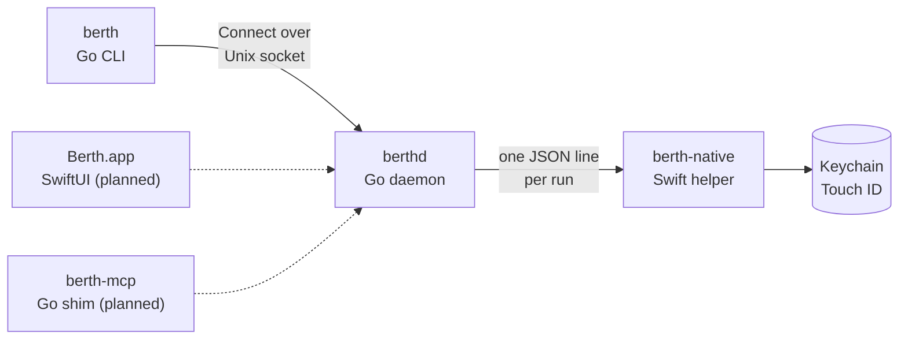
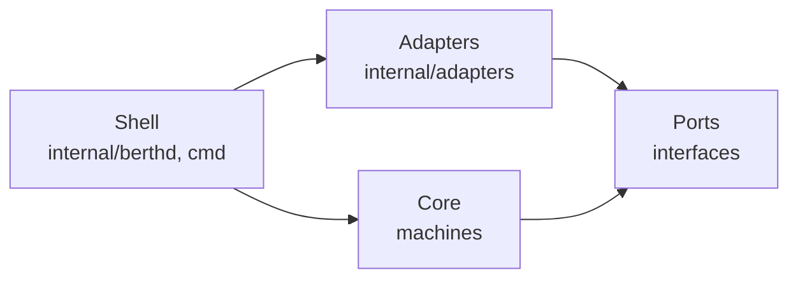
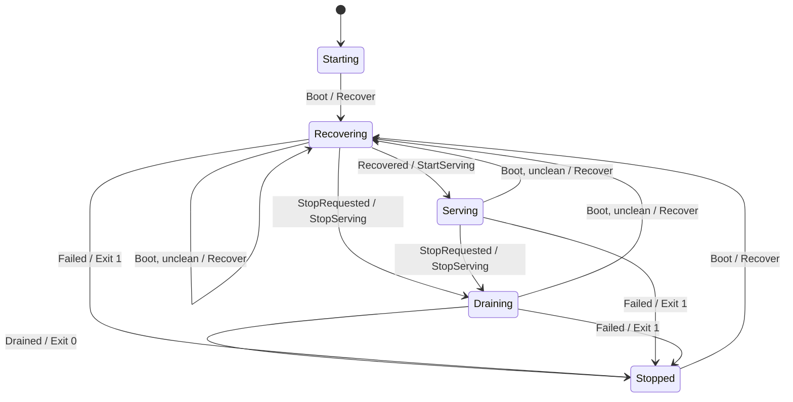
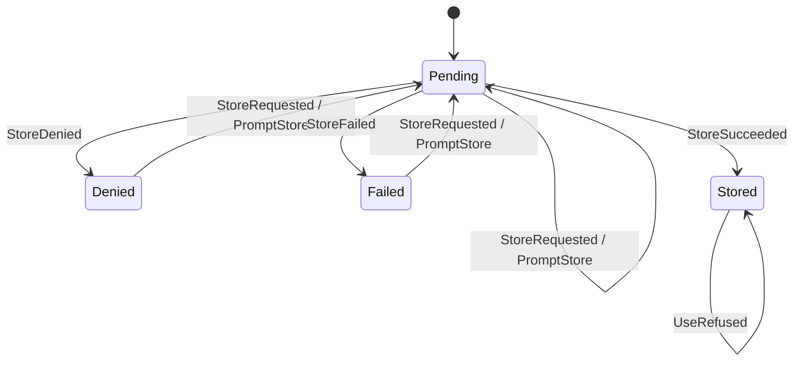
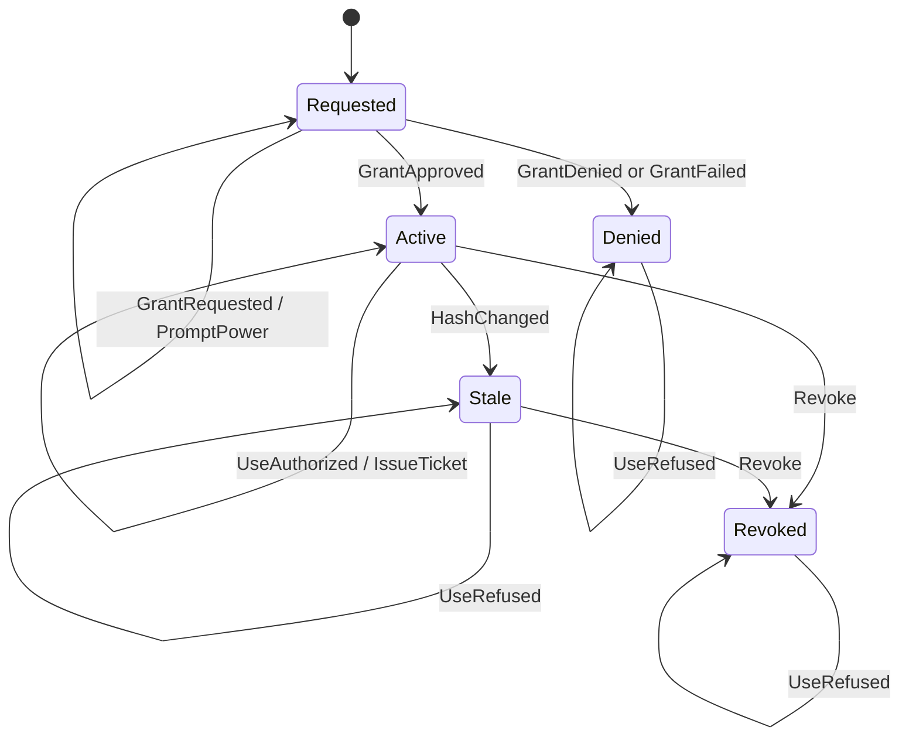
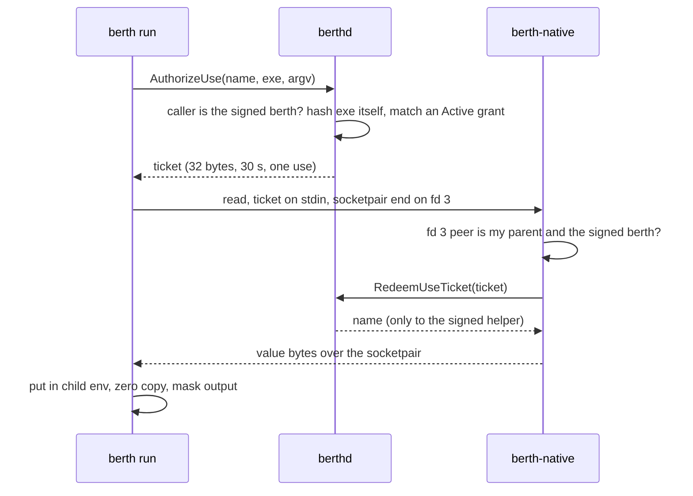

# Berth architecture

This is the canonical description of how Berth is built, for people reading the code and for coding agents changing it.
A change to behaviour or structure updates this file in the same commit.
Each section says what is **built** (in the code on `main` today) and what is **planned** (designed, not yet written).

## What Berth is

Berth is a local app for macOS that lists every browser your agents, tests and scrapers have open, lets you watch and take over any of them, and brokers Keychain secrets to browsers and terminals without agents ever reading them.
It borrows Docker's model: a browser and whoever drives it is a session, a saved Chrome profile is like an image, and Keychain grants are like secrets.
It runs only on your own Mac, talks only over a Unix socket, and has no telemetry.

Berth is in pre release development.
The first useful slice, terminal secrets (E2a), is being integrated now; the browser features start at M2.
See [Milestones](#milestones) for the exact status.

## Processes



| Process | Language | Status | Job |
|---|---|---|---|
| `berthd` | Go | Built | The daemon: owns all state, runs the state machines, serves the API, decides every security question; `make build` signs it, since `berth` and `berth-native` talk only to the signed daemon |
| `berth` | Go | Built | The command line client: `status`, `debug state`, `secret request`, `secret add`, `secret ls`, `secret grant`, `run`; `make build` signs it, since `berthd` gives use tickets only to the signed CLI |
| `berth-native` | Swift | Built | The only Berth process that touches secret values: Keychain add and read, Touch ID, the secure input dialog |
| `Berth.app` | Swift | Planned (M5) | Window and menu bar, live view and takeover, notifications, registers `berthd` as a login item |
| `berth-mcp` | Go | Planned (M4) | A thin MCP shim for agents without a shell; holds no state and exposes only agent methods |
| TUI | Go | Planned (M3) | A full screen terminal view inside `berth` |

Swift does the native work because Keychain, Touch ID and ScreenCaptureKit are Apple frameworks; keeping them in Swift keeps the Go code free of cgo ([ADR 0001](docs/adr/0001-go-for-the-daemon-cli-and-tui.md)).

### The API: Connect over a Unix socket (built)

- One Protobuf schema, package `berth.v1` in [`proto/berth/v1/`](proto/berth/v1), generates every client; generated code is committed under `gen/` ([ADR 0002](docs/adr/0002-connect-api-with-one-protobuf-schema.md)).
- `berthd` serves Connect, gRPC and Connect JSON on one socket, over HTTP/2 without TLS and over HTTP/1.1.
- The socket is `$BERTH_HOME/berthd.sock`; `BERTH_HOME` defaults to `~/Library/Application Support/Berth`.
- Every Go client calls `Handshake` first, and a protocol version mismatch is a typed error (`ERROR_REASON_PROTOCOL_MISMATCH`).
- `buf breaking` fails the build if a change would break an existing client; `v1` only gains fields.

| Service | Methods | Status |
|---|---|---|
| `DaemonService` | `Handshake`, `Status`, `Shutdown` | Built |
| `DebugService` | `GetState` (state and recent transitions of any entity) | Built |
| `SecretsService` | `RequestSecret`, `ListSecrets`, `GrantSecret`, `AuthorizeUse`, `RedeemUseTicket` | Built |
| Sessions, Profiles, Runbooks, Policies | `ListSessions`, `WatchSessions`, `LaunchSession`, `WatchScreen`, `SendInput`, `FillLogin` and more | Planned (M2 to M6) |

### The native helper protocol (built)

`berthd` and `berth run` start `berth-native <command>` once per request, with a scrubbed environment (only `HOME`, `PATH`, `BERTH_HOME`).
The helper reads one JSON object on one line from stdin and writes one JSON line to stdout, except for `read`, whose value goes to file descriptor 3.

| Command | Does | Replies |
|---|---|---|
| `store` | Shows the secure input dialog with facts `berthd` verified, then Touch ID, then writes Keychain item `berth.<name>` | `stored`, `denied` or `failed`; never the value |
| `confirm` | Shows a Touch ID prompt for a power action (today: a grant); with `"interpreter":true` the text starts with "<path> is an interpreter and can print this secret", and `"pass_env"` names are listed | `approved`, `denied` or `failed` |
| `read` | Refuses unless fd 3 is a connected Unix stream socket whose peer, by its audit token, is the helper's parent and satisfies the CLI requirement; connects to the daemon socket, checks by the peer's audit token that the signed `berthd` answers, then redeems the ticket and reads `berth.<name>` | The raw value bytes on fd 3, one end of a socketpair `berth run` created and passed in; or nothing and exit code 3. stdout carries nothing |

The exact message shapes are in [the E2 plan](docs/plans/e2-terminal-secrets.md#native-helper-protocol-items-2-4-and-6-must-match-it-exactly).
Go tests use a fake helper written in Go ([`internal/adapters/native/fakehelper`](internal/adapters/native/fakehelper)), never the Swift binary.
`scripts/build-native.sh` builds the helper in release mode, and `scripts/sign.sh` signs it (and `make build` signs `bin/berth`) with a stable Apple Development identity, identifier and the hardened runtime, because `berthd` trusts both by team, identifier and cdhash, and Keychain items trust the helper by its designated requirement.

## Layers and import rules (built)

Berth is a functional core with an imperative shell, arranged as ports and adapters ([ADR 0005](docs/adr/0005-ports-and-adapters.md)).
The core decides; adapters and the shell do.



| Layer | Path | May import | Holds |
|---|---|---|---|
| Ports | `internal/core/ports/` | stdlib only | `Store`, `Clock`, `RequestLog`, `ExecIdentity`, `PeerFacts`, `Approver`, `TicketSource` and their domain types |
| Machine kit | `internal/core/machine/` | ports | `Transition`, `Actor`, `machinetest.Walk` |
| Machines | `internal/core/{daemon,secret,grant}/` | machine, ports | One transition table each |
| Adapters | `internal/adapters/{sqlite,socket,api,clock,native,execid,peer,ticket}/` | core, gen | Implementations of the ports and the API handlers |
| Shell | `internal/berthd/` | everything | Wires adapters, runs actors, performs effects |
| Clients | `internal/client/`, `internal/cli/`, `cmd/` | gen, api | The Go client, the CLI logic, thin entry points |
| Fakes | `internal/testutil/` | ports | In memory store, fake clock, scriptable secrets fakes |

The rules are enforced by `golangci-lint`, not by convention:

- `depguard` fails the build if `internal/core` imports an adapter, `database/sql`, `os/exec` or `net/http`.
- `forbidigo` bans `time.Now` and `fmt.Print` in `internal/core`, so time comes only from the `Clock` port.
- `exhaustive` fails the build when a `switch` over states, events or effects misses a case.

Ports named in ADR 0005 that do not exist yet: `ProcessSource` (M2), `BrowserDriver` (M4), `SecretStore` (M6), `Notifier` (M5).

## State machines (built)

Every stateful thing has one `state` field, a closed set of events, and one hand written transition function ([ADR 0003](docs/adr/0003-explicit-hand-written-state-machines.md)).
No booleans whose combinations mean something, and no state machine library.

```go
type Transition[S ~string, E Event, F any] func(state S, event E) (S, []F, error)
```

- **Pure:** a transition does no I/O, logging, randomness or clock reads; it returns the next state and the effects to run, or an error wrapping `machine.ErrIllegal`.
- **Actors:** one goroutine owns each entity (`daemon`, `secret/<name>`, `grant/<id>`) and applies its events one at a time from a bounded inbox, so state is never shared or locked.
- **Persist before effects:** the actor writes the new state and the event row in one SQLite transaction, and only then runs the effects; if the write fails, the actor stops rather than act on a state it could not record ([ADR 0004](docs/adr/0004-state-and-event-rows-in-one-transaction.md)).
- **Failures are events:** an effect that fails returns a follow up event (for example `Failed` with a note), so failure is a state, not a silent retry.
- **Illegal events are rejected, not fatal:** the actor reports them and keeps running; nothing is persisted.
- **Walked:** each machine's test runs `machinetest.Walk` over every state and event pair and pins the number of legal pairs, so any table change is deliberate.
- **Names are data:** state and event names are stored in `machine_state` and `machine_event`, so they are never renamed; a retired name becomes illegal everywhere and stays in the code.
- **Debuggable:** `berth debug state <entity>` prints the current state and recent transitions of any machine.

Labels below are event names, with effects after a slash.

### Daemon machine (built, 12 legal pairs)

Source: [`internal/core/daemon/daemon.go`](internal/core/daemon/daemon.go).



`Boot` is legal from every state because a process start is a fact; booting from anything but `Starting` or `Stopped` means the last run crashed, and the `Recover` effect records that as an unclean shutdown.
SIGTERM, SIGINT and the `Shutdown` call all send `StopRequested`.

### Secret machine (built, 7 legal pairs)

Source: [`internal/core/secret/secret.go`](internal/core/secret/secret.go).
One entity per secret name; the value never appears in the machine.



- `PromptStore` asks `berth-native store` to show the dialog; its outcome comes back as `StoreSucceeded`, `StoreDenied` or `StoreFailed`.
- A `Stored` secret refuses another store with `ERROR_REASON_SECRET_EXISTS`; replacing a value is `rotate`, planned for E2b.
- `UseRefused` records a refused use of a stored secret that has no grant to record it on.

### Grant machine (built, 11 legal pairs)

Source: [`internal/core/grant/grant.go`](internal/core/grant/grant.go).
One entity per grant row; a grant pins one verified executable to one secret.



- `PromptPower` asks `berth-native confirm` for Touch ID; `IssueTicket` makes a single use ticket and counts the use on the grant row.
- A `Denied`, `Stale` or `Revoked` grant is never approved again; granting again creates a new grant, which is a new entity.
- No API method sends `Revoke` yet; revoking from the CLI is planned with E2b.

### Planned machines

| Machine | Milestone | Owns |
|---|---|---|
| Session | M2, grows in M4 | One browser and whoever drives it: `Discovered`, `Active`, `Idle`, `Leftover`, `Stopping`, `Stopped`, then `Launching`, `Ready`, `Failed` |
| Profile lock | M4 | Which session holds a Chrome profile, and who waits for it |
| Screen stream | M5 | One live view stream to a client, dropping stale frames |
| Control | M5 | Whether the agent or a person drives the page |
| Fill | M6 | One attempt to type a secret into a page; the value exists only between reading and typing |
| Browser grant | M6 | A Keychain item granted to one browser profile for one site |

Sessions will follow the observe then reconcile pattern: scanners and browser drivers only report what they saw as events, and a periodic reconcile pass sends corrective events so a missed event heals itself.

## Storage (built)

One SQLite file, `$BERTH_HOME/berth.db`, through the pure Go driver `modernc.org/sqlite` (no cgo).

- WAL journal, `synchronous=FULL` so a transition reported as saved survives power loss, foreign keys on, one connection.
- Migrations are numbered SQL files embedded in the binary ([`internal/adapters/sqlite/migrations/`](internal/adapters/sqlite/migrations)); each runs in its own transaction and bumps `PRAGMA user_version`, and a test fails on a gap in the numbering.
- Every table is `STRICT`.
- `SaveTransition` writes `machine_state` and `machine_event` in one transaction with an optimistic version check, so a crash can never leave one without the other and a stale writer gets `ErrVersionConflict`.

| Table | Migration | Holds |
|---|---|---|
| `machine_state` | 0001 | Current state and version of every entity |
| `machine_event` | 0001 | Every transition: entity, version, event, from and to state, a secret free detail, time; unique per entity and version |
| `request_log` | 0001 | The first response to each mutating `request_id`, so retries replay instead of acting twice |
| `secrets` | 0002 | Secret names and creation time; never values |
| `grants` | 0002 | Pinned consumers: resolved path, SHA-256, team and signing ID, argument glob, use count, last use |

Single use tickets live only in `berthd` memory and are never persisted.

## Security model

Berth assumes any agent can be hijacked by text on a web page or in a repository, so every limit is enforced by deterministic code outside the model: the daemon, the native helper and Touch ID.
Instructions and prompts are never a security control.
[docs/agent-safety.md](docs/agent-safety.md) maps the controls to the OWASP agentic top 10 and holds the checklist each milestone walks before it closes.

### The socket (built)

- The socket is mode 0600 inside a 0700 folder, and only one `berthd` may serve it.
- Every connection's peer user ID is checked with `LOCAL_PEERCRED` before a single byte is read; another user's connection is closed.
- Every request is validated against `protovalidate` rules in the schema before a handler acts on it.
- Every mutating call carries a `request_id`; a retry gets the first response, and reusing an ID for another method is a typed error.
- Logs go through a redacting `slog` handler that blanks any attribute whose key names a secret; core dumps are turned off at start.

### The agent surface

- **Built:** a method is meant for agents only when the schema marks it `option (berth.v1.agent) = true`, and `TestAgentSurface` pins the list: `Handshake`, `RequestSecret`, `ListSecrets` and `AuthorizeUse`.
- **Planned (M4):** agents get a session token that works only for their own session, only from their own process tree, and only for agent methods ([ADR 0006](docs/adr/0006-agents-are-scoped-by-session-token.md)); `berth-mcp` and the agent commands expose exactly the marked methods.
- **Today's limit:** until session tokens exist, the daemon cannot tell an agent from the person, because both run as the same user; anything that can reach the socket can call any method, and the protections that hold are Touch ID on power actions, values never crossing the API, and use tickets going only to the signed `berth` CLI.

### Secrets: store and use, never read

Agents may store a secret (the person types it into a native dialog) and use one (Berth injects it where it was granted), but never read one ([ADR 0012](docs/adr/0012-agents-can-store-and-use-secrets-never-read-them.md)).

- No message in the schema carries a value; values exist only inside `berth-native` and in the child process `berth run` starts.
- In Go a value is a `[]byte`, zeroed after use, never a `string`, never in a log, error, event note or reply.
- Keychain items Berth creates use the service prefix `berth.` so they never collide with existing items.
- Dialog and Touch ID text is built only from facts `berthd` verified from the kernel (peer process, executable, process tree, working directory) and from the file on disk (path, SHA-256, code signature); the requester's reason is shown quoted and labelled as the requester's claim, and never stored in an event.
- Granting a consumer is a power action that needs Touch ID.

How a use travels (E2a):



- **Who may hold a ticket.** A ticket lets its holder start `berth-native` and read the value, so `berthd` issues one only when the `AuthorizeUse` caller is the signed `berth` CLI, which puts the value straight into its child. Any other process, including one an agent wrote, gets `ERROR_REASON_PEER_NOT_TRUSTED`.
- **How a binary is recognised.** At start `berthd` checks the `berth` and `berth-native` files beside it against the requirement `anchor apple generic and certificate leaf[subject.OU] = "XPJ7XA42J4" and identifier "<id>"` (`com.wesleybldc.berth.cli`, `com.wesleybldc.berth.native`) and pins each one's cdhash. A socket peer counts as that binary only when the kernel, asked by the peer's audit token (`LOCAL_PEERTOKEN`, then `csops_audittoken`), reports the same cdhash for the image it is running, a valid signature and the hardened runtime. Paths and names are never trusted, a reused pid or an exec'd process fails its audit token, and a debugger cannot attach to a hardened process. A cdhash that differs makes `berthd` read the file once more, so a fresh `make build` works without a restart.
- `RedeemUseTicket` uses the same live check for `berth-native`, before the request log is read, and accepts a ticket only from a helper whose parent is the process the ticket was issued to. `berth-native read` checks the other direction too, through the receiver check below.
- **Who answers the socket.** Anyone can listen on a socket at `BERTH_HOME`, so both clients authenticate the daemon before they act on its answers. `berth run` checks the peer's audit token with the same live check against the signed `berthd` beside it (requirement identifier `com.wesleybldc.berth.daemon`) before `AuthorizeUse`; `berth-native read` checks it with `SecCodeCopyGuestWithAttributes` and the same requirement before it sends the ticket. A server an agent started fails closed in both.
- **Who receives the value.** Berth does not try to make sure it starts the right helper; the helper makes sure the right process receives the value. A release `berth` starts the `berth-native` beside its own resolved executable (the `BERTH_NATIVE` override exists only under the `berth_e2e` build tag) and hands it one end of a Unix socketpair as fd 3. Before it redeems the ticket, `berth-native read` asks the kernel who holds the other end: fd 3 must be a connected `AF_UNIX` stream socket, the pid in its `LOCAL_PEERTOKEN` audit token must equal `getppid()`, and `SecCodeCopyGuestWithAttributes` with that audit token plus `SecCodeCheckValidity` must satisfy the CLI requirement. Anything else (a pipe, FIFO, file or terminal on fd 3, or berth's socket handed through a wrapper process that is now the parent) exits 3 with nothing written. A wrapper that only `exec`s the helper keeps berth as the parent, so the value still reaches only berth. `berthd` also accepts a redeem only from a signed helper whose parent holds the ticket.
- Pins are read from a private copy (0600 in a fresh 0700 folder) so the requirement check and the hash see the same bytes, and a file is pinned again at most once every 10 seconds. The copy does not stop a same-user process from swapping the file before it is copied: a swapped pin can at worst make Berth trust a fake CLI or helper, and the receiver check stops that fake from getting a value.
- An unsigned development `berth run` is refused with a message to run `make build`. The end to end tests compile a test only pin rule (`-tags berth_e2e`, no environment variable) that accepts ad hoc signed binaries beside `berthd`, still requiring the hardened runtime.
- `berthd` identifies the executable itself and never trusts a client hash; a changed hash moves the grant to `Stale`.
- A grant to an interpreter (a shell, `python`, `perl`, `ruby`, `node`, `osascript`, `env`, or any `#!` file) is refused unless `--allow-interpreter` is passed, and then the Touch ID text says the interpreter can print the secret.
- **The consumer's environment.** The child gets only `HOME`, `PATH`, `TERM`, `LANG`, `LC_ALL`, `LC_CTYPE`, `USER`, `LOGNAME`, `SHELL`, `TMPDIR`, the bound secret keys, and the names its grant lists (`berth secret grant --pass-env NAME`, shown in the Touch ID text, returned by `AuthorizeUse`; with several secrets, only names every grant lists). `DYLD_*`, `LD_*`, `*_OPTIONS`, `*_OPTS` and `*OPT` are always dropped, even when listed, because they make a tool load or run other code. Interpreters and tools that run configured commands (`git`, `ssh`, `make`, `find`, `xargs`, `awk`, editors, `java`, `swift`, `expect`) need `--allow-interpreter`.
- A ticket is bound to the secret name, the executable hash and the caller's process ID, lives only in memory, and is valid once for 30 seconds.
- `berth run` masks the value in the child's stdout and stderr as a backstop.
- A store prompt open when `berthd` stops is cancelled (its helper killed) and records `StoreFailed` before the daemon drains; a store a crash left `Pending` is marked `StoreFailed` with the note `interrupted` at the next boot.

### Planned browser credentials (M6)

A grant ties one Keychain item to one browser profile and one site, approved once with Touch ID and then free unless the person sets ask every fill or strict mode ([ADR 0007](docs/adr/0007-grants-per-browser-profile-free-after-one-approval.md)).
A fill is one atomic step with the agent's CDP traffic paused: check the page's real origin, type, submit, wipe the fields on a failed login, scan held messages for the value, then resume; the agent gets only a status ([ADR 0008](docs/adr/0008-atomic-fill-with-the-agent-paused.md)).
The CDP proxy refuses methods outside the agent's own session and logs the rest ([ADR 0009](docs/adr/0009-cdp-proxy-refuses-cross-session-methods-from-day-one.md)).
Other password stores plug in as `berth-secret-<name>` helper programs pinned by code signing identity ([ADR 0011](docs/adr/0011-secret-stores-beyond-the-keychain-are-helper-programs.md)).

### Threat model

E2a defends against agents that are honest, confused, or prompt injected into asking for or printing secrets, and against casual misuse of the signed binaries (copying them, wrapping the helper, pointing them at a fake daemon).
A determined agent running as the same user that can run arbitrary code can still leak an environment injected secret through tool configuration (dotfiles, `PATH`, `HOME`).
The header proxy (E2b) and, beyond that, running agents under a separate user or in a sandbox are the stronger isolation.

### Honest limits

- Any process that holds a secret can leak it: environment injection is only as safe as the command it is pinned to, which is why grants pin the exact executable and an optional argument glob, and why the header proxy (E2b) will be the default for API keys.
- The executable can change between `AuthorizeUse` hashing it and `berth run` starting it; closing that gap needs exec by file descriptor or a signed binary requirement (E2b).
- Environment injection protects against accidental exposure and limits what an agent can steer through variables, but a process running as the same user can still configure a tool through its dotfiles (for example `~/.gitconfig` or `~/.npmrc`), so a hostile agent can make a configurable tool reveal a secret from its environment. The consumer also gets the caller's `PATH` and `HOME`, so a tool that starts other programs through `PATH` can start one the agent placed earlier in `PATH`, and one that reads files under `HOME` reads what the agent left there. The header proxy (E2b) is the mode for strong isolation of API keys.
- Two small denials of service: junk an agent writes into `bin/` beside the binaries makes a pin fail, and the 10 second re-pin limit keeps uses refused for that window; and the first use right after a rebuild can be refused for up to 10 seconds, until the next re-pin.
- Output masking matches only the literal value: an encoded, split by the child, or transformed copy (base64, hex, one character per line) passes through unmasked.
- The store dialog's `NSSecureTextField` hands the value over as a Swift `String`, which cannot be wiped; `berth-native` copies it into a buffer it zeroes and clears the field, but the string's own memory lives until the process exits a moment later.
- A granted interpreter can print the secret whatever the glob says; `--allow-interpreter` only makes that a deliberate choice.
- The receiver check compares the socket peer's audit token pid with `getppid()`; a parent that exited would reparent the helper (to pid 1) and fail that comparison, and the audit token itself stops matching once its process exits or execs.
- Until session tokens (M4), a malicious process running as the person can call every method; it still cannot read a value through the API or grant itself access without Touch ID.
- The peer adapter reads process facts through a raw `proc_info` syscall with a hardcoded struct offset, which a macOS update could break; its test guards it.
- Builds are signed with a free Apple Development identity; the data protection keychain, notarization and Developer ID signing wait for the paid program at M8.

## Milestones

The order is risk first, skeleton before features, terminal before app, and secrets after the parts they depend on.
Each milestone starts from a plan in [`docs/plans/`](docs/plans) with acceptance tests, and ends when `make check` passes and the [agent safety checklist](docs/agent-safety.md#milestone-checklist) is walked.

| Milestone | Builds | Status |
|---|---|---|
| M0 Spike | Five risky proofs: Swift streaming over the socket, Playwright MCP through a token proxy, 60 fps screencast in SwiftUI, Touch ID and Keychain from a signed helper, window capture by process ID | Done; code kept under the tag `m0-spike` ([ADR 0015](docs/adr/0015-m0-spike-results.md), [plan](docs/plans/m0-spike.md)) |
| M1 Skeleton | Repository rules, `berth.v1` schema, machine kit, SQLite store, daemon machine, socket checks, `berth status` and `berth debug state` | Done ([plan](docs/plans/m1-skeleton.md)) |
| E2a Terminal secrets | `berth secret request`, `add`, `ls`, `grant`, `berth run`, `berth-native`, secret and grant machines, audit rows, a Claude Code hook | In progress: built and wired with the end to end canary test; the manual Touch ID check remains ([plan](docs/plans/e2-terminal-secrets.md)) |
| M2 See every browser | `ProcessSource`, signature registry, owner chain, session machine (observed states), `berth ps`, `inspect`, `stop`, `leftovers` | Planned, next |
| M3 Live terminal view | `WatchSessions` stream with resume, the TUI | Planned |
| M4 Managed Chromium | `BrowserDriver` over a private CDP pipe, the token gated CDP proxy, profile locks, session tokens, `berth-mcp` | Planned |
| M5 Mac app | `Berth.app`, login item registration, live view and takeover, window pictures, notifications | Planned |
| M6 Credentials and runbooks | Browser grants, the atomic fill, hard limits per profile, runbooks served to agents | Planned |
| E2b Terminal secrets, rest | Header proxy, `copy`, `rotate`, `rm`, revoke, Keychain access list audit, MCP tools | Planned |
| E1 Other password stores | Helper contract with 1Password and Bitwarden helpers | Optional |
| M7 Firefox and your daily Chrome | WebDriver BiDi adapter; connecting to your own Chrome as a Touch ID power action | Planned |
| M8 Release | License, signed and notarized build, tamper evident audit log, published signature format, first tagged release | Planned |
| M9 Claude in Chrome extension | Tells Berth which tabs another debugger holds | Planned, last |

The repository is public for development from 2026-11-16, with no releases or tags until M8 ([ADR 0017](docs/adr/0017-public-development-repository.md)).

## Decisions

Every decision that binds code has a record in [`docs/adr/`](docs/adr):

| ADR | Decision |
|---|---|
| [0001](docs/adr/0001-go-for-the-daemon-cli-and-tui.md) | Go for the daemon, CLI and TUI; Swift only for native macOS work |
| [0002](docs/adr/0002-connect-api-with-one-protobuf-schema.md) | Connect API with one Protobuf schema |
| [0003](docs/adr/0003-explicit-hand-written-state-machines.md) | Explicit, hand written state machines |
| [0004](docs/adr/0004-state-and-event-rows-in-one-transaction.md) | State and event rows in one transaction |
| [0005](docs/adr/0005-ports-and-adapters.md) | Ports and adapters |
| [0006](docs/adr/0006-agents-are-scoped-by-session-token.md) | Agents are scoped by session token |
| [0007](docs/adr/0007-grants-per-browser-profile-free-after-one-approval.md) | Grants per browser profile, free after one approval |
| [0008](docs/adr/0008-atomic-fill-with-the-agent-paused.md) | Atomic fill with the agent paused |
| [0009](docs/adr/0009-cdp-proxy-refuses-cross-session-methods-from-day-one.md) | CDP proxy refuses cross session methods from day one |
| [0010](docs/adr/0010-macos-26-and-later-only.md) | macOS 26 and later only |
| [0011](docs/adr/0011-secret-stores-beyond-the-keychain-are-helper-programs.md) | Secret stores beyond the Keychain are helper programs |
| [0012](docs/adr/0012-agents-can-store-and-use-secrets-never-read-them.md) | Agents can store and use secrets, never read them |
| [0013](docs/adr/0013-testing-minimal-unit-tests-real-end-to-end-tests.md) | Minimal unit tests, real end to end tests |
| [0014](docs/adr/0014-local-only-personal-first-open-source-later.md) | Local only, personal first (partly superseded by 0017) |
| [0015](docs/adr/0015-m0-spike-results.md) | M0 spike results |
| [0016](docs/adr/0016-brand-sleeping-key.md) | Brand is the Sleeping key |
| [0017](docs/adr/0017-public-development-repository.md) | Public repository for development |

How several coding agents split a milestone is in [docs/agentic-work.md](docs/agentic-work.md), and the rules they follow are in [AGENTS.md](AGENTS.md).
