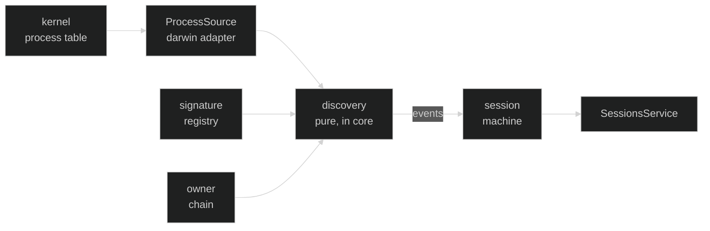
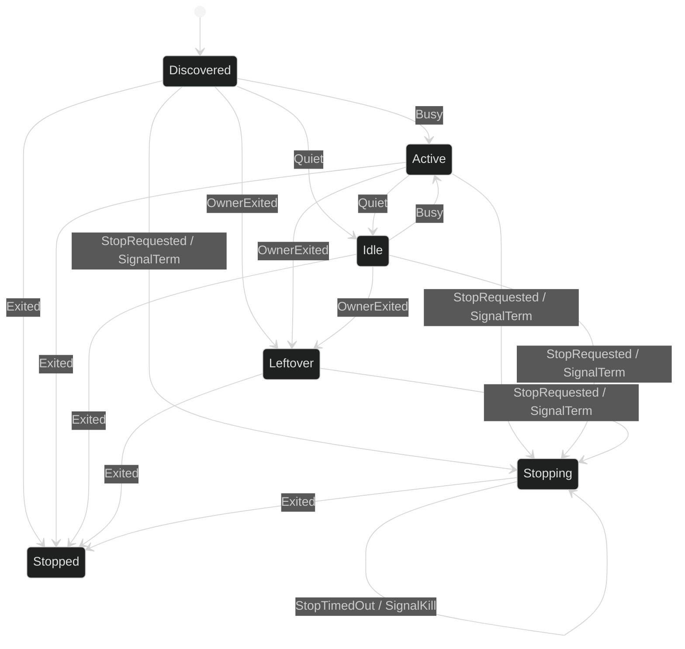

# M2: See every browser

Goal: `berth ps` lists every Chromium family browser running on this Mac, says what it is (Chrome, Chrome for Testing, Chromium, Edge, Brave, a headless shell), whether Playwright or Puppeteer drives it, whether it is headless and how its DevTools protocol is exposed, and who started it (an agent, a terminal, an app or the person); `berth inspect` shows one in detail, `berth stop` ends one, and `berth leftovers` lists and stops the browsers whose owner has gone.
M2 only observes: Berth launches nothing and speaks no CDP until M4.
The maintainer was away when this plan was written and asked not to be blocked; every choice that is his to make is listed under [Decisions for the maintainer](#decisions-for-the-maintainer), with the default taken.

## What the kernel lets Berth see (checked on 2026-11-17, macOS 26.5)

| Fact | Owner's processes | Another user's processes | Source |
|---|---|---|---|
| pid, parent pid, uid, start time, short name | Yes | Yes | `sysctl kern.proc.all`, one call for the whole table |
| Executable path | Yes | Yes (261 of 262 other user processes on this Mac) | `proc_pidpath` (raw `proc_info`, as `internal/adapters/peer` already does) |
| Arguments (`argv`) | Yes | **No**, `EINVAL` | `sysctl kern.procargs2` |
| CPU time | Yes | Not relied on | `proc_pidinfo(PROC_PIDTASKINFO)` |
| Exit notification | Yes | Not relied on | kqueue `EVFILT_PROC` `NOTE_EXIT` (already used for `berth-proxy` in `internal/berthd/procexit.go`) |

So a browser run by another user (a future E3 agent user) can be recognised by its executable path, but its flags, profile and driver are opaque.
M2 lists such a browser as **unmanaged, other user**: it shows the kind its path implies and nothing from its arguments, never tries to read them, and refuses to stop it.

The M0 spike ([ADR 0015](../adr/0015-m0-spike-results.md)) proved the parts M4 builds on (Chrome over `--remote-debugging-pipe` in its own process group, the token gated CDP proxy, `berthd` stopping every Chrome process group it owns on SIGTERM); it did not test discovery of browsers Berth did not start, which is why this milestone starts with the kernel facts above.
One spike finding binds M2: tokens must not travel as command line flags, and other tools may still put credentials in a browser's `argv` (for example `--proxy-server` with a password), so Berth never returns, stores or logs raw arguments, only the facts it parsed from them.

## Design



Observe, then reconcile, as `ARCHITECTURE.md` planned for sessions: the scan loop only reports what it saw as events, and every scan sends corrective events, so a missed kqueue note or a daemon restart heals itself at the next scan.

### ProcessSource (port) and its darwin adapter

- `internal/core/ports/process.go`: `ProcessRef{PID, Start}` names one process instance, since a pid alone is reused; `ProcessInfo{Ref, PPID, UID, Executable}`; `ProcessSource` with `List`, `Args`, `CPUTime`, `WatchExit` and `Signal`.
- `Args` returns `ErrOpaqueProcess` for a process the kernel will not describe (another user's), and `ErrProcessGone` when the pid now names another start time, so a reused pid never answers for the old one.
- `Signal` re-reads the start time immediately before `kill(2)` and refuses a mismatch; the window between the two calls is an honest limit below.
- Adapter `internal/adapters/procscan` (darwin): `kern.proc.all` for the table, `proc_pidpath` per process, `kern.procargs2` parsed by a pure function with its own fixture tests, `PROC_PIDTASKINFO` for CPU, kqueue for exits.
- The table comes from `kern.proc.all` rather than `proc_listpids` plus one `PROC_PIDTBSDINFO` call per pid: one call returns a consistent snapshot with parent, uid and start time, and `x/sys/unix` already wraps it.
- No audit token or cdhash: an audit token needs a task port or a socket connection Berth does not have for a browser it did not start, and nothing in M2 is granted to a browser's code. M4 launches its own browsers and M6 pins grants to profiles, not binaries.

### Signature registry

`internal/core/browsersig`, pure: `Classify(executable, args, argsKnown)` returns a `Signature` with the browser kind, the driver, headless, the CDP exposure, the profile folder and the role.

| Recognised by | Result |
|---|---|
| `Google Chrome.app/Contents/MacOS/Google Chrome` | Chrome |
| `Google Chrome for Testing.app/.../Google Chrome for Testing` | Chrome for Testing |
| `Chromium.app/Contents/MacOS/Chromium` | Chromium |
| `Microsoft Edge.app/Contents/MacOS/Microsoft Edge` | Edge |
| `Brave Browser.app/Contents/MacOS/Brave Browser` | Brave |
| An executable named `chrome-headless-shell` or `headless_shell` | Headless shell, always headless |
| A `* Helper*.app` inside one of those bundles, or `--type=` in its arguments | A helper of that browser, never a session root |
| An executable under `ms-playwright/`, or a profile named `playwright_chromiumdev_profile-*` or under `ms-playwright/mcp-*` | Driver Playwright |
| An executable under `.cache/puppeteer/`, or a profile named `puppeteer_dev_chrome_profile-*` | Driver Puppeteer |
| `--enable-automation` with neither of the above | Driver unknown automation |
| `--headless`, `--headless=new` or `--headless=old` | Headless |
| `--remote-debugging-pipe`; `--remote-debugging-port=N` | CDP over a pipe; CDP on port N (0 means Chrome picked one) |
| `--user-data-dir=PATH` | Profile folder |

- Electron apps (Slack, Cursor, Beeper) are not browsers: their `chrome_crashpad_handler` and helpers sit inside their own bundles and match nothing.
- With `argsKnown` false (another user's process) only the path rules apply, and the signature says so.
- The registry is a table of rules, tested by a table of real paths and argument lists copied from this Mac.

### Owner chain

`internal/core/ownerchain`, pure: given a session root's ancestors (parent first, up to launchd), each with its executable and, for the owner's processes, its arguments, it returns the chain and the owner.

- The owner is the nearest ancestor recognised as an **agent** (`claude`, `codex`, `cursor-agent`, `gemini`, `aider`, `opencode`, `amp`, `goose`, including those run through `node`, `bun` or `deno`); else the nearest **terminal** (Terminal, iTerm2, Ghostty, WezTerm, kitty, Alacritty, Warp, or `tmux` and `screen` servers); else the nearest **app** (any other `.app` bundle executable, for example Cursor or VS Code); else the **person**, when a browser app's main executable was started by launchd (from the Dock, Finder or `open`); else **none**, when an automated or headless browser already hangs from launchd, which means its owner has exited.
- The chain stops at the first ancestor the kernel will not describe, as the peer adapter's does.
- The owner is a process instance (`ProcessRef`), so its exit is detectable later by its start time.

### Discovery (the pure part of the scan)

`internal/core/discovery`, pure: given the process table, the arguments it read, the CPU times and the sessions it already knows, it returns the observed sessions and the events to send.

- A **session root** is a process the registry recognises as a browser and whose parent is not a process of the same browser; every descendant of a root belongs to its session.
- The session id is `<pid>-<start time in microseconds>`, the entity `session/<id>`; the same browser keeps its id across daemon restarts, and a reused pid is a new session.
- Events per scan: `Busy` when the session's CPU time grew by at least 20 ms since the last scan and the session is `Discovered` or `Idle`; `Quiet` when it has not grown for 60 seconds and the session is `Discovered` or `Active`; `OwnerExited` when the owner's `ProcessRef` is gone from the table, or the owner is none at discovery; `Exited` when the root is gone.
- The shell only sends an event the table accepts in the current state, so a steady browser writes no rows.

### Session machine (observed states)

`internal/core/session`, entity `session/<id>`, kind `session`.



- 17 legal pairs, pinned by `machinetest.Walk`.
- `Leftover` is sticky: a browser whose owner has gone stays a leftover however busy it is, until it exits or is stopped.
- `StopTimedOut` comes from a 5 second timer the shell starts with `SignalTerm`; `SignalKill` kills the root and every process still in the session.
- A signal that fails because the process already exited is not a failure: the next scan or `NOTE_EXIT` sends `Exited`.
- M4 adds `Launching`, `Ready` and `Failed` for browsers Berth starts; the names here are stored data and never change.

### berthd's scan loop

- One goroutine in `internal/berthd/sessions.go`: a full scan every 2 seconds, plus a kqueue `NOTE_EXIT` watch on every session root, so an exit is seen at once and a new browser within 2 seconds.
- Arguments are read only for browser processes and their ancestors, not for the whole table.
- Each session is an actor, like secrets and grants; facts (the signature, owner, chain, processes) live in memory beside it and are rebuilt by every scan, so no new table or migration is needed.
- Boot: the first scan rediscovers live browsers under their old ids, and any session the database holds in a live state that the scan does not find gets `Exited` with the note `gone at boot`.

### RPCs and the CLI

| Command | RPC | Prints |
|---|---|---|
| `berth ps [--all]` | `ListSessions` | One line per session: id, state, kind, driver, headless, CDP, owner, process count; `--all` adds sessions that stopped since `berthd` started |
| `berth inspect <id>` | `InspectSession` | The session, its processes with their roles, the owner chain, and the recent transitions |
| `berth stop <id> [--force]` | `StopSession` | The final state; waits up to 10 seconds |
| `berth leftovers [--stop]` | `ListSessions` filtered to `Leftover`, then `StopSession` for each | The leftovers, or what was stopped |

- **Stop needs no Touch ID.** It only ends a process the person could end with `kill`, and stopping lowers what an agent can do, like a revoke. To keep a person's own browser safe from a careless call, a session whose owner is the person or an app refuses a stop without `force` (`ERROR_REASON_SESSION_NOT_STOPPABLE`), and so does every session of another user, with or without `force`.
- **No M2 method is on the agent surface.** Listing shows every browser on the Mac, including the person's own profile folders and other agents' sessions, which ADR 0006 and ADR 0009 keep from an agent; and stopping another session is a cross session action. M4 adds agent methods that see only the caller's own session, once session tokens exist. Adding a method to the agent surface later is an addition; taking one away would break agents.

## Contract (proto additions)

New file `proto/berth/v1/sessions.proto`, and two values appended to `ErrorReason` in `options.proto`; nothing existing changes, so `buf breaking` stays clean.

```proto
service SessionsService {
  rpc ListSessions(ListSessionsRequest) returns (ListSessionsResponse);
  rpc InspectSession(InspectSessionRequest) returns (InspectSessionResponse);
  rpc StopSession(StopSessionRequest) returns (StopSessionResponse);
}
enum SessionState { UNSPECIFIED, DISCOVERED, ACTIVE, IDLE, LEFTOVER, STOPPING, STOPPED }
enum BrowserKind { UNSPECIFIED, CHROME, CHROME_FOR_TESTING, CHROMIUM, EDGE, BRAVE, HEADLESS_SHELL }
enum Driver { UNSPECIFIED, NONE, PLAYWRIGHT, PUPPETEER, AUTOMATION }
enum CdpMode { UNSPECIFIED, NONE, PIPE, PORT }
enum OwnerKind { UNSPECIFIED, AGENT, TERMINAL, APP, PERSON, NONE }
enum ProcessRole { UNSPECIFIED, BROWSER, HELPER }
message SessionProcess { int32 pid; Timestamp started_at; string executable; ProcessRole role; }
message SessionOwner { OwnerKind kind; string name; SessionProcess process; }
message Session {
  string id; SessionState state; BrowserKind kind; Driver driver; bool headless;
  CdpMode cdp; uint32 cdp_port; string user_data_dir; SessionOwner owner;
  SessionProcess browser; uint32 process_count; bool other_user; uint32 uid; Timestamp state_since;
}
message ListSessionsRequest { repeated SessionState states; bool include_stopped; }
message ListSessionsResponse { repeated Session sessions; }
message InspectSessionRequest { string id; uint32 history_limit; }
message InspectSessionResponse {
  Session session; repeated SessionProcess processes; repeated SessionProcess owner_chain;
  repeated Transition history;
}
message StopSessionRequest { string request_id; string id; bool force; }
message StopSessionResponse { SessionState state; }
// ErrorReason
ERROR_REASON_SESSION_NOT_FOUND = 13;
ERROR_REASON_SESSION_NOT_STOPPABLE = 14;
```

- Validation: `id` matches `^[0-9]{1,10}-[0-9]{1,20}$`; `request_id` 8 to 128 characters as everywhere; `history_limit` at most 500; `states` items defined only.
- `StopSession` is idempotent through the request log; a stop of a session already `Stopped` answers `STOPPED`, not an error.
- `user_data_dir` and `cdp_port` are empty for another user's session, and `other_user` is set.
- `Transition` is the existing message from `debug.proto`.

## Work items

Each item ends with `make check` passing and its own commit.

| # | Item | Depends on | Owns | Tests |
|---|---|---|---|---|
| 1 | Plan | | `docs/plans/m2-see-every-browser.md` | |
| 2 | Contract | 1 | `proto/berth/v1/sessions.proto`, `options.proto` reasons, `gen/`, `internal/core/ports/process.go` | `buf breaking` clean; `TestAgentSurface` unchanged |
| 3 | ProcessSource darwin adapter | 2 | `internal/adapters/procscan/` | Parser fixtures for `procargs2`; against the real kernel: the test process appears with its parent and start time, its arguments read back, pid 1's arguments are `ErrOpaqueProcess`, a child started by the test reports `NOTE_EXIT`, `Signal` refuses a stale start time |
| 4 | Signature registry | 2 | `internal/core/browsersig/` | A table of real executables and argument lists from this Mac, including Electron helpers that must not match |
| 5 | Session machine | 2 | `internal/core/session/` | `machinetest.Walk` pinned at 17; Leftover sticky; stop then kill; names stable |
| 6 | Owner chain | 2, 4 | `internal/core/ownerchain/` | Agent through `node`, terminal, app, person, none |
| 7 | Discovery | 3 to 6 | `internal/core/discovery/` | Roots and helpers grouped; reused pid is a new session; Busy and Quiet thresholds; OwnerExited; Exited; other user opaque |
| 8 | Scan loop and RPCs | 5, 7 | `internal/berthd/sessions.go`, `internal/adapters/api/sessions.go`, `internal/client/` | `connectinprocess` tests: list, inspect, not found, stop refused without force for a person's browser and always for another user, repeated `request_id` |
| 9 | CLI | 8 | `internal/cli/sessions.go`, `cmd/berth/` | Golden output of `ps` and `inspect` |
| 10 | End to end and docs | 8, 9 | `test/e2e/sessions_test.go`, `ARCHITECTURE.md` | Below |

Items 3 to 6 can run in parallel after the contract; 7 joins them; 8 to 10 are the integration.

**End to end tests** (`test/e2e/sessions_test.go`) start a real headless browser when one is installed and skip with the reason otherwise.
The test looks for `BERTH_E2E_CHROME`, then the newest `chrome-headless-shell` under `~/Library/Caches/ms-playwright`, then Chrome for Testing under `~/.cache/puppeteer`, then `/Applications/Google Chrome.app`, and installs nothing.
On this Mac all four exist: Chrome, Arc, Playwright's Chromium 1223, 1243 and 1248 with their headless shells, and Puppeteer's Chrome for Testing 131 and 154 with their headless shells.

- `ps` shows a headless shell the test started, with driver Playwright, CDP on a port, the test's profile folder, and the owner being the test's process chain; `inspect` lists its helpers.
- A browser started by a short lived owner program that then exits becomes `Leftover`; `leftovers --stop` stops it, and the session is `Stopped` within 10 seconds.
- `stop` on a session the test started ends it; killing a browser outside Berth makes its session `Stopped` through `NOTE_EXIT`.
- Tests kill only the pids they started.

## Exit gate

`make check` passes with the e2e suite (and the skip path is shown by running it with `BERTH_E2E_CHROME=/nonexistent` and no browser found); `berth ps` on the maintainer's Mac shows his Chrome as owned by the person and a Playwright MCP browser as owned by its agent; the agent safety checklist is walked for M2; `ARCHITECTURE.md` marks M2 done.

## Honest limits

- **Another user's browsers are opaque.** Their arguments are refused by the kernel, so kind comes from the path alone, and driver, headless, CDP and profile are unknown. M2 does not stop them.
- **Signals race pid reuse by a hair.** `Signal` checks the start time and then calls `kill(2)`; a process that exits and whose pid is reused in between would get the signal. Pids wrap only after about 99,999 starts, so this needs both an exit and a full wrap inside microseconds.
- **Discovery is a poll.** A browser that starts and exits inside one 2 second scan is never seen, and a new browser shows up to 2 seconds late.
- **Recognition is by path and flags,** which a process controls: a renamed or copied Chrome is missed, and any executable placed at a matching path is listed as a browser. M2 only lists and stops, so a false match costs a wrong line, never a grant.
- **The owner is a guess from the process tree.** A browser started through `launchd`, `open`, or a daemon that reparents its children shows the person or none as the owner, and a tool that double forks makes its browser look like a leftover at once.
- **Active and Idle come from CPU time,** not from page activity; a page playing a video is Active with no agent driving it, and an agent waiting on a slow site looks Idle.
- **Stopped sessions stay in the database** as machine rows; a test suite that launches thousands of browsers adds thousands of entities until a later pruning pass.
- **A person's browser is protected by a flag, not Touch ID.** Anything that can reach the socket can pass `force`; until session tokens (M4) the daemon cannot tell an agent from the person.

## Decisions for the maintainer

Defaults taken while he was away; each is cheap to reverse before M2 closes.

1. **Stop has no Touch ID.** Stopping only ends a process the person could `kill`; a person's or an app's browser needs `force`, and another user's cannot be stopped at all.
2. **No M2 method is on the agent surface.** Agents get scoped methods in M4 with session tokens.
3. **Raw arguments never leave `berthd`** and are never stored; the API returns only the parsed facts.
4. **The registry covers Chrome, Chrome for Testing, Chromium, Edge, Brave and headless shells.** Arc (installed on this Mac), Vivaldi, Opera and Electron apps are left out; Arc is one table row if wanted. Firefox and Safari wait for M7.
5. **Leftover means the owner exited after discovery, or an automated or headless browser already hangs from launchd.** A non automated browser app started by launchd is the person's, not a leftover.
6. **Activity is CPU time:** `Busy` at 20 ms or more of CPU growth between scans, `Quiet` after 60 seconds without it.
7. **Scan every 2 seconds** plus kqueue `NOTE_EXIT` on each session root.
8. **No new table:** facts are rebuilt by every scan, and only machine rows persist; stopped sessions are pruned in a later milestone.
9. **Two new error reasons, 13 and 14.** If another branch takes those numbers first, the later one to merge renumbers before it lands on `main`.
10. **The table comes from `kern.proc.all`,** not `proc_listpids`: one consistent snapshot with parent, uid and start time in one call.
