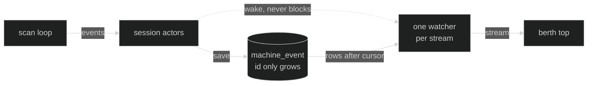

# M3: Live terminal view

Goal: `berth top` opens a full screen terminal view of every browser session that updates as browsers appear, change state and stop, without polling; it can inspect a session and stop one, with the same rules as `berth stop`.
Under it is `WatchSessions`, a server stream of session changes that a client resumes from the last event id it applied, so a dropped connection or a restarted `berthd` loses nothing, and a client that fell too far behind gets a fresh snapshot instead of an unbounded replay.
The maintainer was away when this plan was written and asked not to be blocked; every choice that is his to make is listed under [Decisions for the maintainer](#decisions-for-the-maintainer), with the default taken.

## What M2 left to build on

- Sessions are actors of the session machine (`internal/core/session`), and every transition is a row in `machine_event`, whose `id` is `INTEGER PRIMARY KEY AUTOINCREMENT`: it only grows and is never reused, even after a delete, so it is a durable cursor across `berthd` restarts.
- A browser that is found and stays steady writes **no** row today, because `Discovered` is the initial state; a stream built on the event table would never see it appear. M3 adds one event, `Seen`, for that.
- The facts about a session (kind, driver, owner, processes) live only in `berthd`'s memory and are rebuilt by every scan; the database holds only machine rows.
- `berth ps`, `inspect` and `stop` print every process chosen string through `shown` (in `internal/cli/sessions.go`), which quotes any string holding a control or format character with Go escapes.

## Design



The event table is the only queue.
A session actor that saves a transition only wakes the watchers (a non blocking send on a channel of size one each), and each watcher reads the rows after its own cursor from the database and sends them at its client's pace.
So a slow or stuck client holds one goroutine and at most one page of rows, never an actor, and never a growing buffer.

### The `Seen` event

- `Seen` is legal only in `Discovered` and leads back to `Discovered` with no effect: 18 legal pairs, up from 17.
- `discovery.Events` sends it on a session's first observation when the shell says the machine has no row yet (`Tracked.Unsaved`), before any other event of that scan; so every session has a row from first sight, and a session that already has rows (seen again after a restart) gets none. An M2 session that stayed steady in `Discovered` has no row, so after the upgrade it gets one `Seen` at its next first observation, which is harmless: it changes nothing and only records the session.
- The name is stored data from now on, like every state and event name.

### `WatchSessions`

`WatchSessions(after_event_id)` streams `WatchSessionsResponse`, which is either a **snapshot** or a **change**.

| Request | First message | Then |
|---|---|---|
| `after_event_id = 0` | Snapshot, reason `START` | Changes after the snapshot's `event_id` |
| `after_event_id` at most the newest event id, with at most 1,000 session events after it | None: the changes after it, in order | Live changes |
| `after_event_id` above the newest event id (another database, or one rebuilt) | Snapshot, reason `UNKNOWN_CURSOR` | Changes after it |
| More than 1,000 session events after `after_event_id`, at the start or at any point while the client was slow | Snapshot, reason `BEHIND` | Changes after it |

- A **change** is one session event row: its `event_id`, the event name (`Seen`, `Busy`, `Exited` and so on, fixed strings) and the `Session` with `state` and `state_since` taken from the row, and the other facts from what `berthd` holds in memory; for a session it no longer remembers (pruned after an hour, or seen only before a restart), the `Session` carries only `id`, `state` and `state_since`.
- A **snapshot** is every live session with the `event_id` it is consistent with; the client replaces everything it holds. `berthd` reads the newest event id first and the states second, so the states are never older than the cursor; a change after the cursor that the snapshot already shows is applied again, which is harmless because every change carries the whole new state.
- The client stores the `event_id` of the last message it applied, and reconnects with it.
- Event ids are global across machines, so a session stream's ids have gaps; the client never assumes consecutive ids.
- The stream ends cleanly (end of stream, no error) when `berthd` stops serving: `StopServing` closes every watcher before it shuts the HTTP servers down, so shutdown does not wait out its 5 second grace for open streams.
- At most 16 streams at once; the 17th gets `RESOURCE_EXHAUSTED` with a fixed message and no typed reason, since no client needs to branch on it.

### Backpressure and slow clients

- Actors never wait on a client: `Applied` only does a non blocking send of a wake to each watcher.
- A watcher that is blocked in `Send` (the client stopped reading and HTTP/2 flow control filled) holds its goroutine and the page of rows it is sending; nothing else accumulates for it.
- When it next reads, it reads at most 1,001 rows after its cursor; more than 1,000 means it is behind, and it sends one snapshot instead of the backlog.
- A stuck client is not cut off by a timer: the cost of keeping it is one goroutine, bounded by the 16 stream limit, and it ends when the client goes or `berthd` stops.

### The TUI: `berth top`

- `berth top` opens it; `berth` with no arguments still prints the usage and exits 2, so scripts that call `berth` by mistake never land in a full screen program.
- Built on Bubble Tea v2 (`charm.land/bubbletea/v2` v2.1.1, released 2026-10-28), the only new direct module. `go.mod` had no TUI library, and ADR 0001 puts the TUI in Go. Lip Gloss is left out: the view is plain text with a `>` marker on the selected row, so the golden tests compare plain strings and can assert that no ESC byte reaches the screen at all. `govulncheck` (pinned at v1.9.0) runs over the new modules in `make check`. One of them, `github.com/charmbracelet/ultraviolet`, has no release: it comes in at the pseudo version `v0.0.0-20261008173134-6b8d4baf91b4` that Bubble Tea v2.1.1 pins.
- `berth-proxy`, which holds secret values, links none of these modules: the JSON lines it exchanges with `berth` live in `internal/proxyctl`, not in `internal/cli`, and `TestBerthProxyLinksNoUIModules` runs `go list -deps` on it and fails on any `charm.land`, `charmbracelet` or `muesli` module.
- The model, update and view live in `internal/cli/top.go`, beside `shown` and the name helpers `ps` and `inspect` use, so the TUI prints exactly what the CLI prints. They take no terminal: tests feed messages to `Update` and compare `View` with fixed sessions, a fixed clock and a fixed size.

**Layout**, top to bottom: a header (how many sessions are live and stopped, and the stream's state: watching, or reconnecting with the error); the session list; a detail pane for the selected session; a key line and a status line.

| Column | From |
|---|---|
| ID | `id` |
| STATE | `state` |
| BROWSER | `kind` |
| DRIVER | `driver` |
| HEADLESS | `headless` |
| OWNER | `owner`, as `ps` prints it |
| AGE | now minus the browser's start time: seconds, minutes, hours, then days |

The detail pane shows what `inspect` shows at the top (executable, CDP, profile, arguments, owner), and after `i` the processes, the owner chain and the last 10 transitions from `InspectSession`.

| Key | Does |
|---|---|
| `up`, `down`, `k`, `j` | Move the selection |
| `i`, `enter` | Inspect the selected session (`InspectSession`); `esc` closes the inspection |
| `s` | Stop the selected session, after a confirmation line; `y` confirms, anything else cancels |
| `/` | Filter: typed text matches the id, state, browser, driver and owner, case insensitive; `enter` keeps it, `esc` clears it |
| `a` | Show or hide stopped sessions (like `ps --all`) |
| `q`, `ctrl+c` | Quit |

**Stop follows the M2 rules.** Another user's session is never offered a stop: `s` says why and sends nothing. A session owned by the person or an app is offered a forced stop, and the confirmation line says so (`stop 200-... ? it belongs to you; this is a forced stop. y to stop`); every other session gets a plain one. `StopSession` runs in the background with a fresh `request_id`, and the result lands in the status line; the state changes arrive through the stream like any other.

**Reconnecting.** When the stream ends or fails, the header shows `reconnecting` with the error, and the stream loop (`watchLoop`, beside the model) waits a second and calls `WatchSessions` again with the last `event_id` it delivered, which the model has applied or will apply next, since messages reach it in order; so it resumes, and a snapshot replaces its list.

**Only in a terminal.** `berth top` with a standard output that is not a terminal prints that it needs one, points at `berth ps`, and exits 2.

**Display safety.** Every process chosen string (executable paths, profile folders, owner names, event details, and the error text) goes through `shown` before it reaches the view, so it is quoted with escapes when it holds ESC, CR, LF, other C0 and C1 characters, DEL or bidi overrides; the filter text the person types goes through it too. Lines are cut to the terminal's width after escaping, so a cut can never split an escape sequence.

### Not on the agent surface

`WatchSessions` has no `(berth.agent)` option, for the same reasons as the M2 methods: it shows every browser on the Mac, the person's own and other agents' included, which ADR 0006 and ADR 0009 keep from an agent. M4 can add a stream scoped to the caller's own session with session tokens; adding one later is an addition, and taking this one away would break agents.

## Contract (proto additions)

```proto
service SessionsService {
  rpc WatchSessions(WatchSessionsRequest) returns (stream WatchSessionsResponse);
}
message WatchSessionsRequest {
  int64 after_event_id = 1; // gte 0; 0 starts with a snapshot
}
enum SnapshotReason { UNSPECIFIED, START, BEHIND, UNKNOWN_CURSOR }
message SessionsSnapshot { int64 event_id = 1; repeated Session sessions = 2; SnapshotReason reason = 3; }
message SessionChange { int64 event_id = 1; string event = 2; Session session = 3; }
message WatchSessionsResponse {
  oneof update { SessionsSnapshot snapshot = 1; SessionChange change = 2; }
}
```

- No `ErrorReason` is added, so M3 takes no enum number a parallel branch could also take.
- Port: `ports.EventLog` with `LastEventID` and `EventsAfter(kind, after, limit)`, implemented by `sqlite` (a range scan on the primary key, so no new index or migration) and the in memory test store.

## Work items

Each part ends with `make check` passing and its own commit.

| # | Part | Owns | Tests |
|---|---|---|---|
| 1 | Plan | `docs/plans/m3-live-terminal-view.md` | |
| 2 | `WatchSessions` | `proto/berth/v1/sessions.proto`, `gen/`, `internal/core/ports` (`EventLog`), `internal/adapters/sqlite`, `internal/testutil/store.go`, `internal/core/session` (`Seen`), `internal/core/discovery` (`Unsaved`), `internal/berthd/sessions.go`, `actors.go` (a saved hook), `berthd.go` (close watchers on stop), `internal/adapters/api/sessions.go` | Below |
| 3 | The TUI | `internal/cli/top.go`, `cli.go` (the `top` command and usage), `go.mod`, `go.sum`, `test/e2e/top_test.go` | Below |
| 4 | Docs | `ARCHITECTURE.md` | |

**`WatchSessions` tests** (`internal/berthd`, `internal/adapters/api`, `internal/adapters/sqlite`, `internal/core/session`, `internal/core/discovery`):

- `machinetest.Walk` pinned at 18; `Seen` is legal only in `Discovered`.
- First observation of an unsaved session sends `Seen` before `OwnerExited`; a saved one sends nothing new.
- A fresh stream starts with a `START` snapshot of the live sessions, then a change for a browser that appears and for its stop.
- **Resume after disconnect:** a client that cancels its stream and reconnects with its last `event_id` gets exactly the changes it missed, in order, and no snapshot.
- **Reset when behind:** with the backlog limit lowered, a cursor with more session events after it than the limit gets a `BEHIND` snapshot; a cursor above the newest id gets `UNKNOWN_CURSOR`.
- **A slow client does not block the actors:** a watcher whose `send` blocks while 50 browsers come and go; every scan finishes, every transition is saved, and when the client reads again it gets a `BEHIND` snapshot.
- **Stream end on daemon stop:** closing the watchers ends an open stream with no error; the end to end test sends SIGTERM to a real `berthd` with a stream open and sees the stream end within 3 seconds and `berthd` exit 0.
- At most 16 streams; validation refuses a negative cursor; the agent socket refuses `WatchSessions` by name.
- `EventsAfter` and `LastEventID` against real SQLite, including ids that skip other machines' rows.

**TUI tests** (`internal/cli/top_test.go`, `test/e2e/top_test.go`):

- Golden views of a fixed set of sessions at a fixed time and size: the list, the detail pane, the inspection, the confirmation line for a plain stop and for a forced one, the refusal for another user's session, the filter.
- An injection payload (ESC sequences, CR, LF, BEL, DEL, U+202E, U+0085) in the owner name, profile folder and executable renders escaped, and no ESC byte appears anywhere in the view.
- Snapshot replaces, change upserts, stopped sessions hide until `a`; the stream ending schedules a resume with the last `event_id`.
- Stop sends `force` only for the person's or an app's session, never calls `StopSession` for another user's, and needs `y`.
- **End to end:** the real `berthd` and a real headless Chromium (M2's `findChrome` and skip rules): the TUI model, fed only by `WatchSessions` through the real client, shows the session appear; pressing `s` then `y` stops it through `StopSession`, and the model shows it `stopped`.

## Exit gate

`make check` passes with the new tests, and the e2e TUI test runs (or skips with the reason when no Chromium is found); the maintainer runs `berth top` on his Mac with a Playwright browser open, watches it appear and stops it from the TUI; the agent safety checklist is walked for M3; `ARCHITECTURE.md` marks M3 done.

## Honest limits

- **Only transitions stream.** Facts that change without a transition (a helper process starting, so `process_count` grows) reach the TUI only with the next change of that session or a snapshot; `i` reads them fresh.
- **`Seen` adds one row per browser ever seen,** on top of M2's rows, until the pruning pass M2 deferred. That pass must also keep resume honest: a cursor older than the oldest kept row must get a `BEHIND` snapshot, which `EventsAfter` alone cannot tell; the pruning item adds that check.
- **A session's history before a restart has no facts.** A change replayed for a session `berthd` no longer remembers carries only its id and state, so the TUI shows it with unknown browser and owner.
- **`state_since` in a snapshot comes from memory,** which can trail the database by one transition for a few microseconds; the next change corrects it.
- **Widths are counted in runes,** so a line holding East Asian wide characters can overflow the terminal by a few cells.
- **No colour.** The selected row is marked with `>`, not highlighted; the brand palette can come with the Mac app's pass.
- **Anything that can reach the owner socket can watch,** as with `ListSessions`: the daemon cannot tell an agent running as the person from the person, and session tokens (E3 item 4) guard only the agent socket, where `WatchSessions` is not served.
- **Any client on the owner socket can hold all 16 streams,** and then `berth top` gets `RESOURCE_EXHAUSTED` until one closes; the limit is per daemon, not per caller.
- **A snapshot reads one row per live session,** never the whole history, so `START` and `BEHIND` cost the same however many browsers came and went.

## Decisions for the maintainer

Defaults taken while he was away; each is cheap to reverse before M3 closes.

1. **`berth top`, not bare `berth`.** Bare `berth` keeps printing the usage, so nothing that calls it by mistake opens a full screen program.
2. **Bubble Tea v2 alone,** no Lip Gloss and no Bubbles: the fewest modules, and plain text goldens. The cost is no colour and hand written layout.
3. **A new `Seen` event** gives every session a row at first sight, so the stream can be built on the event table alone; the alternative, an in memory event log with its own sequence, would lose resume across a restart.
4. **Backlog limit 1,000 session events,** after which a client gets a snapshot; **at most 16 streams**.
5. **No typed reason for too many streams,** so M3 adds no `ErrorReason` value.
6. **Stuck clients are not cut off:** they cost one goroutine each, within the 16 stream limit.
7. **Not on the agent surface,** like every M2 method.
8. **The TUI asks before every stop,** and offers a forced stop for the person's and apps' browsers in the same confirmation, naming it as forced, instead of a separate key.

## Exit notes (2026-11-17)

Built on branch `m3`, rebased onto `main` at 3bf6db5: the plan, `WatchSessions` and `berth top`, each with its own commit, then `ARCHITECTURE.md`, with `make check` passing.

- **Contract.** As planned; no `ErrorReason` added. `buf breaking` is clean against `main`.
- **`Seen`** makes the session machine 18 legal pairs; `discovery.Tracked.Unsaved` is set by the shell when `LoadState` finds no row.
- **Streams** live in `internal/berthd/sessions.go`; the actors kit gained a `saved` hook that the session actors use to wake the watchers. M2's review moved the stop of a session's actor into the kit (`final`), and the hook runs before it.
- **`berth top`** lives in `internal/cli/top.go`; the stream loop is `watchLoop`, and `NewTop` is exported for the end to end test, which drives the model the way Bubble Tea does, without a terminal.
- **Verified by hand** in a pseudo terminal against a temporary `berthd`: `berth top` opens on the alternate screen, shows the empty list, and `q` exits 0. A populated list in a real terminal is covered only by the end to end test, which reads the model's view.

What remains for the exit gate: the maintainer runs `berth top` on his Mac with a Playwright browser open, watches it appear and stops it from the TUI; `ARCHITECTURE.md` marks M3 done after that.

### Agent safety checklist (M3)

1. No agent method was added; `WatchSessions` has no `(berth.agent)` option, and the agent socket end to end test now names it among the refused methods.
2. No secret value is touched: a stream message carries the same `Session` facts as `ListSessions` and the fixed event names.
3. Canary: the TUI end to end test plants one in the browser's arguments and checks the inspected view never shows it; M2's canary test still covers `ps`, `inspect`, the log and the database.
4. No power action was added; stop from the TUI follows `berth stop`'s rules.
5. Process chosen text (paths, profile folders, owner names) and error text are quoted with escapes in the TUI, as in the CLI; `TestTopEscapesProcessChosenText` plants ESC, CR, LF, BEL, DEL, U+202E and U+0085 and checks no ESC byte reaches the view.
6. `WatchSessions` is read only; stop from the TUI sends a fresh `request_id`.
7. A stream that falls behind gets a typed `BEHIND` snapshot, an unknown cursor `UNKNOWN_CURSOR`, too many streams `RESOURCE_EXHAUSTED`; a TUI whose stream ends shows `reconnecting` with the error and resumes.
8. OWASP agentic risks: unchanged; the new limits are listed above.
