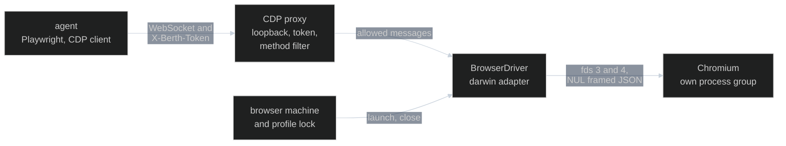
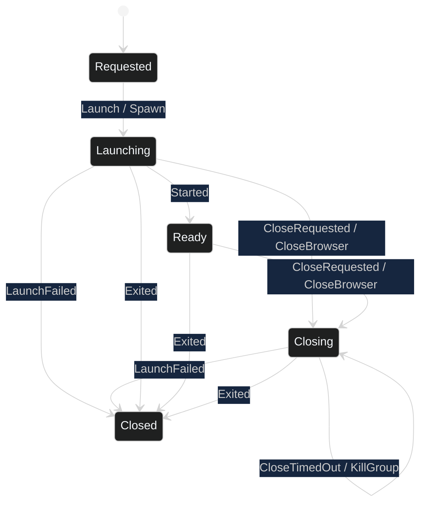

# M4: Managed Chromium

Goal: `berthd` launches Chromium itself, over a private CDP pipe and on a profile folder Berth owns, so no debugging port ever exists; one live browser per profile; and an agent reaches that browser only through a loopback CDP proxy that needs a per browser token and refuses the methods that reach beyond the agent's own session ([ADR 0009](../adr/0009-cdp-proxy-refuses-cross-session-methods-from-day-one.md)).
This is the base that E3 item 8 (browser brokering), M5 (live view and takeover) and M6 (the atomic fill) build on.
The maintainer was away when this plan was written and asked not to be blocked; every choice that is his to make is listed under [Decisions for the maintainer](#decisions-for-the-maintainer), with the default taken.

## What earlier milestones left to build on

- **M0 proof 2** ([ADR 0015](../adr/0015-m0-spike-results.md), code under the tag `m0-spike`): Chrome over `--remote-debugging-pipe` in its own process group; a Go proxy on loopback gated by an `X-Berth-Token` header; Playwright MCP 0.0.85 drove it with `--cdp-endpoint` and `--cdp-header`; Berth's own calls used ids from 1,000,000,000 on the same pipe; tokens must never travel as command line flags.
- **M2** sees every browser on the Mac as an observed session (`session/<pid>-<start µs>`), parses `--user-data-dir` and `--remote-debugging-pipe` from its arguments, and stops one by its process instance. A browser Berth launches shows up there too, with its owner chain running through `berthd`.
- **E3 item 4** (branch `e3b`, about to merge): agent sessions with a token in the `berth-agent-token` header, bound to the agent uid and the process tree of the first caller; `api.AgentSession(ctx)` names the caller's session on the agent socket. M4's agent methods are scoped by it.
- `go.mod` has no WebSocket and no CDP library. The spike used `github.com/coder/websocket` v1.8.15.

### Checked on this Mac (2026-11-17)

| Browser | Answers over the pipe | Exits when the pipe closes |
|---|---|---|
| Playwright `chrome-headless-shell` 1248 (HeadlessChrome 156) | Yes, `Browser.getVersion` and `Target.createTarget` in under 100 ms | Yes, about 13 ms after EOF |
| Puppeteer Chrome for Testing 154 | Yes, after about 1.5 s on a fresh profile | **No**: still running 5 s after EOF |

So a `berthd` that crashes can leave a Chrome for Testing running on a Berth profile; boot recovery must find and stop it (item 5).

## Design



### The BrowserDriver port and its darwin adapter

- **Port** (`internal/core/ports/browser.go`, stdlib only): `BrowserDriver.Launch(ctx, BrowserLaunch) (BrowserConn, error)`, with `BrowserLaunch{Executable, ProfileDir, Headless}`.
  `BrowserConn` is one running browser and its pipe: `Process() ProcessRef`, `Call(ctx, sessionID, method, params)` on Berth's own id range, `Send(raw)` for a message from the proxy, `Sink(func(raw))` for every message that is not a reply to Berth (one sink at a time; with none, messages are dropped so Chrome never blocks), `Done()`, and `Kill()` (SIGKILL to the process group).
- **Adapter** `internal/adapters/cdppipe`: starts the executable with `--remote-debugging-pipe`, `--user-data-dir=<profile>`, `--no-first-run`, `--no-default-browser-check`, `--disable-background-networking`, `--headless=new` when asked, and `about:blank`; the pipe ends on fds 3 (Chrome reads) and 4 (Chrome writes); `Setpgid` puts Chrome in its own process group; the environment is the minimum (`HOME`, `PATH`, `TMPDIR`), so nothing from `berthd`'s environment reaches the browser.
  No `--remote-debugging-port` is ever passed, and the adapter refuses extra arguments: the launch has no field for them.
- **Framing**: one JSON object per message, ended by a NUL byte, in both directions. Messages over 64 MiB end the connection.
- **Ids**: Berth's own calls use ids from 1,000,000,000; replies to them never reach the sink. The proxy refuses an agent message whose id is 1,000,000,000 or more.
- **No CDP library.** A pipe client is about 200 lines (framing, an id table, one reader goroutine); `chromedp` or `go-rod` would bring thousands of generated lines and their own launchers, which would fight the pipe and profile rules.
- **Executable**: a launch names a Chromium family executable or lets `berthd` pick one. A named executable must classify with M2's `browsersig` as Chrome, Chrome for Testing, Chromium or a headless shell, so the owner socket cannot be used to run an arbitrary program through `berthd`. With none named, `berthd` takes the first that exists: its `-browser` flag, Chrome for Testing under `~/.cache/puppeteer`, Playwright's Chromium, then `/Applications/Google Chrome for Testing.app`, `/Applications/Chromium.app`, `/Applications/Google Chrome.app`. Only the binary is shared with the person's Chrome; the profile never is.

### The managed browser machine

A new machine, **linked** to M2's observed sessions rather than grown into them: entity `browser/<id>` (16 lowercase hex characters), kind `browser`.
The observed session of the same process is found by its `<pid>-<start µs>` id, which the browser's facts carry as `session_id`.

Why a second machine instead of `Launching`, `Ready` and `Failed` in the session machine: the session machine starts in `Discovered` and every one of its events is a scan observation, while a launch starts from a request, and its events come from the pipe; one table for both would make every scan event legal in launch states (or the reverse) and blur two sets of stored names.
The scan still sees the browser and keeps doing its job (activity, exit, `berth stop`); both machines reach their end when the process exits.



- 10 legal pairs, pinned by `machinetest.Walk`.
- `Requested` is never stored: the first saved transition is `Launch`, so the row exists, in `Launching`, before any process starts (persist before acting).
- `Spawn` starts the browser through the driver, waits up to 30 seconds for `Browser.getVersion` over the pipe, and returns `Started` with the product name, or kills the process group and returns `LaunchFailed` with a fixed note.
- A `CloseRequested` that arrives while `Spawn` runs is applied before `Started`, so `Launching` accepts it and `Started` in `Closing` is ignored; a `LaunchFailed` in `Closing` ends it.
- `CloseBrowser` sends `Browser.close` over the pipe and starts a 5 second timer, whose `CloseTimedOut` makes `KillGroup` kill the process group.
- `Exited` comes when the pipe reaches EOF and the process has been reaped, and at boot for every live row (`gone at boot`).
- `Closed` is the only final state, so the actors kit's single `final` applies unchanged; why a browser closed is in the event that got it there (`LaunchFailed`, `Exited` or `CloseRequested`).
- Facts (profile, executable, process, endpoint, product) live in `berthd`'s memory beside the actor, as for sessions: no new table and no migration.

### Profile locks

One live browser per profile, enforced by `berthd` and not by a second machine: a profile is held exactly while a browser naming it is in `Launching`, `Ready` or `Closing`, so the lock is that browser's state, and a separate lock machine would be a second field meaning the same thing.

- Profiles are folders `$BERTH_HOME/profiles/<name>`, mode `0700`, with names matching `^[a-z0-9][a-z0-9._-]{0,63}$`; `berthd` creates them and never takes a path from a caller, so the person's own Chrome profile can never be named.
- A launch takes the lock under one mutex before the `Launch` event, and the lock is released when the browser reaches `Closed`; a launch on a held profile answers `ERROR_REASON_PROFILE_BUSY` with the holding browser's id.
- A launch also refuses a profile that any observed M2 session uses as its `user_data_dir` (a Chrome someone started on it outside Berth), with the same reason.
- "Who waits for it" is not built: a second launch is refused, not queued. M5's takeover may add a wait.

### Boot and shutdown

- **Stop on shutdown:** `StopServing` sends `CloseRequested` to every live browser and waits up to 5 seconds, then kills the process groups that remain (the spike's lesson for launchd's SIGTERM).
- **Boot:** every `browser/<id>` row in a live state gets `Exited` with `gone at boot`. Then every observed session whose `user_data_dir` is under `$BERTH_HOME/profiles` is a browser a previous `berthd` launched and lost (Chrome for Testing outlives its pipe); `berthd` stops it through the session machine, as `berth stop --force` would.

### The token gated CDP proxy

One loopback listener per ready browser, on `127.0.0.1:0`, started by `Spawn` once `Browser.getVersion` answered and closed when the browser reaches `Closed`.

- **Endpoint:** `http://127.0.0.1:<port>`; `GET /json/version` (and `/json/version/`) returns `Browser`, `Protocol-Version` and `webSocketDebuggerUrl` = `ws://127.0.0.1:<port>/devtools/browser/<id>`, which is what Playwright's `connectOverCDP` and Puppeteer's `connect` read. Nothing else is served (`/json/list`, `/json/new` and the rest answer 404), so no target ids leak through HTTP.
- **Token:** 32 random bytes, hex, minted per browser at launch; `berthd` keeps only its SHA-256 and compares in constant time. It travels only in the `X-Berth-Token` request header, never in the URL: a web page can open a WebSocket to loopback but cannot set a header, so the header alone also defeats cross site WebSocket and DNS rebinding attacks; and a URL ends up in logs and in process arguments. A request with an `Origin` header is refused too, since no CDP library sends one.
- **One connection at a time** per browser; a second WebSocket gets HTTP 409 while the first is open. The proxy owns the agent side of the shared pipe, so one connection keeps the id spaces simple (agent ids below 1,000,000,000, Berth's above).
- **Filter** (`internal/core/cdppolicy`, pure, stdlib only): every agent message must be a JSON object with an integer `id` and a string `method`; anything else closes the connection. A refused message gets a CDP error reply with the same `id` (code -32000, `refused by Berth: <method>`) and never reaches Chrome. Unknown domains are refused (fail closed), and every method that passes or is refused is counted, never logged with its parameters.
- **Berth's own sessions:** the pipe records the `sessionId` of every target Berth itself attaches to (none in M4; M5's screencast and M6's fill will), and the proxy refuses any agent message that carries one, or names one in `Target.detachFromTarget` or `Target.sendMessageToTarget`, and drops every event and reply that carries one, so the agent can neither see nor drive Berth's sessions.

**Allowed domains** (every method, unless the deny list below names it): `Accessibility`, `Animation`, `Audits`, `BackgroundService`, `Browser`, `CSS`, `CacheStorage`, `Console`, `DOM`, `DOMDebugger`, `DOMSnapshot`, `DOMStorage`, `Database`, `Debugger`, `DeviceAccess`, `DeviceOrientation`, `Emulation`, `EventBreakpoints`, `FedCm`, `Fetch`, `FileSystem`, `HeadlessExperimental`, `HeapProfiler`, `IO`, `IndexedDB`, `Input`, `Inspector`, `LayerTree`, `Log`, `Media`, `Memory`, `Network`, `Overlay`, `Page`, `Performance`, `PerformanceTimeline`, `Preload`, `Profiler`, `Runtime`, `Schema`, `Security`, `ServiceWorker`, `Storage`, `Target`, `Tracing`, `WebAudio`, `WebAuthn`.

**Denied**, each because it reaches outside the agent's own session or its browser:

| Method or domain | Why |
|---|---|
| `Browser.close`, `Browser.crash`, `Browser.crashGpuProcess` | The browser's life belongs to Berth (and to other users of it in M5); the agent ends its session through Berth |
| `Browser.setDownloadBehavior`, `Page.setDownloadBehavior` unless `behavior` is `deny` or `default` | Writes files to any path the agent names, outside the profile; E3 item 8 may allow a workspace folder |
| `Browser.getBrowserCommandLine` | Shows Berth's launch flags and profile path |
| `Browser.executeBrowserCommand` | Runs browser UI commands outside any page |
| `SystemInfo.*` | Machine facts: GPU, hardware, and the browser's process list with pids |
| `Target.exposeDevToolsProtocol` | Hands CDP to page JavaScript, so a web page could drive the browser |
| `Target.setRemoteLocations` | Makes the browser connect out to other debugging targets |
| `Target.attachToTarget`, `Target.detachFromTarget`, `Target.sendMessageToTarget` naming a Berth session or target | Cross session: Berth's own live view and fill sessions |
| `Tethering.*` | Binds TCP ports on the Mac |
| `Extensions.*` | Loads code from disk into the browser |
| `PWA.*` | Installs and launches apps outside the browser |
| `Cast.*` | Talks to cast devices on the network |
| `Autofill.*` | Triggers autofill, which M6 must own |
| Any domain not in the allowed list | Fail closed; new Chrome domains are reviewed before they pass |

Methods that read the profile (`Network.getCookies`, `Storage.getCookies`, `Runtime.evaluate`, screenshots) are allowed on purpose: the agent already holds everything in its own profile through `Runtime.evaluate`, so refusing them would only look safe (see the honest limits).

### How agents get the endpoint

Agents never get the pipe, the profile path or a debugging port: only the proxy endpoint and its token (E3 item 8).

| Method | Agent surface | Why |
|---|---|---|
| `LaunchBrowser`, `ListBrowsers`, `CloseBrowser` | **No** | They name any profile and see or close every managed browser, including other agents' and the person's logged in profiles |
| `OpenAgentBrowser` (planned, item 7) | **Yes** | Launches, or returns, the one browser of the caller's agent session (from `api.AgentSession(ctx)`), on an ephemeral profile `agent-<session id>`, and returns its endpoint and a fresh token once; the token is never kept in the request log |
| `CloseAgentBrowser` (planned, item 7) | **Yes** | Closes only the caller's own browser; another session's id answers `BROWSER_NOT_FOUND`, so ids cannot be probed |

- A token minted by `OpenAgentBrowser` dies with the browser, and the browser closes when its agent session ends (`Revoked`, `Expired` or `Ended`).
- `LaunchBrowserResponse.cdp_token` is set only in the first reply, like `CreateAgentSession`'s token: the request log keeps the reply without it, so a retry gets the browser but no token.
- Persistent named profiles for agents wait for M6's hard limits per profile.

### berth-mcp (planned, item 8)

A thin Go MCP server over stdio for agents without a shell, reaching the agent socket with the session token it reads from `BERTH_AGENT_TOKEN_FILE`, so the token never enters the model's context.

- It exposes exactly the methods marked `(berth.v1.agent) = true`, read from the schema at build time, and a test fails when the tool list and `TestAgentSurface` disagree.
- Tools: `secret_request`, `secret_list`, `browser_open`, `browser_close`; `browser_open` returns the endpoint and writes the token to a `0600` file whose path it returns, so an agent can hand both to Playwright MCP (`--cdp-endpoint`, `--cdp-header`) without the token in its context or in a command line.
- No secret value or token appears in a tool result; tool definitions are fixed strings, pinned by a golden test (the MCP security guidance on pinned tool definitions).

### Live view and takeover hooks for M5 (planned)

- The pipe's own sessions (`Call` with a `sessionID`) are what M5's screencast uses: `Target.attachToTarget` with `flatten`, then `Page.startScreencast` on Berth's id range, invisible to the agent through the session filter above.
- Takeover pauses the agent: the proxy holds the agent's messages in a bounded queue (the same hold M6's atomic fill needs, [ADR 0008](../adr/0008-atomic-fill-with-the-agent-paused.md)), while the person's input goes through `Input.dispatch*` on Berth's session; release replays the queue in order. M5 adds a `Control` machine (`Agent`, `Person`, `Paused`) for that, not a flag.
- The browser machine gains no states for M5: control is a separate machine per browser.

## Contract (proto additions)

New file `proto/berth/v1/browsers.proto` and three values appended to `ErrorReason`; nothing existing changes.

```proto
service BrowsersService {
  rpc LaunchBrowser(LaunchBrowserRequest) returns (LaunchBrowserResponse);
  rpc ListBrowsers(ListBrowsersRequest) returns (ListBrowsersResponse);
  rpc CloseBrowser(CloseBrowserRequest) returns (CloseBrowserResponse);
}
enum BrowserState { UNSPECIFIED, LAUNCHING, READY, CLOSING, CLOSED }
message ManagedBrowser {
  string id; string profile; BrowserState state; string session_id; string executable;
  bool headless; string product; string cdp_endpoint; google.protobuf.Timestamp state_since;
  string close_reason;
}
message LaunchBrowserRequest { string request_id; string profile; bool headless; string executable; }
message LaunchBrowserResponse { ManagedBrowser browser; string cdp_token; }
message ListBrowsersRequest { bool include_closed; }
message ListBrowsersResponse { repeated ManagedBrowser browsers; }
message CloseBrowserRequest { string request_id; string id; }
message CloseBrowserResponse { ManagedBrowser browser; }
// ErrorReason
ERROR_REASON_PROFILE_BUSY = 19;
ERROR_REASON_BROWSER_NOT_FOUND = 20;
ERROR_REASON_BROWSER_LAUNCH_FAILED = 21;
```

- E3 item 4 takes 16 to 18, so M4 starts at 19, whichever lands first.
- Validation: `profile` matches the name rule above; `id` is 16 lowercase hex; `executable` is empty or an absolute path of at most 1,024 bytes; `request_id` 8 to 128 characters.
- `CloseBrowser` of a `Closed` browser answers its state, not an error; it waits up to 10 seconds for `Closed`.

## Work items

Each item ends with `make check` passing and its own commit.

| # | Item | Depends on | Owns | Tests |
|---|---|---|---|---|
| 1 | Plan | | this file | |
| 2 | Contract | 1 | `proto/berth/v1/browsers.proto`, `options.proto` reasons, `gen/`, `internal/core/ports/browser.go` | `buf breaking` clean; `TestAgentSurface` unchanged |
| 3 | Darwin driver and pipe client | 2 | `internal/adapters/cdppipe/` | Framing and id routing against a fake Chrome on two pipes; against a real headless Chromium (skips without one): launch, `Browser.getVersion`, `Target.createTarget` with a `data:` URL, the title read back, `Kill` ends the whole process group |
| 4 | Browser machine | 2 | `internal/core/browser/` | `machinetest.Walk` pinned at 10; launch, fail, close during launch, close then kill |
| 5 | Daemon wiring, profile locks, RPCs and CLI | 3, 4 | `internal/berthd/managed.go`, `berthd.go`, `internal/adapters/api/browsers.go`, `internal/client/`, `internal/cli/browser.go` | A fake driver: launch to ready, profile busy, a refused executable, close, close while launching, exit, boot recovery, shutdown closes all; `connectinprocess`: validation, typed reasons, the token only in the first reply |
| 6 | CDP proxy | 3, 5 | `internal/core/cdppolicy/`, `internal/adapters/cdpproxy/`, `go.mod` (`github.com/coder/websocket`) | Policy table for every allowed and denied row; the proxy: no token 401, wrong token 401, `Origin` 403, second connection 409, a refused method answered by the proxy and never sent to Chrome, an allowed one passed, a Berth session id refused |
| 7 | Agent methods | 5, E3 item 4 | `OpenAgentBrowser`, `CloseAgentBrowser`, `TestAgentSurface` | Scoped to the caller's session; another session's browser is `BROWSER_NOT_FOUND`; the browser closes when the session ends |
| 8 | `berth-mcp` | 7 | `cmd/berth-mcp`, `internal/mcp` | Tool list equals the agent surface; golden tool definitions; no token in any result |
| 9 | End to end and docs | 5, 6 | `test/e2e/browser_test.go`, `ARCHITECTURE.md` | Below |

Items 3 and 4 can run in parallel after the contract; 5 joins them; 6 needs 5's wiring; 7 waits for E3 item 4 on `main`; 8 for 7.

**End to end** (`test/e2e/browser_test.go`), with M2's `findChrome` and skip rules (headless shell first, nothing installed):

- `berth browser launch e2e --headless` through the real `berthd` prints the browser id, the endpoint and the token; `berth browser ls` shows it `ready`, and `berth ps` shows its observed session with `CDP pipe` and the Berth profile folder.
- A real WebSocket client through the proxy with the token: `Target.createTarget`, `Target.attachToTarget` with `flatten`, `Page.navigate` to a `data:` URL with a `<title>`, `Runtime.evaluate` of `document.title`, and the title matches.
- The same connection sends `SystemInfo.getInfo` and `Browser.close` and gets the proxy's refusal, and the browser is still `ready` afterwards; no token gets 401.
- A second launch on the same profile fails with `PROFILE_BUSY`; `berth browser close` ends it, the browser is `closed`, its process group is gone, and the profile can be launched again.
- The token appears in no `berthd` log line and no database byte.
- Tests kill only the pids they started.

## Exit gate

`make check` passes with the new tests (the e2e browser tests run, or skip with the reason when no Chromium is found); the maintainer launches a browser with `berth browser launch`, connects Playwright MCP to the endpoint with `--cdp-header`, drives a page, and sees a denied method refused; items 7 and 8 are built once E3 item 4 is on `main`; the agent safety checklist is walked for M4; `ARCHITECTURE.md` marks M4 done.

## Honest limits

- **Anything with CDP access can read everything in that browser profile.** `Runtime.evaluate` reads every page, cookies and storage; `Network.getCookies` reads them directly; a screenshot shows the screen. The filter keeps an agent inside its own session and its own browser, never safe from itself: whatever is logged in on its profile is the agent's. That is why agents get ephemeral profiles and why M6 puts credentials behind the atomic fill.
- **The token is a bearer secret** in whatever process the agent hands it to (Playwright MCP's flags or environment). It works only on loopback, only for that browser, and dies when the browser closes; until E3, a same user process can read it from that process's environment, and from a command line if the agent passes it as `--cdp-header`.
- **The filter is by method name and a few parameters,** not by effect. Domains Chrome adds later are refused until reviewed, but an allowed method that gains a dangerous parameter passes until the policy learns it.
- **One CDP connection at a time.** Two agents (or an agent and a DevTools window) cannot share a browser; M5's takeover goes through Berth's own pipe session, not a second proxy connection.
- **The proxy parses agent controlled input inside `berthd`:** WebSocket frames (`coder/websocket`) and JSON (`encoding/json`), only after the token check. A bug there is a bug in `berthd`; see decision 3.
- **Chrome for Testing outlives a crashed `berthd`** until the next boot finds it by its profile folder and stops it; a browser that someone moves out of `$BERTH_HOME/profiles` escapes that.
- **The executable is trusted by path and bundle name** (`browsersig`), not by code signature; anything the person can write at a matching path is launched. Pinning Chrome for Testing by its signature waits for a release.
- **No site allowlist yet.** The agent can navigate anywhere; per profile site limits are M6.

## Decisions for the maintainer

Defaults taken while he was away; each is cheap to reverse before M4 closes.

1. **A second machine, `browser`, linked to M2's sessions** by `<pid>-<start µs>`, instead of `Launching`, `Ready` and `Failed` in the session machine. The architecture's planned machines list said "Session (grows)"; this changes that.
2. **Profile locks are the browser machine's state,** not a lock machine: one mutex at launch, released at `Closed`, plus a refusal when an observed session already uses the profile. No waiting queue.
3. **The CDP proxy runs inside `berthd`,** because `berthd` owns the pipe. The alternative is a separate signed `berth-cdp` process that holds the pipe and parses agent traffic, like `berth-proxy`; M6's fill types a secret value over that pipe, which invariant 7 forbids inside `berthd`, so M6 likely needs that move anyway. Taking it now would double M4.
4. **`github.com/coder/websocket` v1.8.15** for the WebSocket server and the e2e client: no dependencies of its own, spike proven with Playwright MCP, and a hand written RFC 6455 server would be the riskier code in `berthd`. No CDP library.
5. **The token only in a header** (`X-Berth-Token`, the spike's name), never in the URL path, and requests with `Origin` refused.
6. **One proxy connection per browser.**
7. **Cookie and storage reads are allowed** (see the honest limits); only cross session and outside the browser methods are refused, and unknown domains fail closed.
8. **Profiles live under `$BERTH_HOME/profiles/<name>`** and are kept after a close, so a profile can hold logins across launches; agent profiles (item 7) are ephemeral and deleted at close.
9. **Executable choice:** the `-browser` flag, then Chrome for Testing, Playwright's Chromium, then the apps in `/Applications`; a named executable must classify as a Chromium family browser.
10. **Error reasons 19 to 21,** after E3 item 4's 16 to 18.
11. **No Touch ID to launch or close** a managed browser: it starts a fresh process on a Berth profile and touches nothing of the person's.
