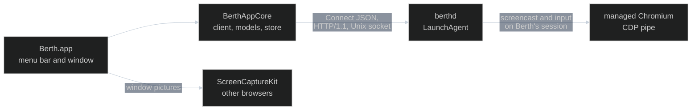
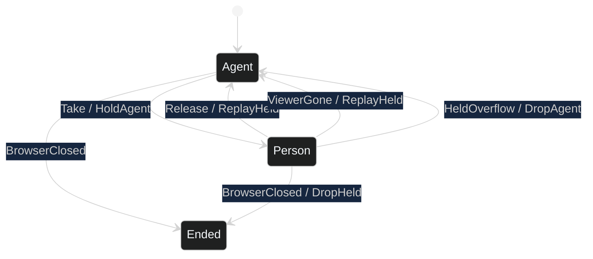

# M5: Mac app

Goal: `Berth.app`, a SwiftUI menu bar item and one window, shows every browser session live from `WatchSessions`, registers `berthd` as a login item, tells the person when Berth needs them, shows a live view of a managed browser and lets the person take it over while the agent waits, and shows a picture of the window of a browser Berth does not manage.
Agent browsers may then run headful, since the person can now see and take over what the agent drives.
The maintainer was away when this plan was written and asked not to be blocked; every choice that is his to make is listed under [Decisions for the maintainer](#decisions-for-the-maintainer), with the default taken, and everything that needs his hands is under [Manual checks](#manual-checks).

## What earlier milestones left to build on

- **M0 proofs 1, 3 and 5** ([ADR 0015](../adr/0015-m0-spike-results.md), code under the tag `m0-spike`): Swift streamed from the Go Connect server over the Unix socket; a SwiftUI window showed Chrome screencast frames at 60 fps with a one frame buffer per watcher, acking each frame before decoding it; ScreenCaptureKit captured a Chrome window by process ID from a signed bundle, and Screen Recording belongs to `Berth.app` (`com.wesleybldc.berth`) only.
- **`berth-native`** already speaks Connect JSON over HTTP/1.1 on a raw Unix socket and checks by the peer's audit token that the signed `berthd` answers before it writes a byte (`native/Sources/BerthNativeCore/Socket.swift`, `Redeem.swift`). That code passed the maintainer's manual check in E2a.
- **M3** gives `WatchSessions`: a snapshot or one change per message, each with the `machine_event` id it is consistent with, resumable after that id across a `berthd` restart; `berth top` folds it in with `apply` and prints every process chosen string through `shown` (`strconv.QuoteToGraphic` when a string holds a control or format character).
- **M4** gives managed browsers over a private CDP pipe (`internal/adapters/cdppipe`), Berth's own CDP sessions on its own id range that the agent's proxy connection never sees, and the M5 hooks: `Page.startScreencast` on a Berth session, takeover through `Input.dispatch*` on Berth's session while the proxy holds the agent's messages, a `Control` machine separate from the browser machine. Agent browsers are headless only until M5.
- **Signing** (`scripts/sign.sh`): the Personal Team `XPJ7XA42J4`, hardened runtime, one stable identifier per binary; `berthd` trusts `berth`, `berth-native` and `berth-proxy` found beside its own executable (`paths.Beside`) by team, identifier and cdhash.
- macOS 26 and later only ([ADR 0010](../adr/0010-macos-26-and-later-only.md)), so `MenuBarExtra`, `Window`, `@Observable`, `SMAppService` and ScreenCaptureKit's screenshot API need no availability checks.

## Design



### App shape

- **A separate Swift package, `macos/`**, beside `native/`, built with SwiftPM and no Xcode project. Targets: `BerthAppCore` (a library: the `berthd` client, the JSON models, the session store, the watch loop, `shown`), `BerthApp` (the executable `Berth`: SwiftUI scenes only), `berth-app-probe` (a command line tool the end to end tests run, never bundled) and `BerthAppCoreTests` (Swift Testing).
- **Shared socket code**: `native/` gains a library target `BerthSocket` holding `UnixSocket`, `checkPeer`, `berthDaemonRequirement` and `socketPath`, moved out of `BerthNativeCore`; both `berth-native` and the app import it. Nothing else of `native/` reaches the app.
- **No secrets in the app.** `Berth.app` never asks for, holds or shows a secret value, and links no Keychain code: the bundle check fails if the `Berth` executable imports any `SecItem`, `SecKeychain` or `SecAccess` symbol. The only Security framework calls are the code signing checks (`SecCodeCopyGuestWithAttributes`, `SecCodeCheckValidity`).
- **SwiftUI**: a `MenuBarExtra` whose label is the brand's template image and the number of live sessions, with a menu that names the counts (active, idle, leftovers), the connection state, "Open Berth" and "Quit"; and one `Window` with the session list. The app is an accessory (`LSUIElement`), so it has no Dock icon; opening the window activates it.
- **Bundle layout**, assembled and signed by `scripts/build-app.sh`:

| Path in `Berth.app/Contents` | Holds | Signed as |
|---|---|---|
| `MacOS/Berth` | The app | `com.wesleybldc.berth` (the bundle) |
| `MacOS/berthd`, `MacOS/berth`, `MacOS/berth-native`, `MacOS/berth-proxy` | The daemon, the CLI, the helper and the proxy, beside each other so `paths.Beside` and every pin work unchanged | Their own identifiers, signed before the bundle |
| `Library/LaunchAgents/com.wesleybldc.berth.daemon.plist` | The login item `SMAppService.agent` registers: `BundleProgram` `Contents/MacOS/berthd`, `RunAtLoad`, `KeepAlive` on unsuccessful exit | Sealed by the bundle signature |
| `Resources/AppIcon.icns` | `brand/app-icon/Berth.icns` | Sealed |
| `Info.plist` | Bundle id `com.wesleybldc.berth`, `LSMinimumSystemVersion` 26.0, `LSUIElement` | Sealed |

The bundle is signed with the hardened runtime and no entitlements, and is not sandboxed: the App Sandbox would block the socket under `~/Library/Application Support/Berth`.
The person's `berth` on `PATH` becomes a symlink to `Contents/MacOS/berth` once they use the app build, so the CLI that `berthd` pins is the one they run.

### How the app talks to berthd

**Choice: a small Swift Connect client speaking JSON over HTTP/1.1 on the Unix socket**, the protocol `berth-native` already speaks, recorded in [ADR 0019](../adr/0019-berth-app-speaks-connect-json-over-the-socket.md).

- **Why not grpc-swift-2**, which the spike used: its NIO transport owns the socket, so the app cannot ask the kernel who answers (`LOCAL_PEERTOKEN`) before it sends a byte; it brings about twenty packages (`swift-nio`, `swift-nio-ssl`, `swift-crypto`, `swift-certificates` and more) into a signed app that must stay small and auditable; and it needs a Swift code generation step in `make gen`. The cost of the choice is hand written models for the few messages the app uses, kept true by fixtures a Go test writes from the real schema (below).
- **Why not JSON through the CLI**: `berth` prints text for people, a process per update cannot carry a stream, and resume would mean parsing cursors out of text.
- **Peer check, app side**: every call opens its own connection, checks by the audit token that the process answering is the signed `berthd` (`berthDaemonRequirement`, Apple's chain and Berth's team), and only then writes the request. The app binary has no test rule; `berth-app-probe` takes the requirement as an argument so the end to end tests can point it at the ad hoc signed `berthd`.
- **Unary calls**: `POST /<service>/<method>`, `Content-Type: application/json`, `Connect-Protocol-Version: 1`, `Connection: close`; a non 200 answer carries a Connect error (`code`, `message`, and the typed `ErrorReason` in `details` when present).
- **Server streams**: `Content-Type: application/connect+json`, the request in one envelope (one flag byte, a four byte big endian length, the JSON); the answer is chunked, one envelope per message, ending with an end of stream envelope (flag `0x02`) whose JSON holds an `error` or nothing. Envelopes over 16 MiB and heads over 64 KiB end the stream as malformed.
- **Proto JSON**: field names in lowerCamelCase, enums by name (an unknown name decodes as unknown, never a crash), 64 bit integers as strings, timestamps as RFC 3339 with 0 to 9 fractional digits, default values omitted.
- **Client streaming is not possible over HTTP/1.1** in Connect, so input for takeover is a unary `SendInput` carrying a batch of events (item 9).
- **berthd side, a pin for the app** (item 7): `berthd` pins `Berth` beside its own executable with identifier `com.wesleybldc.berth`, the same `codetrust.File` rule as the CLI. The listing and watching methods stay open to any owner socket client, as today; the pin gates only the live view and takeover methods, which show page content and send input. It lands with the first method that checks it, so no unused pin ships.

### The session list and the menu bar (items 3 and 4)

- `SessionStore` folds `WatchSessions` in exactly like `berth top`'s `apply`: a snapshot replaces everything; a change replaces one session, keeping the facts it already had when the change carries only `id`, `state` and `state_since`; at most 200 stopped sessions are kept, the oldest dropped first. It records the cursor of the last message it applied.
- `SessionsModel` (`@Observable`, main actor) runs the watch loop: connect, `Handshake` with protocol version 1, `WatchSessions(after_event_id: cursor)`, apply each message; when the stream ends or fails it shows "reconnecting" with the reason and resumes after the cursor, waiting 1 second, doubling to at most 10.
- **Every process chosen string** (owner name, profile folder, executable, event name, error text) goes through `shown`, the Swift twin of the CLI's: unchanged when every character is graphic, else quoted with Go's escapes. A Go test writes the expected outputs of the CLI's `shown` for an injection corpus into a fixture the Swift tests read, so the two cannot drift.
- The window lists live sessions (and stopped ones behind a toggle) with state, browser, driver, headless, owner, profile folder, age and id, newest first, and a status line for the connection. Stop, inspect and filter come after the live view.
- The menu bar label shows the number of live sessions; the menu adds the counts by state and marks leftovers.

### Login item (item 6)

- `SMAppService.agent(plistName: "com.wesleybldc.berth.daemon.plist")` registers `berthd` from inside the bundle; the window's settings section shows its status (`enabled`, `requiresApproval`, `notRegistered`, `notFound`) and offers Register, Unregister and "Open Login Items" (`SMAppService.openSystemSettingsLoginItems()`).
- The app never registers on its own: the person turns it on once, and macOS asks them to allow it in System Settings, General, Login Items.
- A `berthd` already serving (started by hand from `bin/`) holds the socket; the launchd one then exits 1 with "another berthd serves this socket", and `KeepAlive` on unsuccessful exit retries with launchd's throttle. The settings section says which `berthd` answers (its path from `Status`).
- Tests: the plist's keys are checked by the bundle check; registering needs the person, so it is a manual check.

### Notifications (item 8)

- "Needs you" events: a store or rotate dialog waiting (secret `Pending`, `Rotating`, `Removing`), a grant waiting for Touch ID (grant `Requested`), and a new leftover browser (session `Leftover`).
- A new server stream, `WatchNeeds`, resumable on the same `machine_event` cursor and built like `WatchSessions`, sends only facts `berthd` verified: the entity id, the kind, the secret name (already validated by its name rule) or the session's owner name. It is not on the agent surface.
- The app posts one `UNUserNotificationCenter` notification per need, with the agent controlled text quoted and labelled (checklist item 5); clicking it opens the window. It asks for notification permission the first time the person turns notifications on, never at launch.
- Tests: the stream in Go (`internal/berthd`, end to end with a fake helper's open dialog and a real leftover), the notification text builder in Swift; posting is a manual check.

### Live view and takeover for managed browsers (items 9 to 12)



- **Screencast**: `WatchScreen(browser_id, max_fps)` is a server stream. `berthd` attaches to the browser's page target on its own pipe session (`Target.attachToTarget` with `flatten`), sends `Page.startScreencast` (JPEG, quality 70, the window's size), acks each frame before anything else, and keeps one frame per watcher: a new frame replaces an unsent one, so a slow app drops frames instead of lagging. A still page sends no frames, so the app keeps the last one. The agent's proxy connection never sees Berth's session (M4's session filter).
- **Control machine** (`internal/core/control`, entity `control/<browser id>`, 6 legal pairs): `Take` holds the agent: the CDP proxy stops forwarding the agent's messages and queues them, bounded at 1,000 messages or 16 MiB; the agent sees only a slow browser, never a takeover event ([ADR 0008](../adr/0008-atomic-fill-with-the-agent-paused.md)'s pause, which M6's fill reuses). `Release`, or the person's screen stream ending (`ViewerGone`), replays the queue in order. A queue that overflows closes the agent's proxy connection (`HeldOverflow`), which fails closed: the agent reconnects with its token and finds the person in control until release.
- **Input**: `TakeControl(browser_id, request_id)` answers a control id; `SendInput(control_id, events)` is unary and carries a batch of mouse, wheel and key events, which `berthd` sends as `Input.dispatchMouseEvent` and `Input.dispatchKeyEvent` on Berth's session; `ReleaseControl(control_id, request_id)` ends it. Only the signed `Berth.app` may call these three and `WatchScreen` (the app pin).
- **No machine for screen streams.** The planned "Screen stream" machine becomes a watcher like `WatchSessions`'s: a frame buffer of one, no stored state, so nothing to recover at boot.
- Tests: the control table walked and pinned; the queue's bound; the Go end to end with a real headless shell: frames arrive (JPEG magic bytes, the page's size), an agent's `Runtime.evaluate` sent during a takeover gets no answer until release and then the right one, the person's typed text reads back from an `<input>`, and the agent's connection sees no event of Berth's session.

### Window pictures for browsers Berth does not manage (item 13)

- For any other session (the person's Safari or Chrome, a Cowork browser) the app finds the largest on screen window whose owning application's pid is the session's browser pid (`SCShareableContent`), and captures it with `SCScreenshotManager`, sized from the content rectangle and scale, refreshed every 2 seconds while the detail is open.
- Needs Screen Recording for `Berth.app`; without it the detail says how to turn it on and the app never asks on its own. Capture runs in the app, never in `berthd`, since the grant belongs to the bundle.
- Tests: the window choice is a pure function over `(pid, frame, on screen, layer)` tested in Swift; capture is a manual check.

### Headful agent browsers (item 14)

- `OpenAgentBrowser` gains `headless`, default true; headful is allowed once takeover is built, so the person can watch an agent's browser in the app and take it over through Berth.
- Honest limit: input the person gives directly to a headful window reaches Chrome without pausing the agent; the app's takeover is the supported way to act on an agent's page.

## Contract (proto additions, items 7 to 12)

```proto
service ScreenService {
  rpc WatchScreen(WatchScreenRequest) returns (stream WatchScreenResponse);
  rpc TakeControl(TakeControlRequest) returns (TakeControlResponse);
  rpc SendInput(SendInputRequest) returns (SendInputResponse);
  rpc ReleaseControl(ReleaseControlRequest) returns (ReleaseControlResponse);
}
message WatchScreenRequest { string browser_id; uint32 max_fps; }
message WatchScreenResponse { bytes jpeg; uint32 width; uint32 height; uint64 seq; google.protobuf.Timestamp at; }
message TakeControlRequest { string request_id; string browser_id; }
message TakeControlResponse { string control_id; }
message InputEvent { oneof event { MouseEvent mouse; KeyEvent key; WheelEvent wheel; } }
message SendInputRequest { string control_id; repeated InputEvent events; }
message SendInputResponse {}
message ReleaseControlRequest { string request_id; string control_id; }
message ReleaseControlResponse {}
// NeedsService, item 8
rpc WatchNeeds(WatchNeedsRequest) returns (stream WatchNeedsResponse);
// ErrorReason, appended after the last value on main
ERROR_REASON_NOT_BERTH_APP;
ERROR_REASON_CONTROL_HELD;
```

- Nothing is on the agent surface; `TestAgentSurface` is unchanged.
- `SendInput` takes no `request_id`: an input batch replayed by a retry would type twice, so the client never retries it, and the control id scopes it.
- Validation: `browser_id` 16 lowercase hex, `max_fps` 1 to 60, at most 64 events per batch, key text at most 16 runes.

## Work items

Each part ends with `make check` passing and its own commit.
Items 2 to 5 are built in this pass; the rest follow.

| # | Item | Depends on | Owns | Tests |
|---|---|---|---|---|
| 1 | Plan | | this file, ADR 0019 | |
| 2 | Shared socket library and app core | 1 | `native/Package.swift`, `native/Sources/BerthSocket/`, `macos/Sources/BerthAppCore/`, `macos/Sources/berth-app-probe/`, `internal/cli/swiftfixture_test.go`, `test/e2e/app_test.go` | Below |
| 3 | App shell and bundle | 2 | `macos/Sources/BerthApp/`, `macos/Bundle/`, `scripts/build-app.sh`, `scripts/check-app-bundle.sh` | The bundle check, ad hoc signed |
| 4 | Make targets | 3 | `Makefile` | `make check` builds and tests the app |
| 5 | Docs | 4 | `ARCHITECTURE.md` | |
| 6 | Login item | 3 | `macos/Sources/BerthApp/LoginItem.swift` | The plist keys; registering is manual |
| 7 | App pin in `berthd` | 2 | `internal/codetrust`, `internal/berthd/berthd.go`, `internal/peertrust` | A release pin needs the app's requirement; a peer that is not the app gets `NOT_BERTH_APP` |
| 8 | Notifications | 2 | `WatchNeeds` contract and shell, `macos/.../Needs*.swift` | Go stream tests, Swift text builder |
| 9 | Screen and control contract | 1 | `proto/berth/v1/screen.proto`, `gen/`, `internal/core/control/` | `buf breaking`; control walk pinned at 6 |
| 10 | Screencast in `berthd` | 9 | `internal/berthd/screen.go`, `internal/adapters/cdppipe` | Go end to end: frames arrive from a real headless shell |
| 11 | Takeover in `berthd` | 9, 10 | `internal/adapters/cdpproxy` (hold and replay), `internal/berthd/screen.go` | Go end to end: the agent waits, then gets its answer; typed text reads back |
| 12 | Live view in the app | 10, 11 | `macos/.../LiveView*.swift` | Frame decoding and input mapping in Swift; the view is manual |
| 13 | Window pictures | 3 | `macos/.../WindowPicture*.swift` | Window choice in Swift; capture is manual |
| 14 | Headful agent browsers | 11 | `OpenAgentBrowser.headless` | Go: a headful launch request is honoured only for an agent session |
| 15 | Close | all | `ARCHITECTURE.md`, this file | Agent safety checklist |

**Item 2 tests:**

- `BerthSocket`: the moved tests still pass in `native/`.
- Client (Swift, against a fake server on a socketpair, never a real socket): a unary call's exact request bytes; a 200 answer decoded; a Connect error with a typed reason; a stream of envelopes split across reads and chunks, ending cleanly; an end of stream with an error; a malformed chunk, an oversized envelope and an early close each end the stream with an error; a peer that fails the trust check gets nothing written.
- Models: the fixture a Go test writes with `protojson` from a `WatchSessionsResponse` that sets every `Session` field decodes into the Swift models with every field read back; unknown enum names decode as unknown; 64 bit ids as strings.
- `shown`: every fixture case equals the Go output.
- Store: snapshot replaces, change upserts, a state only change keeps the facts, stopped trimmed at 200, counts by state, cursor after each message.
- Watch loop: after an ended stream it resumes with the last cursor, after an error it shows reconnecting with the escaped reason and backs off 1, 2, 4, 8, 10, 10 seconds on a fake sleeper, and a message resets the backoff.
- **End to end** (`test/e2e/app_test.go`): the real `berthd` (ad hoc signed, `berth_e2e`) and a real headless Chromium with M2's skip rules; `berth-app-probe`, the app's core with the e2e requirement, prints a `START` snapshot, then the browser's `Seen` and its `Stopped` after the test kills it; run again after the last cursor it prints the same changes and no snapshot; run with the release requirement it refuses the server before writing a byte and exits 1.

## Exit gate

`make check` passes with the app built and its tests run; the end to end probe test runs (or skips with the reason when no Chromium is found); every manual check below passes on the maintainer's Mac; the agent safety checklist is walked for M5; `ARCHITECTURE.md` marks M5 done.

## Manual checks

These need the maintainer's hands: a signed build, a permission grant or a GUI.

1. `make app` builds and signs `bin/Berth.app`; `codesign --verify --deep --strict bin/Berth.app` passes and `codesign -dv` shows team `XPJ7XA42J4` and `com.wesleybldc.berth`.
2. With `berthd` running (`bin/berthd` or the bundle's), open `bin/Berth.app`: the menu bar shows the template icon and the number of live sessions; "Open Berth" shows the window with the same sessions as `berth ps`.
3. Start a Playwright browser: it appears in the window and the count grows; close it: it shows stopped and the count drops. Quit `berthd`: the status says reconnecting; start it again: the list catches up with no duplicate rows.
4. Login item (item 6): turn on "Start berthd at login", allow Berth in System Settings, General, Login Items; log out and in; `launchctl print gui/$(id -u)/com.wesleybldc.berth.daemon` shows it running from inside the bundle, and `berth status` answers.
5. Notifications (item 8): allow notifications when asked; a store dialog requested by an agent and a leftover browser each post one notification, with agent text quoted.
6. Live view and takeover (items 10 to 12): launch a managed browser, drive it with Playwright MCP; the app shows it live; take over, type into the page; the agent's next step waits; release, and the agent continues.
7. Window pictures (item 13): grant Screen Recording to Berth in System Settings, Privacy and Security; a Safari session's detail shows its window.
8. A headful agent browser (item 14) opens on screen and can be taken over from the app.

## Honest limits

- **The app trusts only the release `berthd`.** A `berthd` built by `go build` or the end to end tests is refused by the app; only `make build` or the bundle's `berthd` is accepted.
- **Hand written models.** The app decodes only the fields it uses; a new field is ignored until the app learns it. The fixture test catches renames and removals, not additions the app should show.
- **One connection per call.** Every unary call and every stream pays a connect and a code signing check (well under a millisecond each locally); fine for a list and for input batches, measured again in item 12.
- **Accessory app.** No Dock icon, so the window is reached only from the menu bar (or a notification).
- **Anything on the owner socket can still watch** sessions, as with `berth top`; only screen and input need the app's signature.
- **Direct input to a headful agent window does not pause the agent** (item 14).

## Decisions for the maintainer

Defaults taken while he was away; each is cheap to reverse before M5 closes.

1. **`macos/` as its own SwiftPM package**, no Xcode project; `scripts/build-app.sh` assembles the bundle. An Xcode project would add a second build system for one target.
2. **Connect JSON over HTTP/1.1 on the raw socket**, not grpc-swift-2 ([ADR 0019](../adr/0019-berth-app-speaks-connect-json-over-the-socket.md), superseding that line of ADR 0015), with the socket code shared with `berth-native` through a new `BerthSocket` target.
3. **The app checks `berthd` before writing a byte**, release requirement only; the probe takes the requirement as an argument for the end to end tests.
4. **All four binaries inside the bundle, beside `Berth`** in `Contents/MacOS`, so `paths.Beside` and every pin stay as they are; the person's `berth` becomes a symlink into the bundle.
5. **An accessory app** (`LSUIElement`), no Dock icon.
6. **No App Sandbox, no entitlements**, hardened runtime.
7. **The `berthd` pin for the app lands with the first method that checks it** (item 7), the screen and control methods; listing and watching stay open to the owner socket.
8. **Input as unary batches** (`SendInput`), since Connect has no client streaming over HTTP/1.1; it takes no `request_id`, so a retry never types twice.
9. **No screen stream machine**; a `Control` machine with `Agent`, `Person` and `Ended`, 6 legal pairs, and the held queue bounded at 1,000 messages or 16 MiB, overflow closing the agent's connection.
10. **The app never registers the login item or asks for notifications or Screen Recording on its own**; each starts from a button.
11. **Reconnect backoff** 1 second doubling to 10; **200 stopped sessions** kept, like `berth top`.
12. **Shared fixtures**: a Go test in `internal/cli` writes the session and `shown` fixtures the Swift tests read, so the hand written models and the escaping cannot drift silently from the schema and the CLI.
