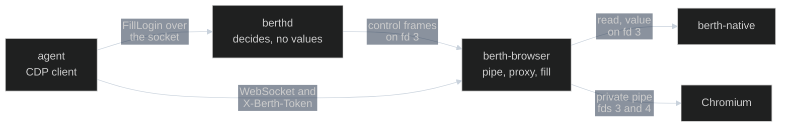
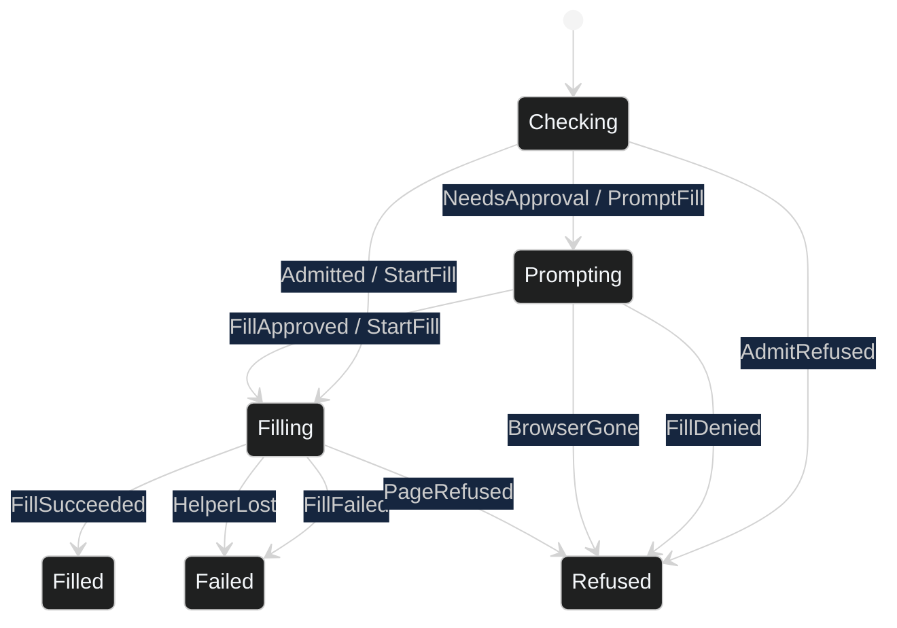

# M6: Credentials and runbooks

Goal: an agent logs in to a site in a managed browser without ever holding, seeing or being able to read back the password.
The person grants one Keychain item to one browser profile and one origin with Touch ID once ([ADR 0007](../adr/0007-grants-per-browser-profile-free-after-one-approval.md)); the fill runs as one atomic step with the agent's CDP traffic paused ([ADR 0008](../adr/0008-atomic-fill-with-the-agent-paused.md)); every profile carries hard limits the agent cannot change; and the person writes runbooks that agents fetch through their session.
Because a fill types a value over the CDP pipe, and `berthd` must never hold a value (invariants 7 and 11), the pipe, the CDP proxy and the fill move out of `berthd` into a new signed process, `berth-browser`, one per managed browser, which reads values through `berth-native` the way `berth-proxy` does.
The maintainer was away when this plan was written and asked not to be blocked; every choice that is his to make is listed under [Decisions for the maintainer](#decisions-for-the-maintainer), with the default taken, and everything that needs his hands is under [Manual checks](#manual-checks).
No code is written with this plan, because other branches are changing `berthd` now; item 1 is this file.

## What earlier milestones left to build on

- **E2b** ([plan](e2b-header-proxy.md)): `berth-proxy` is a signed Go process that `berthd` pins by team, identifier and live cdhash (`codetrust`, `TrustProxy`), watches with kqueue `NOTE_EXIT`, and gives tickets bound to the proxy's pid, consumer kind `PROXY` and action `USE`; the proxy starts `berth-native read` with a socketpair end on fd 3, `berth-native` checks that the fd 3 peer is its parent and satisfies the proxy requirement, redeems the ticket and writes the value; the proxy keeps it in an anonymous `mmap` outside the Go heap, `mlock`ed, never a Go string (`internal/proxy/value.go`), and zeroes it on every exit path.
- **E3 item 6** ([plan](e3-isolated-agents.md#item-6-berthd-starts-berth-proxy-for-agent-sessions)): `berthd` starts a signed helper as the owner with a scrubbed environment through a reusable starter (`internal/proxyproc`), records its pid against the agent session before it acts, and stops it when the session ends; the starter is the model for starting `berth-browser`.
- **M4** ([plan](m4-managed-chromium.md)): the `BrowserDriver` port and its `cdppipe` adapter (Chromium over `--remote-debugging-pipe` on fds 3 and 4, Berth's own calls on ids from 1,000,000,000, Berth's own sessions invisible to the agent), the browser machine with profile locks, profiles under `$BERTH_HOME/profiles/<name>`, the token gated CDP proxy (`internal/adapters/cdpproxy`) with its strict parser and method filter (`internal/core/cdppolicy`). Decision 3 there left the proxy inside `berthd` and said M6 must move it before any fill. On branch `m4b`, not yet on `main`: `OpenAgentBrowser` and `CloseAgentBrowser` give an agent session headless browsers on ephemeral profiles deleted at close, and `berth-mcp` exposes the agent surface.
- **M5** ([plan](m5-mac-app.md), first items on `main`): `Berth.app` and its Connect JSON client; planned there and not built yet: the `Control` machine (`Agent`, `Person`, `Ended`), the hold and replay of the agent's messages in the CDP proxy, bounded at 1,000 messages or 16 MiB, `WatchNeeds` notifications, and the error reasons `NOT_BERTH_APP` and `CONTROL_HELD`.
- **E3** ([ADR 0018](../adr/0018-agents-run-as-a-separate-macos-user.md), proposed): agents may run as a separate macOS user that reaches only the agent socket with a session token; `berthd` cannot read another user's process arguments, so agents get browsers only through Berth.

## Design



### Where fills run: `berth-browser`

**One `berth-browser` process per managed browser holds the pipe, serves the CDP proxy and runs the fill.**
`berthd` keeps every decision (grants, limits, the machines, the request log) and never holds a value or parses an agent's WebSocket frames again.

- **Binary:** `cmd/berth-browser`, Go, signed with the hardened runtime as `com.wesleybldc.berth.browser` by `make build`, standard library plus the packages it takes over (`cdppipe`, `cdpproxy`, `cdppolicy`, `github.com/coder/websocket`). The locked value type moves from `internal/proxy` into a shared `internal/lockedvalue` that both helpers import.
- **Why the whole proxy moves, not only the fill step:** the fill must hold the agent's messages and scan them for the value, which only the process holding both the agent's stream and the value can do; and moving the proxy closes the honest limit that `berthd` parses agent controlled WebSocket frames. A fill only helper would need the pipe handed back and forth between two processes, and two writers on one pipe.
- **Why one per browser, not one for all:** a parser bug or a crash reaches one browser and one profile's values; its lifetime is the browser's, so there is nothing to multiplex or recover; and a ticket bound to its pid can only be redeemed for that browser.
- **Pinning:** `berthd` starts only the `berth-browser` beside its own executable (`paths.Beside`; a `BERTH_BROWSER` override exists only under `berth_e2e`), checks the file against `codetrust` before starting it, then registers kqueue `NOTE_EXIT` on the child and checks the live cdhash, signature and hardened runtime by the audit token of the control socket's peer, as `TrustProxy` does; anything else is killed and the launch fails with `BROWSER_LAUNCH_FAILED`. The `berth_e2e` pin rule accepts the ad hoc signed test binary.
- **Launch:** through a starter shaped like `internal/proxyproc`, in its own process group, with only `HOME`, `PATH`, `BERTH_HOME` and `TMPDIR`; `berth-browser` refuses to start with anything else in its environment (so `GODEBUG` or `GOTRACEBACK` cannot change it), turns core dumps off, and refuses a control socket whose peer, by audit token, is not its parent and the signed `berthd`.
- **The control channel:** one end of a Unix socketpair on fd 3, created by `berthd` before the start, so no other process can ever connect to it. Frames are a four byte big endian length and one JSON object, at most 16 MiB (a screencast frame fits). `berthd` sends `launch`, `call` (its own CDP calls, for M5's screencast and input), `hold`, `release`, `fill` and `close`; `berth-browser` answers `ready`, `reply`, `event` (only events of Berth's own sessions), `fill_result` and `exited`. The exact frames are part of the contract item.
- **The pipe:** `berth-browser` starts Chromium as its own child through the `cdppipe` adapter, unchanged, so the pipe's fds exist only in `berth-browser` and Chrome; `berthd` never holds them. `ready` carries Chrome's pid and start time, and `berthd` checks with `procscan` that its parent is that `berth-browser` before it records it for the kill below.
- **The proxy:** `berth-browser` listens on `127.0.0.1:0` and serves exactly what the M4 proxy serves. `berthd` still mints the token and sends only its SHA-256 in `launch`; the token is never in `berth-browser`'s memory except while it compares a request's header.
- **Supervision:** no restart. When `berth-browser` exits, kqueue tells `berthd`, which kills Chrome's process group by the recorded pid while the group leader is unreaped (the M4 reaper rule) and moves the browser to `Closed` with the note `helper exited`. When `berthd` dies, the control socket reaches EOF and `berth-browser` aborts any fill (zeroing values, closing Berth's tab), kills Chrome's group and exits. Boot recovery stays as in M4: every live `browser/` row gets `Exited`, and any Chrome left on a Berth profile is stopped.
- **The driver port does not change:** a new adapter, `internal/adapters/browserproc`, implements `ports.BrowserDriver` and `BrowserConn` over the control channel, so `internal/berthd/managed.go` swaps adapters and keeps its machine and locks. `berthd` stops importing `cdpproxy` and `github.com/coder/websocket`, and a test pins that `go list -deps ./cmd/berthd` names neither.

### Browser grants

A browser grant pins one Keychain item to one **named profile** and one **origin** (scheme, host, port), approved once with Touch ID and then free ([ADR 0007](../adr/0007-grants-per-browser-profile-free-after-one-approval.md)).

- **Data on the grant row** (kind `browser`, beside `exe` and `proxy`): the profile name, the origin's scheme (`https` only outside `berth_e2e`), host (lowercase, a DNS name, never an IP literal or `localhost` outside `berth_e2e`, through `hostpolicy`) and port (default 443), an optional username secret (a second `berth.<name>` Keychain item that Berth fills into the username field), optional username and password selectors, an optional label the person writes (for example "work account", printable, at most 64 characters), and `ask_every_fill`.
- **The grant machine is unchanged** (11 legal pairs): `GrantRequested` and `PromptPower`, `GrantApproved`, `Revoke`, `UseAuthorized` and `IssueTicket` for each fill; browser grants never see `HashChanged`.
- **Granting** is an owner method, `GrantBrowser`, never on the agent surface, and needs Touch ID through `berth-native confirm` with a new `"action":"browser"`. The prompt is built only from facts `berthd` verified or the exact thing being granted: "Let browser profile `<profile>` log in to `<origin>` with `<secret>` (and username `<username secret>`). Agents using this profile can sign in as this account; they never see the password." It names whether the profile is an agent profile and which agent sessions it is assigned to, and the requester's process facts as for other grants. The origin is printed as `https://host` with the port only when it is not 443.
- **Ask every fill and strict mode:** with `ask_every_fill` on the grant, or the global strict mode on, every fill asks Touch ID first ("Fill `<secret>` into `<origin>` in profile `<profile>` for agent session `<name>`"). Strict mode is a setting in `berth.db`, off by default; turning it on needs nothing, turning it off is a power action with Touch ID.
- **Revocation:** `RevokeGrant` revokes a browser grant with no Touch ID, as for every grant; a fill already past its ticket finishes (it lasts at most 30 seconds), and every later fill is refused with `NO_GRANT`. `RemoveSecret` revokes every browser grant of the secret through `RevokeAll`, unchanged. Deleting a profile revokes its grants.
- **CLI:** `berth secret browser <name> --profile <p> --origin https://host[:port] [--username-secret <name>] [--label <text>] [--username-selector <css>] [--password-selector <css>] [--ask-every-fill]`; `berth secret ls` prints a browser consumer as its grant id, profile, origin, label, ask every fill and state.

### Profiles: grants target named profiles, never ephemeral ones

A grant needs a profile that outlives one browser, so M6 makes profiles first class.

- **`profiles` table:** name (the M4 rule), kind (`owner` or `agent`), created time, and the hard limits below. `berth profile new <name> [--agent]`, `ls`, `limits`, `reset` and `rm`; the folder stays `$BERTH_HOME/profiles/<name>`, and `LaunchBrowser` on an unknown name creates an `owner` profile with default limits, so M4's behaviour holds.
- **Ephemeral agent profiles** (`agent-<session id>`, from M4 item 7) never have a row and can never be granted: `GrantBrowser` refuses them with `PROFILE_NOT_FOUND`, so a fill on an ephemeral browser always answers `NO_GRANT`.
- **Agent profiles:** the owner assigns persistent agent profiles to an agent session when creating it (`berth agent session new --profile <name>`, repeatable). `OpenAgentBrowser` gains `profile`: empty keeps the ephemeral profile, a name opens that profile if it is assigned to the caller's session (else `PROFILE_NOT_FOUND`, so names cannot be probed), under the M4 profile lock. Assigning a profile that holds an Active browser grant is a power action with Touch ID, since it hands the agent those logins; the prompt lists the profile's granted origins.
- **Owner profiles** can be granted too, for the person's own use: `berth browser fill` (below) fills an owner browser from the CLI, which is also how the manual checks run before an agent is involved. Owner profiles are never assignable to agent sessions.

### Hard limits per profile

Stored on the profile row, set only on the owner socket, never reachable by an agent; loosening a limit is a power action with Touch ID, tightening is not (the rule for revoke).

| Limit | Default (agent / owner) | Enforced by | When |
|---|---|---|---|
| Allowed hosts: exact hosts and `*.domain` patterns | Empty means every host for owner profiles; agent profiles must list at least one | Chromium launch flags built by the driver from validated patterns: `--proxy-server` pointing at a closed loopback port, `--proxy-bypass-list` naming the allowed hosts plus `<-loopback>`, and `--force-webrtc-ip-handling-policy=disable_non_proxied_udp`; plus the CDP filter refusing navigations to other hosts | At launch, so page scripts, redirects and subresources are covered; a change applies at the next launch |
| Fills per rolling hour | 10 / 30 | `berthd`, counted from the `fills` table, so a restart does not reset it | Each fill |
| Consecutive failed fills per grant before the breaker opens | 3 / 5 | `berthd`; an open breaker refuses fills on that grant with `FILL_LIMIT` until `berth profile reset`, and posts a Needs you (M5's `WatchNeeds`) | Each fill |
| Fill window: days and local start and end minute | None | `berthd`, with its `Clock` port | Each fill |
| Browser lifetime | 4 hours / none | `berthd` closes the browser through the browser machine | Timer from `Ready` |
| Downloads | Off / on | `berth-browser` sends `Browser.setDownloadBehavior` `deny` on its own session at launch; on keeps M4's `<profile>/Downloads` | At launch |

The navigation budget, the new tab limit and anomaly rules from [agent safety](../agent-safety.md#hard-limits-per-profile-planned-m6) wait for a later milestone; they need counting in `berth-browser` and a pause path into Needs you that M6 does not build.
The allowed hosts pattern rule is the proxy grant host rule plus a leading `*.`; a pattern for a granted origin is checked when the grant is made, and `GrantBrowser` refuses an origin outside the profile's allowed hosts with `BAD_BROWSER_TARGET`.
The filter keeps refusing `Target.createBrowserContext` with `proxyServer`, which is now load bearing.

### The atomic fill: sealed, in a tab Berth owns

**The fill never types into the agent's page.**
`berth-browser` opens its own tab in the same browser context, so the login's cookies and storage land where the agent works, fills and submits there with the agent paused, closes the tab, and only then lets the agent go on.

Why not fill the agent's own page and then block reads of the field: holding the agent's CDP messages stops reads *after* the fill, but not code the agent planted *before* it, and an agent that can call `Runtime.evaluate` can plant code freely.
Event listeners on `input` or `keydown`, a `MutationObserver`, an overridden `HTMLInputElement.prototype` value setter, a timer that copies the field into a global, a submit handler that posts it to another server, a breakpoint (`Debugger` is allowed whole) that pauses inside the site's login handler, a `Fetch` interception that rewrites the login page to add a keylogger, a script added with `Page.addScriptToEvaluateOnNewDocument`, or a script in Playwright's own isolated world (which shares the DOM): each one captures the value with no CDP read at all.
Tracking which documents the agent touched would make the fill refuse nearly always, since Playwright evaluates in every page it acts on, and the list of ways to plant code is open ended.
A page the agent never had a session on has none of that.

```mermaid
%%{init: {"theme":"dark","themeVariables":{"primaryTextColor":"#F4F7FA","lineColor":"#C9D2DC","signalColor":"#C9D2DC","signalTextColor":"#F4F7FA","actorTextColor":"#F4F7FA","noteTextColor":"#F4F7FA"},"sequence":{"actorMargin":60,"messageMargin":40,"wrap":true}}}%%
sequenceDiagram
  participant A as agent
  participant D as berthd
  participant B as berth-browser
  participant N as berth-native
  A->>D: FillLogin(browser, grant, url)
  D->>D: grant, limits, window, breaker; Touch ID if asked
  D->>B: fill: url, origin, selectors, tickets
  B->>B: hold the agent; open Berth's tab; load url
  B->>B: check origin, TLS state and fields
  B->>N: read, ticket, socketpair on fd 3
  N-->>B: value bytes
  B->>B: type, submit, wait, wipe if still on the form
  B->>B: close the tab; zero; scan held messages
  B-->>D: fill_result
  B->>A: release held messages
  D-->>A: FILLED, REFUSED, FAILED or DENIED
```

1. **Admit (in `berthd`).** The caller names a browser of its own (another session's answers `BROWSER_NOT_FOUND`), an optional grant id and the login page URL. `berthd` finds the Active browser grant for the browser's profile whose origin equals the URL's origin (exactly one, or the named one, else `NO_GRANT`), applies the limits, and asks Touch ID when the grant or strict mode says so. It saves the fill row, then issues one ticket per secret (password, and username when set), each bound to `berth-browser`'s pid, consumer kind `BROWSER`, action `USE`, 30 seconds, and sends `fill`. A fill while the person holds control (M5) answers `CONTROL_HELD`; a take during a fill waits for it, which lasts at most 30 seconds.
2. **Hold.** `berth-browser` stops forwarding the agent's messages to Chrome and queues them, and queues every message from Chrome to the agent too, on M5's bounded queue (1,000 messages or 16 MiB; overflow closes the agent's connection, which fails closed). If M5's hold is not on `main` yet, M6 builds it in `cdpproxy` with M5's bounds and M5 reuses it.
3. **Berth's tab.** `Target.createTarget` with `about:blank` in the browser context of the agent's pages (the default context unless the agent made one; the fill uses the context of the agent's most recently active page target), attached on Berth's id range. The agent's browser level auto attach would attach it too: that `Target.attachedToTarget` is in the held queue, so `berth-browser` drops it, detaches that agent session from Berth's id range, and runs the target if it waits for a debugger. Every held event naming Berth's target or that session is dropped, so after the fill the agent has seen nothing of the tab, which no longer exists. On Berth's session: `Network.setBypassServiceWorker` true (a worker the agent registered on the origin cannot see the request), `Network.enable` and `Page.enable`. Then `Page.navigate` to the URL, and wait for the load event, at most 15 seconds.
4. **Check the page (before any value exists).** The main frame's security origin from `Page.getFrameTree` must equal the grant's origin after every redirect (`origin_mismatch`); the main document's response must have `securityState` `secure` (`not_secure`); in an isolated world Berth creates on its own session, the password field is the grant's selector or, with none, the only visible `input` of type `password` in the main frame's document (`no_password_field`, `several_password_fields`); a password field only inside a frame is refused (`field_in_frame`); the field must be enabled and not read only; when it sits in a `form` with an `action`, the action must resolve to the grant's origin (`form_target_mismatch`); the username field is the grant's selector or the nearest visible `input` of type `text`, `email` or `tel` before the password field in the same form, and when none is found with a username secret set, the fill refuses (`no_username_field`). A grant's selector must match exactly one element of the right type. A refusal here starts no `berth-native`, so the Keychain is never touched for a page that fails.
5. **Read.** For each ticket, `berth-native read` with a socketpair end on fd 3, exactly as `berth-proxy` does; the value goes into locked memory; a value that is not valid UTF-8, or holds a control character, fails (`value_not_text`).
6. **Type.** `DOM.focus` on the field by its backend node id, a check in Berth's isolated world that the focused element is that field and the origin is unchanged, then `Input.insertText`. The CDP message is assembled in locked memory (the JSON escaped value between fixed bytes) and written to the pipe in one write, then zeroed; it never becomes a Go string. Username first, then password.
7. **Submit and settle.** `Input.dispatchKeyEvent` Enter on the password field. The fill succeeds when the main frame commits a new document (a new loader id) or the field leaves the document, within 15 seconds; otherwise it fails (`still_on_form`) and Berth wipes every field it filled (empties the value and fires an `input` event in its isolated world).
8. **Close and zero.** The tab is closed whatever the outcome, and the values are zeroed on every path, before `fill_result`.
9. **Scan and resume.** Every held message is scanned for each value as raw bytes, JSON escaped, URL and form encoded, and base64 (standard and URL alphabets). A match is withheld: a reply becomes a CDP error with the same id (`withheld by Berth`), an event is dropped, the fill result records the count, and the agent's CDP connection is closed after the release, which fails closed; a match means something the agent set up reached the value, so it also posts a Needs you. Then the queue is replayed in order.
10. **Answer.** The agent gets only the outcome (`FILLED`, `REFUSED`, `FAILED`, `DENIED`) and a fixed reason phrase. It then loads the site in its own tab, signed in through the shared cookies.

What the agent can observe afterwards: that it was paused for a few seconds, the outcome and reason, and whatever the login left in the profile (cookies, storage, the signed in site); never the page that held the value, its network events, its DOM or its post data, since its CDP session never reached that tab and the tab is gone.

**Filter changes M6 makes in `cdppolicy`,** each with a row in the policy table: `Security.setIgnoreCertificateErrors` and `Security.handleCertificateError` are refused (they weaken TLS for every tab, Berth's included); `Fetch.enable` without a `sessionId` (browser level interception of every target) is refused, and `Fetch` stays allowed inside page sessions; `Target.attachToTarget`, `activateTarget` and `closeTarget` naming a Berth owned target id are refused, as M4 planned.

**Profile preferences:** before every launch the driver also writes `credentials_enable_service` false and `profile.password_manager_enabled` false into `Default/Preferences` (beside M4's download keys), so Chrome never saves the filled password into the profile, where autofill could later put it into the agent's own page.

### The fill machine

New machine `internal/core/fill`, entity `fill/<id>` (32 lowercase hex), one per attempt.



- `Checking` is the first saved state (`FillRequested` with effect `AdmitFill`), so the row exists before any effect (persist before acting).
- `AdmitFill` returns `Admitted`, `NeedsApproval` or `AdmitRefused` with a fixed note (`no grant`, `fill limit`, `outside window`, `breaker open`).
- `StartFill` issues the tickets and sends `fill`; `HelperLost` comes when `berth-browser` exits or 30 seconds pass without `fill_result`.
- `Filled`, `Failed` and `Refused` are final; boot recovery fails every live fill with `HelperLost` and the note `interrupted`.
- 11 legal pairs, pinned by `machinetest.Walk`; event notes hold only fixed phrases and counts, never a URL path, selector or value.
- The `fills` table keeps id, grant id, browser id, profile, agent session, origin, outcome, reason, withheld count, created and ended time, and is what the limits count.
- If M5's `Control` machine is on `main` when item 10 lands, it gains a `Filling` state (`Agent` to `Filling` on `FillStarted` with `HoldAgent`, back on `FillEnded` with `ScanAndRelease`, and `Filling` to `Ended` on `BrowserClosed`); otherwise M6 adds `Control` with `Agent`, `Filling` and `Ended`, and M5 adds `Person`.

### Runbooks served to agents

A runbook is a Markdown document the person writes, telling agents how to do one job on one or more profiles; it is guidance, never a security control, since the limits and grants are what bind.

- **Shape:** UTF-8 Markdown, at most 64 KiB, no control characters but newline and tab, with a front matter block: `name` (the profile name rule), `title`, `profiles` (the persistent profiles it applies to) and `origins` (the sites it expects to use, each checked against those profiles' allowed hosts, with a warning, not a refusal, when one falls outside). The body is free steps text.
- **Storage:** in `berth.db`, `runbooks` (name, current version) and `runbook_versions` (name, version, content, SHA-256, created time), append only, so every change is kept; each change is a `RunbookChanged` event whose note is the version and the hash, never the content (the audit trail ASI06 asks for). Not files in the shared workspace, which the agent user can write.
- **Authoring:** only the person, on the owner socket: `berth runbook add <file>` (a new version of the name in its front matter), `berth runbook ls`, `show <name> [--version N]`, `rm <name>`; the app can edit them later. No agent method writes a runbook; a proposal flow is a later item.
- **Fetching:** `ListRunbooks` and `GetRunbook(name)` are agent methods scoped by session: on the agent socket a runbook is visible only when one of its profiles is assigned to the caller's session, and any other name answers `RUNBOOK_NOT_FOUND`; on the owner socket every runbook is visible. The reply carries the content, version, hash and time; `berth-mcp` returns it labelled as the person's instructions, and the content goes to the model, as a runbook is meant to.

### How M6 meets E3, M4 and M5

- **E3 (agent user):** `FillLogin`, `ListLogins`, `ListRunbooks` and `GetRunbook` reach the agent user only through the agent socket with a session token; no value travels toward any agent process; persistent agent profiles live in the owner's `$BERTH_HOME/profiles`, which the agent user cannot read, so their cookies reach the agent only through CDP. `berth-browser` and Chrome run as the owner in M6; running them as the runner user needs `berth-native` to run as the owner with its socketpair passed to the runner's `berth-browser`, the shape E3 item 5 designs, and is a follow up there.
- **M4 agent browsers:** ephemeral profiles stay as they are and can never fill; persistent agent profiles, assigned by the owner, are how an agent gets logins. `berth-mcp` gains `browser_logins`, `browser_fill_login`, `runbook_list` and `runbook_get`, and its tool list test follows `TestAgentSurface`.
- **M5 takeover:** the fill reuses M5's hold and queue; a fill and a takeover never overlap (`CONTROL_HELD` one way, a short wait the other). The person can watch Berth's tab in the live view, where a password field shows only bullets. When a login needs the person (an MFA prompt on the page that took the password), the fill fails with `still_on_form` and closes its tab in M6; handing that tab to the person is a later item.

## Contract (proto additions)

Nothing existing changes meaning; every addition is a new field, value or method.

```proto
// secrets.proto
enum ConsumerKind { ...; CONSUMER_KIND_BROWSER = 3; }
message BrowserTarget {
  string profile; string scheme; string host; uint32 port;
  string username_secret; string username_selector; string password_selector;
  string label; bool ask_every_fill;
}
message Consumer { ...; BrowserTarget browser = <next>; }
rpc GrantBrowser(GrantBrowserRequest) returns (GrantBrowserResponse);     // owner, Touch ID
message GrantBrowserRequest { string request_id; string name; BrowserTarget target; }
message GrantBrowserResponse { GrantOutcome outcome; string grant_id; }
rpc SetStrictMode(SetStrictModeRequest) returns (SetStrictModeResponse); // owner, Touch ID to turn off

// profiles.proto (new)
service ProfilesService {
  rpc CreateProfile(CreateProfileRequest) returns (CreateProfileResponse);
  rpc ListProfiles(ListProfilesRequest) returns (ListProfilesResponse);
  rpc SetProfileLimits(SetProfileLimitsRequest) returns (SetProfileLimitsResponse); // Touch ID to loosen
  rpc ResetProfile(ResetProfileRequest) returns (ResetProfileResponse);             // closes breakers
  rpc RemoveProfile(RemoveProfileRequest) returns (RemoveProfileResponse);          // revokes its grants
}
enum ProfileKind { UNSPECIFIED, OWNER, AGENT }
message ProfileLimits {
  repeated string allow_hosts; uint32 fills_per_hour; uint32 max_consecutive_failures;
  FillWindow window; google.protobuf.Duration max_lifetime; bool downloads;
}
message FillWindow { uint32 days_mask; uint32 start_minute; uint32 end_minute; }

// agents.proto
message CreateAgentSessionRequest { ...; repeated string profiles = <next>; } // Touch ID if one holds a browser grant

// browsers.proto
message OpenAgentBrowserRequest { ...; string profile = <next>; }   // with m4b
rpc FillLogin(FillLoginRequest) returns (FillLoginResponse) { option (berth.v1.agent) = true; }
rpc ListLogins(ListLoginsRequest) returns (ListLoginsResponse) { option (berth.v1.agent) = true; }
message FillLoginRequest { string request_id; string browser_id; string grant_id; string url; }
message FillLoginResponse { string fill_id; FillOutcome outcome; string reason; }
enum FillOutcome { UNSPECIFIED, FILLED, REFUSED, FAILED, DENIED }
message ListLoginsRequest { string browser_id; }
message Login { string grant_id; string origin; string label; }  // never a secret name
message ListLoginsResponse { repeated Login logins; }

// runbooks.proto (new)
service RunbooksService {
  rpc PutRunbook(PutRunbookRequest) returns (PutRunbookResponse);       // owner
  rpc RemoveRunbook(RemoveRunbookRequest) returns (RemoveRunbookResponse); // owner
  rpc ListRunbooks(ListRunbooksRequest) returns (ListRunbooksResponse) { option (berth.v1.agent) = true; }
  rpc GetRunbook(GetRunbookRequest) returns (GetRunbookResponse) { option (berth.v1.agent) = true; }
}

// options.proto, appended after the last ErrorReason on main when the contract lands
ERROR_REASON_PROFILE_NOT_FOUND; ERROR_REASON_BAD_BROWSER_TARGET; ERROR_REASON_FILL_LIMIT;
ERROR_REASON_RUNBOOK_NOT_FOUND; ERROR_REASON_CONTROL_HELD (only if M5 has not added it);
```

- **Agent surface:** `FillLogin`, `ListLogins`, `ListRunbooks` and `GetRunbook` join it, and `TestAgentSurface` pins the new list; `GrantBrowser`, `SetStrictMode`, `ProfilesService`, `PutRunbook` and `RemoveRunbook` stay owner only. `FillLogin` takes no secret name and returns no value; `TestNoFieldCarriesAValue` stays green with no new exception.
- **Validation:** origins as the proxy host rule plus scheme and port; selectors printable ASCII, at most 256 bytes; `url` an absolute `https` URL of at most 2,048 bytes (loopback `https` only under `berth_e2e`); `label` printable, at most 64; `allow_hosts` at most 64 patterns; runbook content at most 64 KiB.
- **Ticket redeem:** `RedeemUseTicketResponse.consumer_kind` gains `BROWSER`; `berth-native read` accepts a `berth-browser` parent (`com.wesleybldc.berth.browser`) only for tickets of that kind.
- **Native protocol:** `confirm` gains `"action":"browser"` (grant), `"action":"fill"` (ask every fill and strict mode), `"action":"assign"` (a profile with grants to an agent session) and `"action":"loosen"` (limits and strict mode off), each with only verified facts.
- **Control frames** between `berthd` and `berth-browser` are written down in this plan by the contract item, with a Go type per frame in a shared `internal/browserctl` package.
- **Migrations** (numbers taken at rebase): `profiles` and `agent_session_profiles`; `grants` rebuilt with kind `browser` and its columns under a CHECK that refuses mixed rows, keeping every id as 0004 did; `fills`; `runbooks` and `runbook_versions`; `settings` (strict mode).

## Work items

Each item ends with `make check` passing and its own commit; "needs the maintainer" means a signed build, Touch ID or his decision.

| # | Item | Depends on | Owns | Tests |
|---|---|---|---|---|
| 1 | Plan | | this file | |
| 2 | Spike on real Chromium | 1 | A results section here; scratch code outside the repository | Answers, with the command and output, for the headless shell and Chrome for Testing: `--proxy-server` with `--proxy-bypass-list` and `<-loopback>` blocks a non listed host, an IP literal and loopback, and WebRTC with the UDP flag; a browser level auto attach session on a new target can be detached on Berth's id range with no event reaching the agent; `Network.setBypassServiceWorker` keeps a registered worker from seeing the POST; `Fetch.enable` at browser level intercepts page requests (so refusing it matters); `Input.insertText` into a password field fires `input` and a form posts it; the password manager preferences stop a save; restoring a closed tab restores no password value |
| 3 | Contract | 1 | `proto/`, `gen/`, `internal/core/ports/`, `internal/browserctl` frame types, name constants for the fill machine, migrations, `codetrust` (`BrowserSigningID`) | `buf breaking` clean; `TestAgentSurface` pinned at the new list; no field carries a value; grant ids kept by the rebuild |
| 4 | Shared locked value | 1 | `internal/lockedvalue`, `internal/proxy` | The proxy's existing value tests move and pass; the proxy e2e passes unchanged |
| 5 | `berth-browser` | 3, 4 | `cmd/berth-browser`, `internal/browserhelper` (launch, control loop, proxy wiring), `internal/adapters/cdpproxy` (hold, scan, Berth target rules), `Makefile` and `scripts/sign.sh` lines | A fake Chrome and a fake `berthd` on the socketpair: refuses an extra environment variable and a control peer that is not its parent; launch, ready with Chrome's pid; a relayed `call` and its reply; hold queues both ways and release replays in order; overflow closes the agent; EOF on control kills Chrome's group and exits; the real headless shell drives a page through the moved proxy |
| 6 | `berthd` on the helper | 5 | `internal/adapters/browserproc`, `internal/berthd/managed.go`, `cmd/berthd` trust files | Pin refusal kills and fails the launch; helper exit closes the browser and kills Chrome's group; `go list -deps ./cmd/berthd` has no `cdpproxy` or `coder/websocket`; every M4 browser and Playwright e2e passes through the helper |
| 7 | `berth-native` receiver | 3 | `native/` (`berthBrowserRequirement`, the receiver table, the four confirm actions), `internal/adapters/native/` and `fakehelper` | Receiver table: browser parent with `BROWSER`, crossed kinds refused; prompt text builders for each new action |
| 8 | Profiles and limits | 3, 6 | `internal/berthd/profiles.go`, `internal/adapters/api/profiles.go`, `internal/cli/profile.go`, `cdppipe` launch flags and preferences, agent session profiles | Defaults; loosen asks Touch ID, tighten does not; allowed hosts become exactly the flags; an unassigned profile is `PROFILE_NOT_FOUND` to an agent; assignment with grants asks Touch ID; lifetime closes the browser on a fake clock |
| 9 | Browser grants and strict mode | 3, 7, 8 | `internal/berthd/lifecycle.go` grant paths, `internal/adapters/sqlite` grant columns, `internal/cli/secret_browser.go`, `ls` | Grant round trip keeps every field; origin outside allowed hosts refused; ephemeral profile refused; revoke and remove reach browser grants; strict mode off asks Touch ID; golden `ls` |
| 10 | Fill machine | 3 | `internal/core/fill/`, the `Control` change if M5's is on `main` | Walk pinned at 11; names pinned |
| 11 | The fill in `berth-browser` | 5, 7 | `internal/browserhelper/fill.go`, `cdppolicy` rows | Against the real headless shell and a loopback HTTPS login page (`berth_e2e` only): each page refusal (origin after redirect, not secure, none or several password fields, field in a frame, form action elsewhere, missing username field) starts no `berth-native`; a good page is posted the canary; a page that stays on the form is wiped; the tab is gone and the values zeroed on every path; held replies and events holding the canary in each encoding are withheld and close the agent; the new filter rows refuse |
| 12 | Fill wiring | 6, 8, 9, 10, 11 | `internal/berthd/fill.go`, `internal/adapters/api/browsers.go`, `internal/cli/browser_fill.go`, `berth-mcp` tools | Admission (no grant, two grants without a grant id, limit, window, breaker after N failures, reset); ask every fill prompts; another session's browser is `BROWSER_NOT_FOUND`; `CONTROL_HELD`; a retry with the same `request_id` does not fill twice; tickets bound to the helper's pid |
| 13 | Runbooks | 3 | `internal/berthd/runbooks.go`, `internal/adapters/api/runbooks.go`, `internal/cli/runbook.go`, `berth-mcp` tools | Front matter parsing and limits; versions append; scoped visibility on the agent socket; `RunbookChanged` notes hold no content |
| 14 | End to end and docs | 6, 12, 13 | `test/e2e/fill_test.go`, `ARCHITECTURE.md`, `docs/agent-safety.md`, `docs/plans`, new ADRs | Below |
| 15 | Close | all | this file | Agent safety checklist walked |

Items 4, 7, 10 and 13 can run in parallel after the contract; 5 follows 4; 6 follows 5; 8 and 9 follow 6; 11 needs 5 and 7; 12 joins them.
Items 5 and 6 rewrite the managed browser wiring, so they start only once the branches now changing `berthd` (M4 item 7 on `m4b`, M5's takeover) have landed, and rebase onto them.

**End to end** (`test/e2e/fill_test.go`), real `berthd`, `berth-browser`, fake helper with a canary, real headless Chromium with M2's skip rules:

- A loopback HTTPS login page (a test root compiled in under `berth_e2e`) that records the posted form; a persistent agent profile with allowed hosts naming it; a browser grant with a username secret; an agent session assigned the profile.
- Before the fill, the agent (a Go CDP client through the proxy) plants everything the design names: a keylogger and a value setter override in its own tab of the same origin, an init script, browser level auto attach with `waitForDebuggerOnStart`, `Fetch.enable` in its page session, and a `Debugger` breakpoint. Then `FillLogin`: the outcome is `FILLED`, the page received the canary username and password, and the canary in every encoding appears in no frame the agent received (every frame is recorded), no global its scripts set, no `berthd` or `berth-browser` log line, no database file and no CLI output.
- After the fill, the agent's tab loads the site signed in, and `Target.getTargets` lists no Berth tab.
- Refusals: a URL on another origin is `NO_GRANT`; a page redirecting to another origin is `REFUSED` with `origin_mismatch` and the fake helper's read log is empty; three wrong passwords open the breaker and the fourth is `FILL_LIMIT`; `berth profile reset` closes it; a navigation to a host outside the allowed hosts fails in Chrome.
- `berth-browser` killed with `SIGKILL` during a fill: the fill ends `Failed` with `helper lost`, Chrome's process group is gone, and the browser is `Closed`.
- Runbooks: `berth runbook add` then `GetRunbook` from the assigned session returns it, from another session `RUNBOOK_NOT_FOUND`.
- Tests kill only the pids they started.

## Exit gate

`make check` passes with the new tests (the fill e2e runs, or skips with the reason when no Chromium is found); `berthd` links no WebSocket or CDP proxy code; every manual check below passes on the maintainer's Mac; the agent safety checklist is walked for M6; ADRs record the `berth-browser` process and the sealed fill (amending ADR 0008); `ARCHITECTURE.md` marks M6 done and moves the CDP proxy limit to `berth-browser`.

## Manual checks

1. `make build` signs `bin/berth-browser`; `codesign -dv` shows the team and `com.wesleybldc.berth.browser`; `berth browser launch` starts it, and `ps -o ppid` shows Chrome's parent is `berth-browser`, not `berthd`.
2. `berth secret request` a test password and username for a site he controls (or a public demo login page with demo credentials), `berth profile new demo --agent --allow-host <host>`, `berth secret browser ... --profile demo --origin https://<host>`: the Touch ID prompt names the profile, the origin and the secrets, and nothing an agent wrote.
3. `berth browser fill` on an owner browser of the profile logs in; `berth secret ls` shows the use.
4. An agent through `berth-mcp` and Playwright MCP: open the assigned profile, `browser_fill_login`, and continue signed in; the transcript holds no password, and the agent's CDP stream recorded by Playwright's trace holds none.
5. `--ask-every-fill` and strict mode each prompt per fill; turning strict mode off asks Touch ID.
6. Three wrong passwords open the breaker and post a Needs you once M5's notifications exist; `berth profile reset` closes it.
7. `kill -9` on `berth-browser` closes the browser within seconds, with no Chrome left running.
8. A runbook he writes reaches the agent through `runbook_get`, and an agent session without the profile cannot see it.

## Honest limits

- **The agent gets the signed in session.** Cookies and storage the login leaves are the agent's, by design; it can act as the account until the session ends server side, and can exfiltrate what the account can read. The password is what it never gets.
- **The site's own code sees the password,** as with any login; an XSS hole on the granted origin, or a site script that trusts storage the agent can write in the shared profile (cookies, `localStorage`), can leak it. Berth trusts the origin the person granted.
- **The fill trusts Chrome's facts:** the frame tree's origin, the security state and the DOM come from the renderer of a page Berth does not control; a Chrome bug there is a Berth bug.
- **One origin per fill.** A login that redirects to an SSO origin is refused unless that origin has its own grant, and a fill never spans two origins in M6.
- **Logins whose next step lives only in the submitting tab** (an MFA prompt on the page that took the password, an OAuth popup that posts back to its opener) fail with `still_on_form` or cannot be served; the person handles them through M5's takeover, and handing Berth's tab over is a later item. HTTP authentication dialogs are not filled.
- **The scan matches the value and common encodings only;** a transformed copy passes, which is why the agent never gets a session on Berth's tab, and the scan is a backstop.
- **The agent can tell that a fill happened** (it was paused, and it got an outcome), and can see Berth's tab only if a drop rule has a gap; the e2e checks the known events.
- **Allowed hosts depend on Chromium honouring its proxy flags;** a Chrome feature that opens connections outside the proxy (beyond WebRTC, which the flag covers) would escape the list until the policy learns it.
- **`berth-browser` and Chrome run as the owner,** so a flaw in the moved proxy or a CDP filter gap still runs with the owner's rights; it moved out of `berthd`, not out of the owner's account (E3 follow up).
- **A malicious process running as the person** reaches the owner socket and can call `FillLogin` on any managed browser; it can only fill a granted origin within the limits, never read a value, and cannot grant or loosen without Touch ID.
- **Runbooks are guidance:** a hijacked agent can ignore one; the limits and grants are what hold. A same user process can still write `berth.db` directly, as for every table.
- **Limits apply at launch for allowed hosts and downloads;** a tightened list reaches a running browser only after it closes.
- **The value passes through Chrome's renderer and the kernel's pipe buffer,** which Berth cannot zero; it lives there until Chrome reuses that memory.

## Decisions for the maintainer

Defaults taken while he was away; each is cheap to reverse before M6 closes.

1. **A separate signed `berth-browser`, one per managed browser, holding the pipe, the CDP proxy and the fill,** instead of a fill only helper or one helper for every browser; `berthd` drops `cdpproxy` and `coder/websocket`.
2. **Control over an inherited socketpair on fd 3** with length prefixed JSON frames; `berthd`'s own CDP calls (M5's screencast and input) are relayed through it; no restart on a crash.
3. **The sealed fill in a tab Berth owns,** in the agent's browser context so any login style carries over, rather than filling the agent's page and blocking reads (which pre planted code defeats) or a separate context plus a cookie copy (which loses logins kept in storage).
4. **No in place fill in M6.** A fill into the agent's own page, needed for popups that post back to their opener, waits for a later milestone with a clean document rule, and its weaker guarantee in writing.
5. **The username is an optional second Keychain item,** filled like the password, so no username reaches `berthd` or the agent; the alternative is a plain username on the grant.
6. **The agent names the browser, an optional grant id and the login URL;** `ListLogins` gives it grant ids, origins and labels, never a secret name.
7. **Field rules:** main frame only, exactly one visible password field unless the grant gives a selector, form action on the grant's origin, `https` and a secure state only, `Input.insertText`, Enter to submit, 15 seconds to load and 15 to settle, 30 seconds for the whole fill.
8. **Grants target named persistent profiles;** ephemeral agent profiles can never fill; persistent agent profiles are assigned to an agent session at creation, with Touch ID when the profile holds a browser grant; owner profiles are never assignable.
9. **Allowed hosts through Chromium's proxy flags at launch,** with a closed loopback proxy and a bypass list, rather than DNS rules (which miss IP literals) or a Berth egress proxy (a much larger build).
10. **Limit defaults** as in the table: 10 fills an hour and a breaker at 3 consecutive failures for agent profiles, 4 hour agent browser lifetime, downloads off for agent profiles; loosening needs Touch ID.
11. **Runbooks in `berth.db`,** versioned and append only, Markdown with front matter, written only by the person through the CLI, read by agents through session scoped methods; no proposal flow yet.
12. **Strict mode is global and off by default;** turning it off needs Touch ID.
13. **A scan hit withholds the message, closes the agent's CDP connection after release and posts a Needs you,** rather than only counting it.
14. **The person can fill owner browsers from the CLI** (`berth browser fill`), which the manual checks use.
15. **`berth-browser` and Chrome run as the owner in M6;** the runner user waits for E3's launch helper.
16. **The navigation budget, tab limit and anomaly rules** from the agent safety page move to a later milestone.

## Exit notes

None yet; item 1 (this plan) is written, and no code exists.
