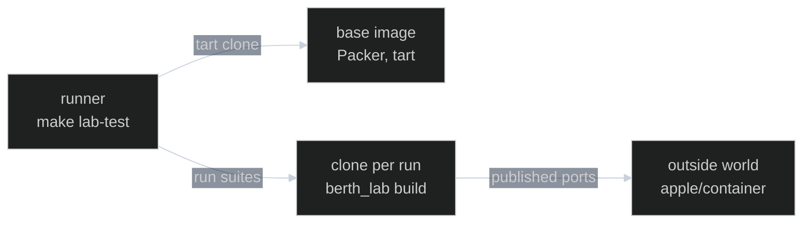

# Test lab: unattended end to end tests in macOS VMs

Status: In progress. The maintainer accepted this plan and its eight [decisions](#decisions) on 2026-11-19, and the decision is [ADR 0020](../adr/0020-test-lab-in-macos-vms-with-a-berth-lab-flavor.md), accepted.
Phase 1 (items 1, 2, 3, 10, 12 and 13, none of which needs a VM) is in progress: items 1, 2, 3 and 10 are built, and items 12 and 13 are in review.
Phase 1b is item 16, [gate and review hardening](#item-16-gate-and-review-hardening), which also needs no VM.
Phase 2 starts with a one day tart spike that answers the [spike questions](#phase-2-spike), run before item 5a's image design.
The work item table's Status column is the source of truth; `ARCHITECTURE.md` follows it.
Open questions for the maintainer are listed under [Decisions](#open-for-the-maintainer).

Goal: every check that today needs the maintainer's hands (real signing, the store dialog and approvals, headful browsers, the app's GUI and permissions, a real second macOS user) runs unattended in macOS VMs, locally (and in CI if the maintainer chooses item 5b), so the guided manual scripts retire and only a short release checklist needs a person.

## Why now

- E2b, M2, M3 and M4 are built and wait only on guided checks; E3's spike and cross user tests wait on the maintainer's admin password; M5 items 1 to 8 wait on GUI checks.
- M5's takeover (items 9 to 14) and M6's fills need headful browsers, real approvals and real login pages on every change, which a guided script cannot give at the pace agents build.
- A `| tail -1` once hid a failed fast forward merge and an unwanted push followed; the gate itself must fail fast before anything else is automated.

## What was checked (2026-11-19)

| Question | Answer | Source |
|---|---|---|
| tart version and licence | 2.42.0 (2026-11-17), now `openai/tart`, FSL-1.1-ALv2 since 2026-06-05 with no fees or core limits; `brew install openai/tools/tart`. `tart.run/licensing` still shows the old Fair Source tiers, which no longer apply | [releases](https://api.github.com/repos/openai/tart/releases/latest), [LICENSE](https://raw.githubusercontent.com/openai/tart/main/LICENSE), [licence note](https://github.com/openai/tart/blob/main/docs/blog/posts/2023-02-11-changing-tart-license.md) |
| VMs at once | 2 macOS VMs per host (Apple's EULA, enforced by Virtualization.framework); a third fails at once rather than queuing | [discussion 1054](https://github.com/openai/tart/discussions/1054) |
| Base images | `ghcr.io/cirruslabs/macos-tahoe-vanilla` (auto login, passwordless sudo, no sleep or screen lock, Gatekeeper off), `-base` (Homebrew, the guest agent, SIP already off), `-xcode:N`; user `admin`, password `admin`; 50 GB, the Xcode image grows to 140 GB | [macos-image-templates](https://github.com/cirruslabs/macos-image-templates), [quick start](https://tart.run/quick-start) |
| SIP | The templates turn it off with Packer booting Recovery (`recovery = true`) and a `boot_command` that opens Terminal and runs `csrutil disable`; by hand, `tart run --recovery --vnc-experimental` | [disable-sip.pkr.hcl](https://github.com/cirruslabs/macos-image-templates/blob/main/templates/disable-sip.pkr.hcl) |
| Pre granting TCC | With SIP off, `sqlite3` inserts rows into the system and user `TCC.db` (Accessibility, ScreenCapture, PostEvent, AppleEvents) with `auth_value` 2; a bundle id client needs a matching `csreq`, as GitHub's runner images write. On macOS 27 the user database moved; on 26 it has not. macOS 15 and later can still show a periodic private window picker prompt for Screen Recording. PPPC profiles need MDM, unverified here | [update-tcc-database.sh](https://github.com/cirruslabs/macos-image-templates/blob/main/scripts/update-tcc-database.sh), [runner-images](https://raw.githubusercontent.com/actions/runner-images/main/images/macos/scripts/build/configure-tccdb-macos-27.sh), [real desktop note](https://jonnyzzz.com/blog/2026/07/16/a-real-macos-desktop-for-a-linux-agent) |
| Headless and the display | `--no-graphics` only skips the host window: the VM always has a `VZMacGraphicsDeviceConfiguration`, so with auto login there is a WindowServer session for GUI apps and screen capture; `--vnc-experimental` adds a VNC server for debugging | [Run.swift](https://raw.githubusercontent.com/openai/tart/main/Sources/tart/Commands/Run.swift), [VM.swift](https://raw.githubusercontent.com/openai/tart/main/Sources/tart/VM.swift), [issue 1212](https://github.com/openai/tart/issues/1212) |
| Snapshots | None; `tart clone` is APFS copy on write, so a clone per run deleted afterwards is the clean snapshot. `tart set --disk-size` on a stopped VM; the base image grows APFS at boot | [Clone.swift](https://raw.githubusercontent.com/openai/tart/main/Sources/tart/Commands/Clone.swift), [FAQ](https://tart.run/faq) |
| Host gotcha | The host user running tart needs an unlocked login keychain on macOS 15 and later | [FAQ](https://tart.run/faq) |
| Packer | `packer-plugin-tart` v1.21.0 (2026-07-09): `recovery`, `recovery_partition`, `disk_size_gb`, `headless` | [releases](https://github.com/cirruslabs/packer-plugin-tart/releases), [builder docs](https://developer.hashicorp.com/packer/integrations/cirruslabs/tart/latest/components/builder/tart) |
| CI | Cirrus Runners takes no new customers and Cirrus CI shut down on 2026-06-01; Orchard (0.58.0) is for clusters; Tartelet (0.12.0, 2025-06-13) is low activity. For one Mac, a host loop that clones, boots, injects a just in time runner config for actions/runner (v2.338.2) and deletes the clone is the simplest | [conda-forge note](https://conda-forge.org/blog/2026/06/17/large-runners-gha/), [Tartelet](https://raw.githubusercontent.com/framna-dk/tartelet/main/README.md) |
| Touch ID in a guest | None. `.deviceOwnerAuthentication` falls back to the login password dialog; `.deviceOwnerAuthenticationWithBiometrics` fails. No Secure Enclave of its own (inferred: Apple derives the VM identity from the host's). iCloud sign in breaks for concurrent clones | [LAPolicy](https://developer.apple.com/tutorials/data/documentation/localauthentication/lapolicy/deviceownerauthentication.md), [iCloud in VMs](https://developer.apple.com/tutorials/data/documentation/virtualization/using-icloud-with-macos-virtual-machines.md) |
| Keychain in a guest | `security unlock-keychain -p admin ~/Library/Keychains/login.keychain-db` unlocks it by script | [FAQ](https://tart.run/faq) |
| `testing/synctest` | Stable since Go 1.25 (`synctest.Test`, `Wait`); Go 1.27, which `go.mod` names, adds `synctest.Sleep`. Channels, `select`, `sync.Cond`, `WaitGroup` and `time.Sleep` block durably; mutexes, I/O, loopback sockets and syscalls do not, so a goroutine on a real socket or an `os/exec` pipe keeps fake time from moving; `net.Pipe` works | [Go 1.25](https://go.dev/doc/go1.25), [Go 1.27](https://go.dev/doc/go1.27), [package](https://pkg.go.dev/testing/synctest) |
| apple/container | 1.7.1 (2026-11-06), macOS 26 on Apple silicon; one lightweight VM per OCI container, each with its own IP reachable from the host, local DNS names (`container system dns create`), `--publish` to host ports. It cannot run inside a tart macOS guest (no nested virtualization for macOS guests), so it runs on the host; whether a guest reaches container IPs directly is unverified, so guests use ports the host publishes | [releases](https://github.com/apple/container/releases), [networking](https://raw.githubusercontent.com/apple/container/1.7.1/docs/networking.md), [Darwin.swift](https://raw.githubusercontent.com/openai/tart/main/Sources/tart/Platform/Darwin.swift) |

## Design

- **Two loops.** The host runs `make lab-test`: it clones the base image, boots it headless, copies in the tree, builds the `berth_lab` binaries inside, runs the suites, copies the results and logs out, and deletes the clone. At most 2 clones at once, so suites are grouped into two lanes.
- **Inside the VM everything is real macOS** (launchd, TCC, WindowServer, the Keychain, `codesign`); only the certificate and the approval differ from a release build.
- **Outside the VM** apple/container runs the world Berth talks to, on the host, reached from the guest through published ports.
  This is open: if [spike question 5](#phase-2-spike) shows the Go test servers can run inside the guest, apple/container is needed only for Rack and PHP, or not at all.
- **Results** are JUnit XML plus the canary search report, `berthd` logs and crash reports, copied out before the clone is deleted.

### The `berth_lab` flavor

Modelled on `berth_e2e` (`internal/peertrust/pin_e2e.go`, `cmd/berth/build_e2e.go`, `cmd/berth-proxy/roots_e2e.go`), with the same pattern of paired `//go:build` files and a release test.

| Seam | Release | `berth_lab` |
|---|---|---|
| Trust requirement (`codetrust`, `peertrust.Pinner`, the app's and `berth-native`'s requirement checks) | Apple's chain, team `XPJ7XA42J4` | `anchor` the lab only self signed CA, same identifiers (whether a self signed CA works here at all is [spike question 1](#phase-2-spike)); real `codesign --verify`, real bundle pins, real live cdhash checks |
| `berth-native` approval (store dialog, confirm, Touch ID) | `LAContext` and the real dialog | A seam that reads a scripted answer file the test writes, or Accessibility drives the real password sheet that `.deviceOwnerAuthentication` falls back to |
| Value channel, receiver check, `mlock`, CDP filter, app pin, envpolicy | Real | Real, unchanged |

- The lab CA and its key exist only in the image's login keychain and in no file in the repository.
- `berth_lab` and `berth_e2e` never combine; `berth_lab` has no `BERTH_NATIVE` or `BERTH_PROXY` overrides, and no loopback upstream rule except the test root of the outside world's TLS servers.
- Swift: the seam is a compile time condition (`-D BERTH_LAB`) in `berth-native` and `Berth.app`, never a runtime switch, as `#if DEBUG` test switches are today.
- **Release test:** see the seam guard below; `peertrust.Lab` is false in a release build, and the test joins `TestReleaseTrustsOnlyAppleChain` and the `TestRelease*` tests in `cmd/`.

#### The seam guard

A lab binary that escaped the VM would trust a certificate nobody controls and approve without a person, so the flavor is fenced at every exit.
These are item 4's "Done when".

- **A sentinel, not a hash.** Every build under the `berth_lab` tag (Go) or `-D BERTH_LAB` (Swift) compiles in one fixed sentinel string, such as `BERTH_LAB_BUILD_DO_NOT_SHIP`, kept where the linker cannot drop it.
  A fixed string is easy to scan for and does not change when the lab CA is rebuilt; the CA's hash is not compiled in or scanned for.
  Item 4 adds a second fixed marker to the `berth_e2e` files the same way, since none exists today.
- **Signing refuses it.** `scripts/sign.sh` and `scripts/check-app-bundle.sh` refuse any binary that contains the lab sentinel or the `berth_e2e` marker, so neither flavor can be signed with the real identity or packed into a bundle.
- **The release test scans built binaries.** It builds every release binary (`berthd`, `berth`, `berth-proxy`, `berth-mcp`, `berth-native` and `Berth.app`'s executable) and scans the bytes for the sentinel, the `berth_e2e` marker, the seam's symbols and the scripted answer path; checking Go constants alone would miss a build tag set by mistake.
- **Lab binaries refuse to start outside a VM.** At start each lab binary reads `hw.model` with `sysctl` and exits unless it names a virtual machine (`VirtualMac2,1` on Apple silicon guests, inferred; the spike confirms the exact value).
- **The scripted answer file is guarded.** It is owned by root and readable only by root in the guest, or each answer carries a key derived from the run's id, so an agent process in the guest cannot write approvals for itself.

### The base image

Built as code with Packer and `packer-plugin-tart` from `ghcr.io/cirruslabs/macos-tahoe-xcode` (SIP off, auto login, passwordless sudo already), plus:

- the TCC database pre granted for the lab's `Berth.app`, `berth-native`, Terminal and the test runner (Accessibility, Screen Recording, PostEvent), with `csreq` blobs made from the lab certificate, and notifications allowed for `com.wesleybldc.berth`;
- a scripted unlocked login keychain holding the lab CA as a code signing identity;
- Go, `buf`, `golangci-lint`, Node, and the Playwright and Puppeteer browsers and Chrome cached, at pinned versions;
- a second and third macOS user creatable by script (E3), never pre created, so each run starts with none.

The image is versioned by a hash of its inputs and rebuilt only when they change; a run never mutates it.

### The outside world on apple/container

| Container | Replaces or proves |
|---|---|
| httpbin and TLS upstreams with the lab test root | httpbin.org and real APIs in E2b checks; the header proxy's canary and lifecycle runs |
| Rack and PHP FastCGI | The `_method` override refusal on a grant with a method limit, against servers that honour it |
| A DNS server | The DNS rebinding limit of the agent session proxy |
| Hostile pages | The CDP filter: `file:` drops, clipboard keys, `chrome://` moves, file pickers, history tricks |
| Slow and malformed upstreams | Stalled heads, chunked encoding edge cases, oversized headers, early closes |
| A login page that records its posts | M6's fill, when it is built |

Berth itself cannot run there: it is macOS only.
Whether these need apple/container at all is open until [spike question 5](#phase-2-spike): every row but Rack and PHP could be a Go test server inside the guest, bound to the guest's own address and named in its `/etc/hosts`.

## Phase 2 spike

One day with tart on the host, before item 5a's image design and before item 4 is built.
Each question has a pass criterion; a failed criterion changes the plan before code is written, and its answer is recorded here with the date.

| # | Question | Pass criterion | Changes if it fails |
|---|---|---|---|
| 1 | Does a self signed CA work as a code signing identity in a guest: `codesign --verify`, a designated requirement anchored by certificate hash, a TCC `csreq`, `SMAppService` and notifications? | A binary and a bundle signed by a lab CA leaf pass `codesign --verify --strict` against an `anchor = H"<hash>"` requirement; a TCC row with a `csreq` made from that requirement grants the bundle; `SMAppService` registers the login item and a notification is delivered | Decision 3 and item 4's trust seam; the fallback is ad hoc signing with cdhash pins, which tests less |
| 2 | Does the `.deviceOwnerAuthentication` password sheet appear in a guest, and can Accessibility type into it? | The sheet appears for a lab signed `berth-native`, and an Accessibility client finds its secure field and submits the guest password, with the evaluation succeeding | Decision 2: if secure input blocks typing, the real sheet is never driven in the lab and joins the release checklist |
| 3 | Does the Screen Recording private window picker prompt appear despite a pre granted TCC row? | A lab signed `Berth.app` with a pre granted row captures a window on a fresh clone with no prompt, across two boots | Item 9 adds an Accessibility click on the prompt, or each run uses a fresh clone (it does already) and the prompt is dismissed once |
| 4 | What are the clone, boot and cold build times, and how do the tree and results get in and out? | Clone plus boot to a logged in desktop under 60 s; a cold `make build` in the guest timed; a way chosen for the tree (a read only `tart run --dir` mount or a copy) and for results (a writable mount or `scp`), and for the Go module and build caches (baked into the image or mounted) | Item 5a's design and the [run time targets](#run-time-targets) |
| 5 | Can the outside world run inside the guest, and can a guest reach apple/container? | A Go test server bound to the guest's address and named in `/etc/hosts` serves TLS with the lab test root to a headful Chrome in the guest; separately, a guest reaches a container's IP or a port the host publishes | Decision 5: if Go servers in the guest suffice, apple/container is kept only for Rack and PHP, or dropped |
| 6 | Is the base image still published, and what macOS does it run? | `ghcr.io/cirruslabs/macos-tahoe-xcode` (or `-base`) pulls, is pinned by digest, and its `sw_vers` is recorded beside the host's 26.5 | Item 5a builds the base from an IPSW with Packer instead |
| 7 | Can the guest's internet access be blocked? | With the chosen network mode (softnet with an allow list, or host packet filter rules), the guest reaches the outside world and the host's published ports but `curl https://example.com` fails | Items 5a and 6: until it passes, "no test reaches the internet" is a convention, not a guarantee |

## Work items

Sizes: S under a day, M a few days, L a week or more, for one worker.
Order is for the fastest payoff: the gate and lint first, then the flavor and the image that every VM suite needs, then the suites that unblock M5's takeover and M6's fills.
Items 3, 10, 12, 13 and 16 need no VM and can run in parallel with anything.
Status is one of Built (merged to `main`), In review (on a branch awaiting review or merge) or Planned.

| # | Item | Status | Depends on | Size | Owns | Done when |
|---|---|---|---|---|---|---|
| 1 | Gate script | Built | | S | `scripts/gate.sh`, `scripts/test-gate.sh`, `Makefile` (`make gate`, and `check` runs `test-gate`), `AGENTS.md`, `CLAUDE.md` | `set -euo pipefail` throughout, no pipe hides a status (`pipefail`, `PIPESTATUS` or no pipe); it runs `make check`, rebases, runs it again, fast forwards and pushes only on success, and prints each step's exit; a test script feeds it a failing merge and a failing check and proves nothing is pushed |
| 2 | Lint stack | Built | | S | `.pre-commit-config.yaml`, `.editorconfig`, `.rumdl.toml`, `scripts/lint-*.sh`, `.claude/hooks/after-edit.sh`, `ruff.toml` (removed) | The [lint table](#lint-stack) holds; mechanical fixes only; `make check` passes |
| 3 | `testing/synctest` for actors and timers | Built | | M | `internal/berthd` tests, `internal/core/machine` tests, `internal/testutil/eventually.go` | Every timer and actor test that sleeps or polls (`testutil.Eventually`, grace timers, expiry, idle actors, backoff) runs in `synctest.Test` with fake time; real socket and `os/exec` tests stay outside bubbles; the suite gets faster and no test sleeps |
| 4 | `berth_lab` flavor | Planned | Spike question 1 | M | `internal/peertrust/pin_lab.go`, `internal/codetrust`, `cmd/*/build_lab.go`, `native/` and `macos/` lab conditions, `scripts/sign.sh`, `scripts/check-app-bundle.sh`, release tests | The [flavor table](#the-berth_lab-flavor) holds and every bullet of [the seam guard](#the-seam-guard) holds: the sentinel compiled in under the tag, signing and the bundle check refusing it and the `berth_e2e` marker, a release test scanning built release binaries, lab binaries refusing to start outside a VM, and the scripted answer file readable only by root or keyed to the run; a `berth_lab` build refuses an ad hoc signed peer and accepts a lab signed one |
| 5a | Base image and local runs | Planned | The [spike](#phase-2-spike) | L | `lab/image/*.pkr.hcl`, `lab/scripts/`, `make lab-image`, `make lab-test` | `make lab-image` builds the image from code; `make lab-test` clones, boots headless, runs a smoke suite (`berth status`, a headless browser in `berth ps`), copies results out and deletes the clone; two lanes at most; the guest reaches nothing but the outside world; exit codes follow the [flake policy](#flake-policy) and run times meet the [targets](#run-time-targets) |
| 5b | Self hosted GitHub Actions runner | Planned; whether to build it at all is a [maintainer decision](#open-for-the-maintainer) | 5a, and every other item | M | A host runner loop, `.github/workflows/lab.yml` | The same loop serves one GitHub Actions job per clone with a just in time runner config, under the [CI runner](#the-ci-runner) rules: triggers only on push to `main` and manual dispatch, never on a fork pull request, approval required for outside collaborators |
| 6 | Outside world | Planned | 5a, spike question 5 | M | `lab/world/` (OCI images and a compose script for apple/container, or Go test servers in the guest), the lab test root | Every [container](#the-outside-world-on-applecontainer) starts, is reached from a guest, and is torn down after the run; no test reaches the internet |
| 7 | M2, M3 and M4 in the VM | Planned | 4, 5a, 6 | M | `test/lab/browsers_test.go` | M2's exit check (real Chrome profiles owned by the person, a Playwright MCP browser owned by its agent), M3's (`berth top` shows it appear and stops it), M4's (Playwright MCP through `--cdp-header`, a denied method refused) and every [headful check](m4-managed-chromium.md#checks-that-need-a-headful-browser) (clipboard keys against the real pasteboard, a tab moving to `chrome://`, a `file:` drop) pass unattended |
| 8 | E2b in the VM | Planned | 4, 5a, 6 | M | `test/lab/proxy_test.go` | Real lab signing, the real `berth-native` with its approval through the seam, a TLS upstream in the outside world: the canary reaches only the granted host; rotate, revoke and remove behave as in the E2b plan; the canary is in no output, log, database file or crash report |
| 9 | M5 app in the VM | Planned | 4, 5a | M | `test/lab/app_test.go`, an Accessibility driver | M5 manual checks 2 to 5 (menu bar count, window list, login item through `SMAppService`, notifications), then 6 to 8 once those items exist; one Accessibility smoke test compares the menu bar count and the window's table with `berth ps` |
| 10 | SwiftUI snapshot tests | Built | | M | `macos/Tests/BerthAppSnapshotTests/`, the shared fixtures | The session list, settings and the menu bar menu with an open need (the app has no other needs view) rendered offscreen from the Go written fixtures, compared with checked in images in `make check`, light and dark; a test proves one changed digit fails the compare |
| 11 | E3 spike and tests in the VM | Planned | 4, 5a | L | `test/lab/agents_test.go`, `berth agent setup` run for real | The [spike questions](e3-isolated-agents.md#item-1-the-spike) answered with a real second user created in the clone; every "Lab VM, real second user" row of the E3 acceptance tests passes; ADR 0018 can move from Proposed on the evidence |
| 12 | Fuzzing | Built | | M | `Fuzz*` tests beside `internal/strictjson`, `internal/core/cdppolicy`, `internal/proxy` (HTTP head and chunked parsers), `shown`, and a Go and Swift corpus in the shared fixtures | `make check` runs each fuzzer's seed corpus only; `make fuzz` and `make fuzz-long` run timed budgets, the long one nightly in the lab; Go and Swift agree on every corpus entry for `shown`, `quoted` and the Connect envelope reader; crashers become checked in corpus files |
| 13 | Model based tests of the machines and actors | Built | | L | `internal/core/machine/machinetest`, `internal/berthd` model tests | A random walk of commands per machine through the real actors kit against a model, checking invariants after each step: one live actor per entity, each saved hook fires once, no orphaned child process, final states hold no goroutine; seeds are logged and replayable, and `make check` uses fixed seeds. Built at kit level only: `berthd`'s real effects and cleanup hooks are swapped for the walk's own fakes, so the shell's own hooks are covered by its unit and end to end tests |
| 14 | Canary agent scenarios | Planned | 7, 8 | L | `test/lab/scenarios/`, a scripted MCP client | Recorded realistic agent sessions replay through Playwright MCP and `berth-mcp` with canary secrets; the canaries are searched for across every output, log, database file, transcript and crash dump; optionally a nightly real Claude agent in the VM |
| 15 | Release checklist and retiring the scripts | Planned | 7, 8, 9, 11 | S | `docs/release-checklist.md`, the plans' manual check sections | The guided scripts are marked superseded in each plan; the checklist holds only [what still needs a person](#what-still-needs-a-person) |
| 16 | Gate and review hardening (Phase 1b) | Planned | 1 | M | `scripts/gate.sh`, `scripts/test-gate.sh`, `.claude/agents/berth-review.md` and the review skill, `.claude/agents/berth-worker.md`, `scripts/lint-*.sh`, `Makefile`, `AGENTS.md` | Every rule in [item 16](#item-16-gate-and-review-hardening) holds and `scripts/test-gate.sh` proves each gate rule with a case that fails without it |

Sequencing against the product: M5 items 9 to 14 start after lab items 4, 5a and 7, and M6 after lab item 6 too, so takeover and fills are tested headful from their first commit.
Item 5b comes last, after every suite runs locally, and only if the maintainer wants it.

### Item 16: gate and review hardening

Built in Phase 1b, before any VM work, because every later item is merged through this gate.

- **Reviews are tied to a commit.** Each review records the sha it read and the change's `git patch-id`; `scripts/gate.sh merge` refuses a branch unless a recorded review matches its patch id.
  The record lives in git notes (`refs/notes/berth-review`) or in a file under `.git/`, never in the tree; which one is a [maintainer decision](#open-for-the-maintainer).
- **Review refuses a dirty worktree.** `berth-review` stops if `git status --porcelain` shows anything, so the review reads exactly the commit it records.
- **Changed test packages run hard.** The gate runs every package whose tests or code the branch changed with `-race -count=10`, on top of `make check`.
- **Status drift check.** The gate fails when a lab item's Status in this plan's table disagrees with the test lab row of `ARCHITECTURE.md` (for example an item built in one and planned in the other).
- **No sleeping in bubbles.** A lint fails on `time.Sleep` or `testutil.Eventually` in a package that uses `testing/synctest`, with an allow list file for the few tests that must use real time on a real socket.
- **Fixed seeds in `make check`.** Every randomized test (fuzz seed corpora, model based walks) uses fixed seeds there, so `make check` is deterministic; random seeds run only in `make fuzz`, `make fuzz-long` and the lab.
- **Test branches list production changes.** A branch whose purpose is tests and that changes production code lists each such change, with its reason, in its report.
- **Workers rebase before review.** A worker rebases on the latest `main` and runs `make check` again before it asks for review, so the reviewed patch is the merged patch.
- **Commit messages.** Subjects stay under about 72 characters, followed by a blank line and a body that says why; the gate warns on longer subjects and on a missing body.
- **The personal data pattern allows the HTML attribute.** The pattern in `scripts/gate.sh` includes a bare word that is also the name of the HTML input attribute M6's fill needs (the one that tells a browser which saved value a field takes, such as `current-password`), so M6's login page fixtures would fail the push scan.
  The planned fix matches only forms the HTML attribute never takes, such as the company's other product name and its email domain, instead of the bare word; `scripts/test-gate.sh` proves the attribute passes and each organisation form still fails.
  The words themselves stay out of this plan, since the scan reads it.

## Lint stack

Inventory of tracked files: 221 Go, 49 Swift, 46 Markdown, 9 shell (POSIX `sh`), 8 Protobuf, 8 JSON, 4 YAML, 2 TOML, 1 CSS (`brand/colors/tokens.css`).
There is no Python, JavaScript or TypeScript, so no linter or formatter is added for them; `ruff.toml`, the ruff hooks, `make fmt`'s `uvx ruff format` and the edit hook's `.py` case go.
There are no GitHub workflows yet; item 5b adds the first, if the maintainer chooses it, so `actionlint` comes with it.

| Language | Tool | Version | Status |
|---|---|---|---|
| Go | golangci-lint v2 (gofumpt, goimports and the configured linters) | 2.15.0 | Exists |
| Swift | `swift format lint --strict` from the Xcode toolchain; SwiftLint is not added, since its rules overlap and it is one more binary | Swift 6.3 toolchain (`swift format` 6.3.0) | Exists |
| Shell | shellcheck (`shellcheck-py`) | v0.11.0.1-1 hook (shellcheck 0.11.0) | Exists |
| Shell | shfmt through `scop/pre-commit-shfmt`, `-d`, reading `.editorconfig`'s `[*.sh]` section (`indent_size = 2`, `shell_variant = posix`, and `switch_case_indent = true` so today's indented `case` items stay as they are); `make fmt` runs the same version with `-w` | v3.14.1-1 (shfmt 3.14.1) | Exists (item 2) |
| Protobuf | `buf format` and `buf lint` (STANDARD), `buf breaking` (FILE) | 1.75.0 | Exists |
| Markdown | rumdl through `rvben/rumdl-pre-commit` (`rumdl-check`), with MD013 (line length) off so one sentence per line never fights it, MD041 (first line heading) off since agent and skill files open with frontmatter, the README with its logo and `CLAUDE.md` with an import, and inline HTML allowed for the README logo; a lint, never a rewrap | v0.3.5 | Exists (item 2) |
| Markdown | The no em or en dash hook (pygrep) | | Exists |
| YAML, JSON, TOML | `check-yaml`, `check-json`, `check-toml` from pre-commit-hooks; no formatter for 14 small files | v6.0.0 | Exists |
| GitHub Actions | actionlint | Pinned to its release current when item 5b adds the first workflow | Planned, item 5b |
| Every file | trailing whitespace, final newline, merge conflicts, large files, private keys, gitleaks | pre-commit-hooks v6.0.0, gitleaks v8.30.1 | Exists |
| Python | ruff | | Removed (item 2): no Python in the repository |

Prettier is not chosen: it needs Node for files no JavaScript touches, and with `proseWrap: preserve` it adds little over rumdl.
markdownlint-cli2 (v0.24.1) would also work with MD013 off, but pulls in Node.
dprint (0.65.0) with its Markdown plugin (0.29.0) and `textWrap: "sentence"` would enforce one sentence per line itself; it is [decision 6](#decisions).

## The CI runner

Item 5a runs the lab locally with `make lab-test`; item 5b, a self hosted GitHub Actions runner on the maintainer's Mac, comes last and only if the maintainer wants it.

- **The repository is public** ([ADR 0017](../adr/0017-public-development-repository.md)), so a self hosted runner is a door into the maintainer's Mac for anyone who can open a pull request.
- **Fork pull requests never run on it.** `.github/workflows/lab.yml` triggers only on `push` to `main` and `workflow_dispatch`, never on `pull_request` or `pull_request_target`.
- **Outside collaborators need approval.** The repository setting "Require approval for all outside collaborators" is on, as a second fence should a trigger ever be widened.
- **One clone per job, deleted after.** Each job gets a just in time runner config inside a fresh clone, so no job sees another's files or a runner token that outlives it.
- **The guest has no internet** except the outside world (once [spike question 7](#phase-2-spike) passes), so a hostile job cannot fetch tools or send data out; the runner's own connection to GitHub is made by the host loop, not the guest, or through a single allowed host if the spike shows the runner must live in the guest.
- **Whether to have it at all** is a [maintainer decision](#open-for-the-maintainer): `make lab-test` on his Mac and the gate's lab pass may be enough for a one person project.

## Flake policy

- **Two kinds of failure, two exit codes.** `make lab-test` exits 2 for an infrastructure failure (the clone will not pull, boot, mount or copy results out, or the host is out of VM slots or disk) and 1 for a test failure; 0 means every suite passed with no skip.
- **No blind reruns.** A test failure is investigated to its root cause before anything runs again, as `make check` failures are today; an infrastructure failure may be retried once by the loop, and the retry is logged.
- **A flake ledger.** `lab/flakes.md` lists every failure that passed on a later run without a code change: the date, the test, the commit, the exit code, the suspected cause and the issue that fixes it.
  A test that appears twice is quarantined only with the maintainer's agreement and a dated entry, never silently.

## Run time targets

- `make check` stays under about 90 s on the maintainer's Mac; item 16's `-count=10` runs cover only changed packages, so they add to the gate, not to `make check`.
- The lab smoke suite (item 5a) finishes under 10 min from clone to results out, a full lab run in two lanes under about 45 min.
- Go module and build caches, the browsers and the tools are baked into the image or mounted read only from the host (which one is [spike question 4](#phase-2-spike)); a run never downloads them.
- A target missed twice in a row is a defect, logged and fixed like a failing test.

## Worker feedback

- **Who runs it.** Workers run `make check`; the lead runs `make lab-test` for a branch that touches a lab suite, the flavor, signing, the app or `berth-native`, since the host has only 2 VM slots and workers must not compete for them.
- **Slots.** A lock file on the host hands out the two slots; a run that cannot get one waits, and the wait is printed, rather than failing as tart does for a third VM.
- **Where results land.** `lab/results/<run id>/` on the host (ignored by git): JUnit XML, the canary search report, `berthd` logs, crash reports and the exit code; the lead quotes the summary line in the merge report.
- **Whether gate merge requires a lab pass, and when.** Not until item 5a and the suites for the touched area exist; from then on `scripts/gate.sh merge` requires a recorded lab pass for the branch's patch id when the branch touches the areas above. This is a [maintainer decision](#open-for-the-maintainer) with the recorded review.

## Where the snapshot tests run

- Item 10's snapshots run on the host in `make check`, as built, compared against images recorded on the host's macOS (26.5).
- A guest runs them only when its macOS matches the host's; otherwise the images would differ by system fonts and AppKit controls, and a guest run would need its own recorded set.
- The base image is pinned by digest, so its macOS version is known; the lab skips the snapshot suite with a logged reason, not a failure, when the versions differ, and this is the one skip [the skip rule](#skips-fail-in-the-lab) allows by name.

## Skips fail in the lab

- In the lab, `BERTH_LAB_NO_SKIP=1` turns every `t.Skip` into a failure through a shared test helper, so a missing tool, permission or service fails the run instead of passing it quietly.
- Swift tests follow the same variable.
- The only allowed skips are listed by test name in `lab/allowed-skips.txt`, each with its reason; the snapshot suite on a mismatched macOS is the first entry.

## Disk budget

- The host has about 225 GB free (2026-11-19) on a 926 GB disk.
- The Xcode base image is about 140 GB, and each clone grows by what a run writes, so two lanes and one image rebuild could exhaust the disk.
- The preferred image is the `-base` image (about 50 GB) plus the Command Line Tools or a minimal Xcode with only the macOS platform, if [spike question 6](#phase-2-spike) and a cold build in it allow; Swift tests need Xcode's `xcodebuild`, so the spike checks what the minimal install must hold.
- `make lab-test` refuses to start below a free space floor (to be set from the spike, about 60 GB) with the infrastructure exit code, and the old image is deleted only after a new one passes the smoke suite.
- The budget is a [maintainer decision](#open-for-the-maintainer).

## Exit gate

- `make check` passes with items 1, 2, 3, 10, 12, 13 and 16.
- `make lab-test` passes locally, with both lanes, on a clean clone per run; and as the self hosted GitHub Actions job only if the maintainer chooses item 5b.
- The release test proves `berth_lab` absent from built release binaries, and signing refuses a lab or `berth_e2e` binary.
- The manual checks of E2b, M2, M3, M4 and M5 items 1 to 8, and E3's cross user rows, run unattended, and each plan says so.
- The release checklist exists and holds only what still needs a person.
- `ARCHITECTURE.md` marks the lab built and ADR 0020 accepted or revised.

## Honest limits

- **No Touch ID and no Secure Enclave in a VM.** The approval seam or the password fallback stands in, so the biometric prompt itself is proven only on the release checklist.
- **A lab certificate is not the team certificate.** Real `codesign` runs, but the release requirement (Apple's chain, team `XPJ7XA42J4`) is checked only by its unit test and on the release checklist.
- **A self signed certificate may behave differently.** `SMAppService`, notifications and Keychain access control lists may treat a self signed identity differently from a Developer ID one, so a pass in the lab does not prove those three for a release build; spike question 1 measures what it can, and the release checklist covers the rest.
- **Two VMs at once per Mac** (Apple's licence), so the suites run in two lanes and a full run takes as long as its longest lane.
- **Lab runs compete with workers.** A lab run takes CPU, memory and disk from the worker sessions building on the same Mac, so `make check` times rise during a run; the slot lock and the [run time targets](#run-time-targets) watch for it.
- **SIP is off in the image** to pre grant permissions, so anything SIP would change about Berth's behaviour (TCC prompts, library validation edge cases) is not what a person with SIP on sees; the release checklist covers one run with SIP on.
- **First run permission prompts are never tested.** TCC is pre granted in the image, so the prompts a new user sees on first launch (Screen Recording, notifications, the login item) and Berth's handling of a denial run only on the release checklist.
- **The Screen Recording private window picker prompt** that macOS 15 and later can show despite a grant may need an Accessibility click or a fresh clone per run (spike question 3).
- **macOS version skew.** The host runs 26.5, the guest runs whatever the pinned base image holds, and users run any macOS 26 or later release ([ADR 0010](../adr/0010-macos-26-and-later-only.md)); a pass on one version does not prove another, and the plan records each version a run used.
- **Headful Chrome on a paravirtual GPU.** The guest's graphics device is paravirtual, so Chrome's GPU process, compositing and screencast frame rates differ from real hardware; tests check behaviour and correctness, never frame rates or rendering timing.
- **The maintainer's own Chrome profile** (his logins, extensions, years of state) is never in the lab; M2's owner rules are proven on fresh profiles.
- **apple/container runs on the host, not in the guest**, so the outside world is shared by the two lanes and is reached through published ports, unless spike question 5 moves it into the guest.
- **Images are large:** about 140 GB for the Xcode base on the host, plus a clone's growth per lane; see the [disk budget](#disk-budget).
- **SwiftUI snapshots (item 10) pin what a process can pin, not everything.** The accent and highlight colour and overlay scrollers are pinned through the test's argument domain, and the appearance, locale, time zone, scale and sRGB bitmap are fixed; Increase Contrast and Reduce Transparency come from the system and cannot be overridden from inside the test, so a failure names them when either is on. System fonts and AppKit controls change between macOS releases, so a macOS update can need one re-record; the images are byte identical run to run on one Mac.
- **FSL-1.1-ALv2** allows this internal use; a hosted service built on tart would not be.

## Decisions

Accepted by the maintainer on 2026-11-19, each as the default proposed here; each is still cheap to reverse before item 4.
Decisions 2, 3, 4 and 5 now hang on spike answers or on an open question below, and decision 7 is restated as built.

1. **tart over UTM, Anka or Parallels:** free under its current licence, scriptable, a Packer plugin and the cirruslabs images with SIP off.
2. **Approval through a compiled in seam that reads scripted answers,** with one Accessibility test driving the real password sheet, rather than Accessibility for every approval: faster and steadier, while the real dialog still gets one run.
   The one real sheet test depends on spike question 2.
3. **A lab only self signed CA,** not ad hoc signing and not the team key in the VM: real certificate checks, no real key leaves the host.
   It depends on spike question 1.
4. **A host loop with just in time runner configs** for GitHub Actions, not Tartelet or Orchard: fewest moving parts for one Mac.
   Whether there is a runner at all is open (item 5b).
5. **The outside world on apple/container** on the host, not containers inside the guest (impossible) and not public test services.
   Open: Go test servers inside the guest may replace most of it (spike question 5).
6. **rumdl to lint Markdown, not dprint to format it.** dprint's `textWrap: "sentence"` would enforce one sentence per line by rewriting files; rumdl only reports, which keeps hand made line breaks in tables and lists. Switch if the rule should be enforced by a formatter.
7. **Fuzzing and model based tests, as built (item 12 built, item 13 in review):** `make check` runs only the fuzz seed corpora and the model walks with fixed seeds, with no timed budget; `make fuzz` runs a short timed budget and `make fuzz-long` a long one, nightly in the lab.
   This replaces "short budgets in `make check`", which made `make check` slower and nondeterministic.
8. **Item order** as in the table: gate and lint first, then the flavor and image, then the suites that unblock M5's takeover and M6's fills; item 16 is Phase 1b and item 5b comes last.

### Open for the maintainer

None of these is decided; each lists the default this plan proposes until he answers.

| # | Question | Proposed default | Waits on |
|---|---|---|---|
| A | Keep apple/container for the outside world? | Keep it only for what cannot run in the guest (Rack and PHP), or drop it | Spike question 5 |
| B | Have a self hosted GitHub Actions runner at all (item 5b)? | No until every suite runs locally; then decide, with the [CI runner](#the-ci-runner) rules if yes | Item 5a and the suites |
| C | Decision 7 as built: seeds only in `make check`, timed budgets in `make fuzz` and `make fuzz-long` | Accept as built | Review of items 12 and 13 |
| D | Gate merge requires a recorded review for the branch's patch id (item 16), stored in git notes or a file under `.git/`; later, a recorded lab pass for branches that touch lab areas | Yes, in git notes; the lab pass once item 5a exists | Nothing |
| E | Disk budget: the `-base` image plus a minimal Xcode (about 50 to 70 GB) rather than the Xcode image (about 140 GB), against about 225 GB free | The smaller image if the spike's cold build works in it | Spike questions 4 and 6 |
| F | [ADR 0019](../adr/0019-berth-app-speaks-connect-json-over-the-socket.md) (Connect JSON over the socket for `Berth.app`) is still Proposed, though the app is built on it | Accept it; this plan does not change its status | Nothing |

## Follow ups

- **Item 13, an idle actor on a non final entity:** a caller that gives up before its event is sent can leave the fresh actor it started for a live entity idling until another event comes; that is by design for one entity, but a churn test (many short lived entities, each touched once by a cancelled call) should prove it stays bounded.
- **Item 13, orphaned children on a panic:** the browser walk's fake spawn starts real `sleep` children and its cleanup kills them, but a panic in another goroutine ends the test binary before cleanup runs, so those children outlive it; give them a parent death signal or a process group the test reaps from outside.

## What still needs a person

One short release checklist (item 15), run before a release and never on every change:

- real Touch ID for a store, a grant, a rotate and a remove;
- `make build` and `make app` with the real team signing key from the host keychain, and the release requirement accepting them;
- `berth ps` and `berth top` with the maintainer's own Chrome profile open;
- one run on his Mac with SIP on, for the login item, notifications and Screen Recording prompts.
