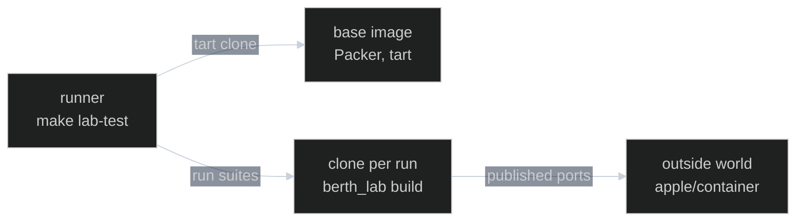

# Test lab: unattended end to end tests in macOS VMs

Status: In progress. The maintainer accepted this plan and its eight [decisions](#decisions) on 2026-11-19, and the decision is [ADR 0020](../adr/0020-test-lab-in-macos-vms-with-a-berth-lab-flavor.md), accepted.
Phase 1 (items 1, 2, 3, 10, 12 and 13, none of which needs a VM) is in progress.
Phase 2 starts with a one day tart spike, run before item 5's image design.

Goal: every check that today needs the maintainer's hands (real signing, the store dialog and approvals, headful browsers, the app's GUI and permissions, a real second macOS user) runs unattended in macOS VMs, locally and in CI, so the guided manual scripts retire and only a short release checklist needs a person.

## Why now

- E2b, M2, M3 and M4 are built and wait only on guided checks; E3's spike and cross user tests wait on the maintainer's admin password; M5 items 1 to 8 wait on GUI checks.
- M5's takeover (items 9 to 14) and M6's fills need headful browsers, real approvals and real login pages on every change, which a guided script cannot give at the pace agents build.
- A `| tail -1` once hid a failed fast forward merge and an unwanted push followed; the gate itself must fail fast before anything else is automated.

## What was checked (2026-11-19)

| Question | Answer | Source |
|---|---|---|
| tart version and licence | 2.42.0 (2026-11-17), now `openai/tart`, FSL-1.1-ALv2 since 2026-06-05 with no fees or core limits; `brew install openai/tools/tart`. `tart.run/licensing` still shows the old Fair Source tiers, which no longer apply | [releases](https://api.github.com/repos/openai/tart/releases/latest), [LICENSE](https://raw.githubusercontent.com/openai/tart/main/LICENSE), [licence note](https://github.com/openai/tart/blob/main/docs/blog/posts/2023-02-11-changing-tart-license.md) |
| VMs at once | 2 macOS VMs per host (Apple's EULA, enforced by Virtualization.framework); a third fails at once rather than queuing | [discussion 1054](https://github.com/openai/tart/discussions/1054) |
| Base images | `ghcr.io/cirruslabs/macos-tahoe-vanilla` (auto login, passwordless sudo, no sleep or screen lock, Gatekeeper off), `-base` (Homebrew, the guest agent, SIP already off), `-xcode:N`; user `admin`, password `admin`; 50 GB, the Xcode image grows to 140 GB | [macos-image-templates](https://github.com/cirruslabs/macos-image-templates), [quick start](https://tart.run/quick-start) |
| SIP | The templates turn it off with Packer booting Recovery (`recovery = true`) and a `boot_command` that opens Terminal and runs `csrutil disable`; by hand, `tart run --recovery --vnc-experimental` | [disable-sip.pkr.hcl](https://github.com/cirruslabs/macos-image-templates/blob/main/templates/disable-sip.pkr.hcl) |
| Pre granting TCC | With SIP off, `sqlite3` inserts rows into the system and user `TCC.db` (Accessibility, ScreenCapture, PostEvent, AppleEvents) with `auth_value` 2; a bundle id client needs a matching `csreq`, as GitHub's runner images write. On macOS 27 the user database moved; on 26 it has not. macOS 15 and later can still show a periodic private window picker prompt for Screen Recording. PPPC profiles need MDM, unverified here | [update-tcc-database.sh](https://github.com/cirruslabs/macos-image-templates/blob/main/scripts/update-tcc-database.sh), [runner-images](https://raw.githubusercontent.com/actions/runner-images/main/images/macos/scripts/build/configure-tccdb-macos-27.sh), [real desktop note](https://jonnyzzz.com/blog/2026/07/16/a-real-macos-desktop-for-a-linux-agent) |
| Headless and the display | `--no-graphics` only skips the host window: the VM always has a `VZMacGraphicsDeviceConfiguration`, so with auto login there is a WindowServer session for GUI apps and screen capture; `--vnc-experimental` adds a VNC server for debugging | [Run.swift](https://raw.githubusercontent.com/openai/tart/main/Sources/tart/Commands/Run.swift), [VM.swift](https://raw.githubusercontent.com/openai/tart/main/Sources/tart/VM.swift), [issue 1212](https://github.com/openai/tart/issues/1212) |
| Snapshots | None; `tart clone` is APFS copy on write, so a clone per run deleted afterwards is the clean snapshot. `tart set --disk-size` on a stopped VM; the base image grows APFS at boot | [Clone.swift](https://raw.githubusercontent.com/openai/tart/main/Sources/tart/Commands/Clone.swift), [FAQ](https://tart.run/faq) |
| Host gotcha | The host user running tart needs an unlocked login keychain on macOS 15 and later | [FAQ](https://tart.run/faq) |
| Packer | `packer-plugin-tart` v1.21.0 (2026-07-09): `recovery`, `recovery_partition`, `disk_size_gb`, `headless` | [releases](https://github.com/cirruslabs/packer-plugin-tart/releases), [builder docs](https://developer.hashicorp.com/packer/integrations/cirruslabs/tart/latest/components/builder/tart) |
| CI | Cirrus Runners takes no new customers and Cirrus CI shut down on 2026-06-01; Orchard (0.58.0) is for clusters; Tartelet (0.12.0, 2025-06-13) is low activity. For one Mac, a host loop that clones, boots, injects a just in time runner config for actions/runner (v2.338.2) and deletes the clone is the simplest | [conda-forge note](https://conda-forge.org/blog/2026/06/17/large-runners-gha/), [Tartelet](https://raw.githubusercontent.com/framna-dk/tartelet/main/README.md) |
| Touch ID in a guest | None. `.deviceOwnerAuthentication` falls back to the login password dialog; `.deviceOwnerAuthenticationWithBiometrics` fails. No Secure Enclave of its own (inferred: Apple derives the VM identity from the host's). iCloud sign in breaks for concurrent clones | [LAPolicy](https://developer.apple.com/tutorials/data/documentation/localauthentication/lapolicy/deviceownerauthentication.md), [iCloud in VMs](https://developer.apple.com/tutorials/data/documentation/virtualization/using-icloud-with-macos-virtual-machines.md) |
| Keychain in a guest | `security unlock-keychain -p admin ~/Library/Keychains/login.keychain-db` unlocks it by script | [FAQ](https://tart.run/faq) |
| `testing/synctest` | Stable since Go 1.25 (`synctest.Test`, `Wait`); Go 1.27, which `go.mod` names, adds `synctest.Sleep`. Channels, `select`, `sync.Cond`, `WaitGroup` and `time.Sleep` block durably; mutexes, I/O, loopback sockets and syscalls do not, so a goroutine on a real socket or an `os/exec` pipe keeps fake time from moving; `net.Pipe` works | [Go 1.25](https://go.dev/doc/go1.25), [Go 1.27](https://go.dev/doc/go1.27), [package](https://pkg.go.dev/testing/synctest) |
| apple/container | 1.7.1 (2026-11-06), macOS 26 on Apple silicon; one lightweight VM per OCI container, each with its own IP reachable from the host, local DNS names (`container system dns create`), `--publish` to host ports. It cannot run inside a tart macOS guest (no nested virtualization for macOS guests), so it runs on the host; whether a guest reaches container IPs directly is unverified, so guests use ports the host publishes | [releases](https://github.com/apple/container/releases), [networking](https://raw.githubusercontent.com/apple/container/1.7.1/docs/networking.md), [Darwin.swift](https://raw.githubusercontent.com/openai/tart/main/Sources/tart/Platform/Darwin.swift) |

## Design

- **Two loops.** The host runs `make lab-test`: it clones the base image, boots it headless, copies in the tree, builds the `berth_lab` binaries inside, runs the suites, copies the results and logs out, and deletes the clone. At most 2 clones at once, so suites are grouped into two lanes.
- **Inside the VM everything is real macOS** (launchd, TCC, WindowServer, the Keychain, `codesign`); only the certificate and the approval differ from a release build.
- **Outside the VM** apple/container runs the world Berth talks to, on the host, reached from the guest through published ports.
- **Results** are JUnit XML plus the canary search report, `berthd` logs and crash reports, copied out before the clone is deleted.

### The `berth_lab` flavor

Modelled on `berth_e2e` (`internal/peertrust/pin_e2e.go`, `cmd/berth/build_e2e.go`, `cmd/berth-proxy/roots_e2e.go`), with the same pattern of paired `//go:build` files and a release test.

| Seam | Release | `berth_lab` |
|---|---|---|
| Trust requirement (`codetrust`, `peertrust.Pinner`, the app's and `berth-native`'s requirement checks) | Apple's chain, team `XPJ7XA42J4` | `anchor` the lab only self signed CA (its certificate hash compiled in), same identifiers; real `codesign --verify`, real bundle pins, real live cdhash checks |
| `berth-native` approval (store dialog, confirm, Touch ID) | `LAContext` and the real dialog | A seam that reads a scripted answer file the test writes, or Accessibility drives the real password sheet that `.deviceOwnerAuthentication` falls back to |
| Value channel, receiver check, `mlock`, CDP filter, app pin, envpolicy | Real | Real, unchanged |

- The lab CA and its key exist only in the image's login keychain and in no file in the repository.
- `berth_lab` and `berth_e2e` never combine; `berth_lab` has no `BERTH_NATIVE` or `BERTH_PROXY` overrides, and no loopback upstream rule except the test root of the outside world's TLS servers.
- Swift: the seam is a compile time condition (`-D BERTH_LAB`) in `berth-native` and `Berth.app`, never a runtime switch, as `#if DEBUG` test switches are today.
- **Release test:** a release build of every binary is scanned for the lab CA's hash, the seam's symbols and the scripted answer path, and `peertrust.Lab` is false; this joins `TestReleaseTrustsOnlyAppleChain` and the `TestRelease*` tests in `cmd/`.

### The base image

Built as code with Packer and `packer-plugin-tart` from `ghcr.io/cirruslabs/macos-tahoe-xcode` (SIP off, auto login, passwordless sudo already), plus:

- the TCC database pre granted for the lab's `Berth.app`, `berth-native`, Terminal and the test runner (Accessibility, Screen Recording, PostEvent), with `csreq` blobs made from the lab certificate, and notifications allowed for `com.wesleybldc.berth`;
- a scripted unlocked login keychain holding the lab CA as a code signing identity;
- Go, `buf`, `golangci-lint`, Node, and the Playwright and Puppeteer browsers and Chrome cached, at pinned versions;
- a second and third macOS user creatable by script (E3), never pre created, so each run starts with none.

The image is versioned by a hash of its inputs and rebuilt only when they change; a run never mutates it.

### The outside world on apple/container

| Container | Replaces or proves |
|---|---|
| httpbin and TLS upstreams with the lab test root | httpbin.org and real APIs in E2b checks; the header proxy's canary and lifecycle runs |
| Rack and PHP FastCGI | The `_method` override refusal on a grant with a method limit, against servers that honour it |
| A DNS server | The DNS rebinding limit of the agent session proxy |
| Hostile pages | The CDP filter: `file:` drops, clipboard keys, `chrome://` moves, file pickers, history tricks |
| Slow and malformed upstreams | Stalled heads, chunked encoding edge cases, oversized headers, early closes |
| A login page that records its posts | M6's fill, when it is built |

Berth itself cannot run there: it is macOS only.

## Work items

Sizes: S under a day, M a few days, L a week or more, for one worker.
Order is for the fastest payoff: the gate and lint first, then the flavor and the image that every VM suite needs, then the suites that unblock M5's takeover and M6's fills.
Items 3, 10, 12 and 13 need no VM and can run in parallel with anything.

| # | Item | Depends on | Size | Owns | Done when |
|---|---|---|---|---|---|
| 1 | Gate script | | S | `scripts/gate.sh`, `scripts/test-gate.sh`, `Makefile` (`make gate`, and `check` runs `test-gate`), `AGENTS.md`, `CLAUDE.md` | `set -euo pipefail` throughout, no pipe hides a status (`pipefail`, `PIPESTATUS` or no pipe); it runs `make check`, rebases, runs it again, fast forwards and pushes only on success, and prints each step's exit; a test script feeds it a failing merge and a failing check and proves nothing is pushed |
| 2 | Lint stack | | S | `.pre-commit-config.yaml`, `.editorconfig`, `.rumdl.toml`, `scripts/lint-*.sh`, `.claude/hooks/after-edit.sh`, `ruff.toml` (removed) | The [lint table](#lint-stack) holds; mechanical fixes only; `make check` passes |
| 3 | `testing/synctest` for actors and timers | | M | `internal/berthd` tests, `internal/core/machine` tests, `internal/testutil/eventually.go` | Every timer and actor test that sleeps or polls (`testutil.Eventually`, grace timers, expiry, idle actors, backoff) runs in `synctest.Test` with fake time; real socket and `os/exec` tests stay outside bubbles; the suite gets faster and no test sleeps |
| 4 | `berth_lab` flavor | | M | `internal/peertrust/pin_lab.go`, `internal/codetrust`, `cmd/*/build_lab.go`, `native/` and `macos/` lab conditions, release tests | The [flavor table](#the-berth_lab-flavor) holds; the release test fails if any lab code, hash or path reaches a release build; a `berth_lab` build refuses an ad hoc signed peer and accepts a lab signed one |
| 5 | Base image and runner | | L | `lab/image/*.pkr.hcl`, `lab/scripts/`, `make lab-image`, `make lab-test`, a self hosted runner loop and `.github/workflows/lab.yml` | `make lab-image` builds the image from code; `make lab-test` clones, boots headless, runs a smoke suite (`berth status`, a headless browser in `berth ps`), copies results out and deletes the clone; two lanes at most; the same loop serves one GitHub Actions job per clone with a just in time runner config |
| 6 | Outside world | 5 | M | `lab/world/` (OCI images and a compose script for apple/container), the lab test root | Every [container](#the-outside-world-on-applecontainer) starts on the host, is reached from a guest through published ports, and is torn down after the run; no test reaches the internet |
| 7 | M2, M3 and M4 in the VM | 4, 5, 6 | M | `test/lab/browsers_test.go` | M2's exit check (real Chrome profiles owned by the person, a Playwright MCP browser owned by its agent), M3's (`berth top` shows it appear and stops it), M4's (Playwright MCP through `--cdp-header`, a denied method refused) and every [headful check](m4-managed-chromium.md#checks-that-need-a-headful-browser) (clipboard keys against the real pasteboard, a tab moving to `chrome://`, a `file:` drop) pass unattended |
| 8 | E2b in the VM | 4, 5, 6 | M | `test/lab/proxy_test.go` | Real lab signing, the real `berth-native` with its approval through the seam, a TLS upstream in the outside world: the canary reaches only the granted host; rotate, revoke and remove behave as in the E2b plan; the canary is in no output, log, database file or crash report |
| 9 | M5 app in the VM | 4, 5 | M | `test/lab/app_test.go`, an Accessibility driver | M5 manual checks 2 to 5 (menu bar count, window list, login item through `SMAppService`, notifications), then 6 to 8 once those items exist; one Accessibility smoke test compares the menu bar count and the window's table with `berth ps` |
| 10 | SwiftUI snapshot tests | | M | `macos/Tests/BerthAppSnapshotTests/`, the shared fixtures | The session list, settings and a need rendered offscreen from the Go written fixtures, compared with checked in images in `make check`, light and dark |
| 11 | E3 spike and tests in the VM | 4, 5 | L | `test/lab/agents_test.go`, `berth agent setup` run for real | The [spike questions](e3-isolated-agents.md#item-1-the-spike) answered with a real second user created in the clone; every "Lab VM, real second user" row of the E3 acceptance tests passes; ADR 0018 can move from Proposed on the evidence |
| 12 | Fuzzing | | M | `Fuzz*` tests beside `internal/strictjson`, `internal/core/cdppolicy`, `internal/proxy` (HTTP head and chunked parsers), `shown`, and a Go and Swift corpus in the shared fixtures | Each fuzzer runs a short budget in `make check` and longer nightly in the lab; Go and Swift agree on every corpus entry for `shown`, `quoted` and the Connect envelope reader; crashers become checked in corpus files |
| 13 | Model based tests of the machines and actors | | L | `internal/core/machine/machinetest`, `internal/berthd` model tests | A random walk of commands per machine through the real actors kit against a model, checking invariants after each step: one live actor per entity, each saved hook fires once, no orphaned child process, final states hold no goroutine; seeds are logged and replayable |
| 14 | Canary agent scenarios | 7, 8 | L | `test/lab/scenarios/`, a scripted MCP client | Recorded realistic agent sessions replay through Playwright MCP and `berth-mcp` with canary secrets; the canaries are searched for across every output, log, database file, transcript and crash dump; optionally a nightly real Claude agent in the VM |
| 15 | Release checklist and retiring the scripts | 7, 8, 9, 11 | S | `docs/release-checklist.md`, the plans' manual check sections | The guided scripts are marked superseded in each plan; the checklist holds only [what still needs a person](#what-still-needs-a-person) |

Sequencing against the product: M5 items 9 to 14 start after lab items 4, 5 and 7, and M6 after lab item 6 too, so takeover and fills are tested headful from their first commit.

## Lint stack

Inventory of tracked files: 221 Go, 49 Swift, 46 Markdown, 9 shell (POSIX `sh`), 8 Protobuf, 8 JSON, 4 YAML, 2 TOML, 1 CSS (`brand/colors/tokens.css`).
There is no Python, JavaScript or TypeScript, so no linter or formatter is added for them; `ruff.toml`, the ruff hooks, `make fmt`'s `uvx ruff format` and the edit hook's `.py` case go.
There are no GitHub workflows yet; item 5 adds the first, so `actionlint` comes with it.

| Language | Tool | Version | Status |
|---|---|---|---|
| Go | golangci-lint v2 (gofumpt, goimports and the configured linters) | 2.15.0 | Exists |
| Swift | `swift format lint --strict` from the Xcode toolchain; SwiftLint is not added, since its rules overlap and it is one more binary | Swift 6.3 toolchain (`swift format` 6.3.0) | Exists |
| Shell | shellcheck (`shellcheck-py`) | v0.11.0.1-1 hook (shellcheck 0.11.0) | Exists |
| Shell | shfmt through `scop/pre-commit-shfmt`, `-d`, reading `.editorconfig`'s `[*.sh]` section (`indent_size = 2`, `shell_variant = posix`, and `switch_case_indent = true` so today's indented `case` items stay as they are); `make fmt` runs the same version with `-w` | v3.14.1-1 (shfmt 3.14.1) | Exists (item 2) |
| Protobuf | `buf format` and `buf lint` (STANDARD), `buf breaking` (FILE) | 1.75.0 | Exists |
| Markdown | rumdl through `rvben/rumdl-pre-commit` (`rumdl-check`), with MD013 (line length) off so one sentence per line never fights it, MD041 (first line heading) off since agent and skill files open with frontmatter, the README with its logo and `CLAUDE.md` with an import, and inline HTML allowed for the README logo; a lint, never a rewrap | v0.3.5 | Exists (item 2) |
| Markdown | The no em or en dash hook (pygrep) | | Exists |
| YAML, JSON, TOML | `check-yaml`, `check-json`, `check-toml` from pre-commit-hooks; no formatter for 14 small files | v6.0.0 | Exists |
| GitHub Actions | actionlint | Pinned to its release current when item 5 adds the first workflow | Planned, item 5 |
| Every file | trailing whitespace, final newline, merge conflicts, large files, private keys, gitleaks | pre-commit-hooks v6.0.0, gitleaks v8.30.1 | Exists |
| Python | ruff | | Removed (item 2): no Python in the repository |

Prettier is not chosen: it needs Node for files no JavaScript touches, and with `proseWrap: preserve` it adds little over rumdl.
markdownlint-cli2 (v0.24.1) would also work with MD013 off, but pulls in Node.
dprint (0.65.0) with its Markdown plugin (0.29.0) and `textWrap: "sentence"` would enforce one sentence per line itself; it is [decision 6](#decisions).

## Exit gate

- `make check` passes with items 1, 2, 3, 10, 12 and 13.
- `make lab-test` passes locally and as the self hosted GitHub Actions job, with both lanes, on a clean clone per run.
- The release test proves `berth_lab` absent from release builds.
- The manual checks of E2b, M2, M3, M4 and M5 items 1 to 8, and E3's cross user rows, run unattended, and each plan says so.
- The release checklist exists and holds only what still needs a person.
- `ARCHITECTURE.md` marks the lab built and ADR 0020 accepted or revised.

## Honest limits

- **No Touch ID and no Secure Enclave in a VM.** The approval seam or the password fallback stands in, so the biometric prompt itself is proven only on the release checklist.
- **A lab certificate is not the team certificate.** Real `codesign` runs, but the release requirement (Apple's chain, team `XPJ7XA42J4`) is checked only by its unit test and on the release checklist.
- **Two VMs at once per Mac** (Apple's licence), so the suites run in two lanes and a full run takes as long as its longest lane.
- **SIP is off in the image** to pre grant permissions, so anything SIP would change about Berth's behaviour (TCC prompts, library validation edge cases) is not what a person with SIP on sees; the release checklist covers one run with SIP on.
- **The Screen Recording private window picker prompt** that macOS 15 and later can show despite a grant may need an Accessibility click or a fresh clone per run.
- **The maintainer's own Chrome profile** (his logins, extensions, years of state) is never in the lab; M2's owner rules are proven on fresh profiles.
- **apple/container runs on the host, not in the guest**, so the outside world is shared by the two lanes and is reached through published ports.
- **Images are large:** about 140 GB for the Xcode base on the host, plus a clone's growth per lane.
- **FSL-1.1-ALv2** allows this internal use; a hosted service built on tart would not be.

## Decisions

Accepted by the maintainer on 2026-11-19, each as the default proposed here; each is still cheap to reverse before item 4.

1. **tart over UTM, Anka or Parallels:** free under its current licence, scriptable, a Packer plugin and the cirruslabs images with SIP off.
2. **Approval through a compiled in seam that reads scripted answers,** with one Accessibility test driving the real password sheet, rather than Accessibility for every approval: faster and steadier, while the real dialog still gets one run.
3. **A lab only self signed CA,** not ad hoc signing and not the team key in the VM: real certificate checks, no real key leaves the host.
4. **A host loop with just in time runner configs** for GitHub Actions, not Tartelet or Orchard: fewest moving parts for one Mac.
5. **The outside world on apple/container** on the host, not containers inside the guest (impossible) and not public test services.
6. **rumdl to lint Markdown, not dprint to format it.** dprint's `textWrap: "sentence"` would enforce one sentence per line by rewriting files; rumdl only reports, which keeps hand made line breaks in tables and lists. Switch if the rule should be enforced by a formatter.
7. **Fuzzing and model based tests in `make check` with short budgets,** longer budgets nightly in the lab.
8. **Item order** as in the table: gate and lint first, then the flavor and image, then the suites that unblock M5's takeover and M6's fills.

## What still needs a person

One short release checklist (item 15), run before a release and never on every change:

- real Touch ID for a store, a grant, a rotate and a remove;
- `make build` and `make app` with the real team signing key from the host keychain, and the release requirement accepting them;
- `berth ps` and `berth top` with the maintainer's own Chrome profile open;
- one run on his Mac with SIP on, for the login item, notifications and Screen Recording prompts.
